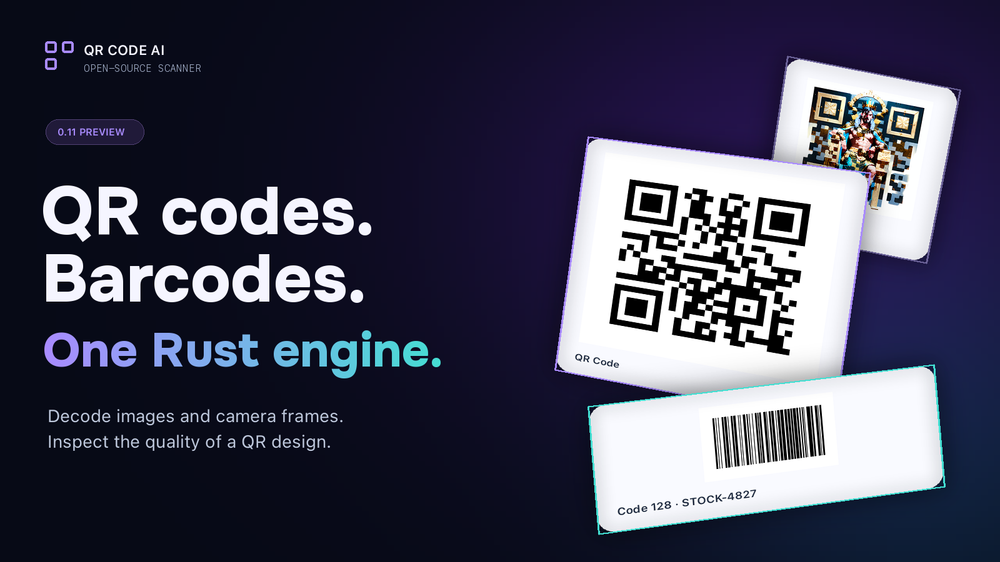
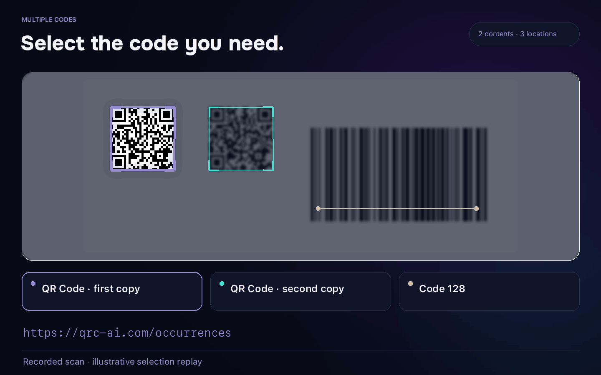
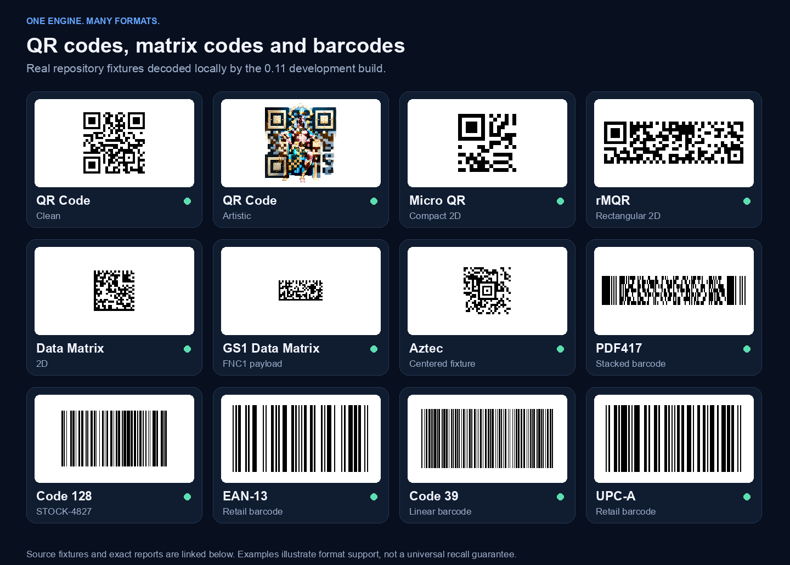
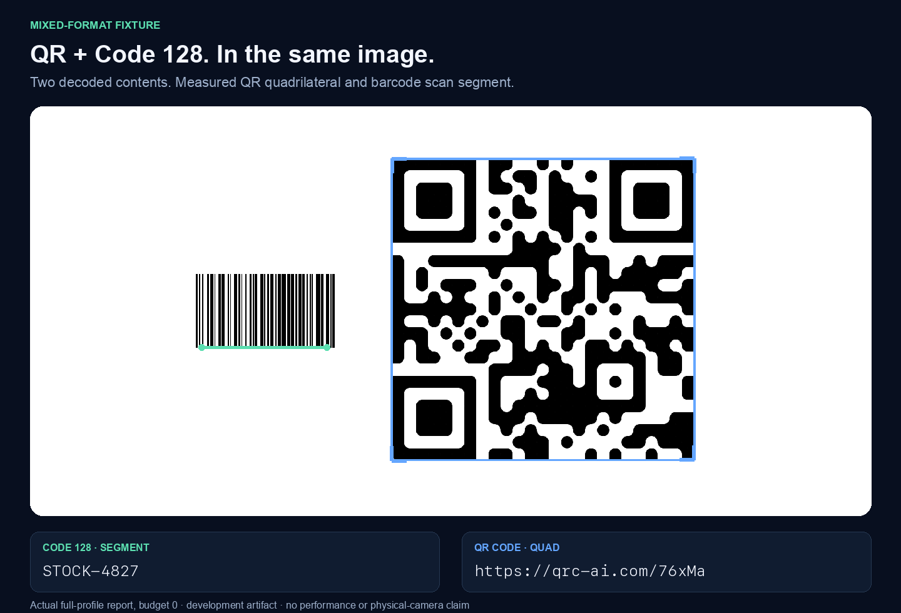
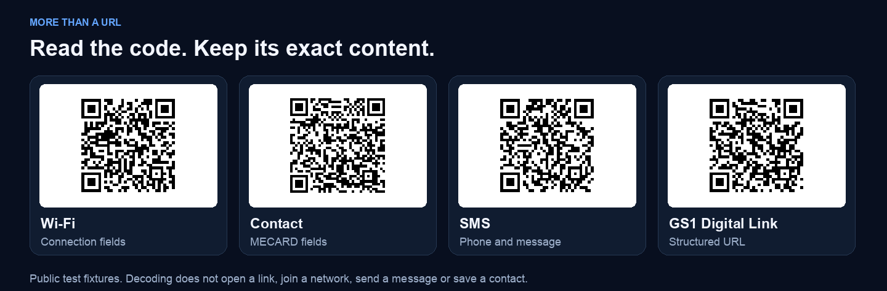

# QR Code & Barcode Scanner

<!-- qrcode-ai-readme-actions:v1 -->

### Ask AI

[](https://chatgpt.com/?q=Help%20me%20understand%20QR%20Code%20%26%20Barcode%20Scanner%20%28README.md%29%20for%20QR%20Code%20%26%20Barcode%20Scanner%2C%20the%20open-source%20scanner.%20Source%20documentation%3B%20publication%20is%20not%20implied.%20Read%20the%20public%20documentation%20below.%20Explain%20what%20this%20destination%20does%2C%20its%20documented%20installation%20or%20access%20steps%2C%20a%20minimal%20example%20if%20supported%2C%20prerequisites%2C%20limitations%20and%20license.%20Distinguish%20published%20packages%20from%20working%20source%20and%20preparation.%20Cite%20your%20sources%3B%20if%20a%20page%20is%20unavailable%20or%20a%20fact%20cannot%20be%20checked%2C%20say%20so.%20Do%20not%20invent%20installation%20commands%2C%20benchmark%20results%20or%20comparisons.%20Answer%20in%20my%20language.%20Public%20sources%3A%20https%3A%2F%2Fgithub.com%2Fqrcode-ai-com%2Fqrcode-barcode-scanner%2Fblob%2Fmain%2FREADME.md%20https%3A%2F%2Fqrcode-ai.com%2Fen-US%2Fqr-code-scanner%20https%3A%2F%2Fqrcode-ai.com%2Fen-US%2Fbarcode-scanner%20https%3A%2F%2Fqrcode-ai.com%2Fen-US%2Fqr-code-scanner%2Fsdk%20https%3A%2F%2Fqrcode-ai.com%2Fen-US%2Fbarcode-scanner%2Fsdk%20https%3A%2F%2Fqrcode-ai.com%2Fen-US%2Fqr-code-generator%20https%3A%2F%2Fqrcode-ai.com%2Fen-US%2Fbarcode-generator)
[](https://claude.ai/new?q=Help%20me%20understand%20QR%20Code%20%26%20Barcode%20Scanner%20%28README.md%29%20for%20QR%20Code%20%26%20Barcode%20Scanner%2C%20the%20open-source%20scanner.%20Source%20documentation%3B%20publication%20is%20not%20implied.%20Read%20the%20public%20documentation%20below.%20Explain%20what%20this%20destination%20does%2C%20its%20documented%20installation%20or%20access%20steps%2C%20a%20minimal%20example%20if%20supported%2C%20prerequisites%2C%20limitations%20and%20license.%20Distinguish%20published%20packages%20from%20working%20source%20and%20preparation.%20Cite%20your%20sources%3B%20if%20a%20page%20is%20unavailable%20or%20a%20fact%20cannot%20be%20checked%2C%20say%20so.%20Do%20not%20invent%20installation%20commands%2C%20benchmark%20results%20or%20comparisons.%20Answer%20in%20my%20language.%20Public%20sources%3A%20https%3A%2F%2Fgithub.com%2Fqrcode-ai-com%2Fqrcode-barcode-scanner%2Fblob%2Fmain%2FREADME.md%20https%3A%2F%2Fqrcode-ai.com%2Fen-US%2Fqr-code-scanner%20https%3A%2F%2Fqrcode-ai.com%2Fen-US%2Fbarcode-scanner%20https%3A%2F%2Fqrcode-ai.com%2Fen-US%2Fqr-code-scanner%2Fsdk%20https%3A%2F%2Fqrcode-ai.com%2Fen-US%2Fbarcode-scanner%2Fsdk%20https%3A%2F%2Fqrcode-ai.com%2Fen-US%2Fqr-code-generator%20https%3A%2F%2Fqrcode-ai.com%2Fen-US%2Fbarcode-generator)
[](https://aistudio.google.com/prompts/new_chat?prompt=Help%20me%20understand%20QR%20Code%20%26%20Barcode%20Scanner%20%28README.md%29%20for%20QR%20Code%20%26%20Barcode%20Scanner%2C%20the%20open-source%20scanner.%20Source%20documentation%3B%20publication%20is%20not%20implied.%20Read%20the%20public%20documentation%20below.%20Explain%20what%20this%20destination%20does%2C%20its%20documented%20installation%20or%20access%20steps%2C%20a%20minimal%20example%20if%20supported%2C%20prerequisites%2C%20limitations%20and%20license.%20Distinguish%20published%20packages%20from%20working%20source%20and%20preparation.%20Cite%20your%20sources%3B%20if%20a%20page%20is%20unavailable%20or%20a%20fact%20cannot%20be%20checked%2C%20say%20so.%20Do%20not%20invent%20installation%20commands%2C%20benchmark%20results%20or%20comparisons.%20Answer%20in%20my%20language.%20Public%20sources%3A%20https%3A%2F%2Fgithub.com%2Fqrcode-ai-com%2Fqrcode-barcode-scanner%2Fblob%2Fmain%2FREADME.md%20https%3A%2F%2Fqrcode-ai.com%2Fen-US%2Fqr-code-scanner%20https%3A%2F%2Fqrcode-ai.com%2Fen-US%2Fbarcode-scanner%20https%3A%2F%2Fqrcode-ai.com%2Fen-US%2Fqr-code-scanner%2Fsdk%20https%3A%2F%2Fqrcode-ai.com%2Fen-US%2Fbarcode-scanner%2Fsdk%20https%3A%2F%2Fqrcode-ai.com%2Fen-US%2Fqr-code-generator%20https%3A%2F%2Fqrcode-ai.com%2Fen-US%2Fbarcode-generator)
[](https://grok.com/?q=Help%20me%20understand%20QR%20Code%20%26%20Barcode%20Scanner%20%28README.md%29%20for%20QR%20Code%20%26%20Barcode%20Scanner%2C%20the%20open-source%20scanner.%20Source%20documentation%3B%20publication%20is%20not%20implied.%20Read%20the%20public%20documentation%20below.%20Explain%20what%20this%20destination%20does%2C%20its%20documented%20installation%20or%20access%20steps%2C%20a%20minimal%20example%20if%20supported%2C%20prerequisites%2C%20limitations%20and%20license.%20Distinguish%20published%20packages%20from%20working%20source%20and%20preparation.%20Cite%20your%20sources%3B%20if%20a%20page%20is%20unavailable%20or%20a%20fact%20cannot%20be%20checked%2C%20say%20so.%20Do%20not%20invent%20installation%20commands%2C%20benchmark%20results%20or%20comparisons.%20Answer%20in%20my%20language.%20Public%20sources%3A%20https%3A%2F%2Fgithub.com%2Fqrcode-ai-com%2Fqrcode-barcode-scanner%2Fblob%2Fmain%2FREADME.md%20https%3A%2F%2Fqrcode-ai.com%2Fen-US%2Fqr-code-scanner%20https%3A%2F%2Fqrcode-ai.com%2Fen-US%2Fbarcode-scanner%20https%3A%2F%2Fqrcode-ai.com%2Fen-US%2Fqr-code-scanner%2Fsdk%20https%3A%2F%2Fqrcode-ai.com%2Fen-US%2Fbarcode-scanner%2Fsdk%20https%3A%2F%2Fqrcode-ai.com%2Fen-US%2Fqr-code-generator%20https%3A%2F%2Fqrcode-ai.com%2Fen-US%2Fbarcode-generator)
[](https://www.perplexity.ai/?q=Help%20me%20understand%20QR%20Code%20%26%20Barcode%20Scanner%20%28README.md%29%20for%20QR%20Code%20%26%20Barcode%20Scanner%2C%20the%20open-source%20scanner.%20Source%20documentation%3B%20publication%20is%20not%20implied.%20Read%20the%20public%20documentation%20below.%20Explain%20what%20this%20destination%20does%2C%20its%20documented%20installation%20or%20access%20steps%2C%20a%20minimal%20example%20if%20supported%2C%20prerequisites%2C%20limitations%20and%20license.%20Distinguish%20published%20packages%20from%20working%20source%20and%20preparation.%20Cite%20your%20sources%3B%20if%20a%20page%20is%20unavailable%20or%20a%20fact%20cannot%20be%20checked%2C%20say%20so.%20Do%20not%20invent%20installation%20commands%2C%20benchmark%20results%20or%20comparisons.%20Answer%20in%20my%20language.%20Public%20sources%3A%20https%3A%2F%2Fgithub.com%2Fqrcode-ai-com%2Fqrcode-barcode-scanner%2Fblob%2Fmain%2FREADME.md%20https%3A%2F%2Fqrcode-ai.com%2Fen-US%2Fqr-code-scanner%20https%3A%2F%2Fqrcode-ai.com%2Fen-US%2Fbarcode-scanner%20https%3A%2F%2Fqrcode-ai.com%2Fen-US%2Fqr-code-scanner%2Fsdk%20https%3A%2F%2Fqrcode-ai.com%2Fen-US%2Fbarcode-scanner%2Fsdk%20https%3A%2F%2Fqrcode-ai.com%2Fen-US%2Fqr-code-generator%20https%3A%2F%2Fqrcode-ai.com%2Fen-US%2Fbarcode-generator)

Choose an AI assistant to explain this destination using its public sources. Gemini opens Google AI Studio. The link includes the public question; sign-in or a manual paste may be required. Check the answer against the documentation.

<details>
<summary>Copy the question</summary>

```text
Help me understand QR Code & Barcode Scanner (README.md) for QR Code & Barcode Scanner, the open-source scanner. Source documentation; publication is not implied. Read the public documentation below. Explain what this destination does, its documented installation or access steps, a minimal example if supported, prerequisites, limitations and license. Distinguish published packages from working source and preparation. Cite your sources; if a page is unavailable or a fact cannot be checked, say so. Do not invent installation commands, benchmark results or comparisons. Answer in my language. Public sources: https://github.com/qrcode-ai-com/qrcode-barcode-scanner/blob/main/README.md https://qrcode-ai.com/en-US/qr-code-scanner https://qrcode-ai.com/en-US/barcode-scanner https://qrcode-ai.com/en-US/qr-code-scanner/sdk https://qrcode-ai.com/en-US/barcode-scanner/sdk https://qrcode-ai.com/en-US/qr-code-generator https://qrcode-ai.com/en-US/barcode-generator
```

</details>

[](https://cursor.com/install-mcp?name=qrscan&config=eyJjb21tYW5kIjoibnB4IiwiYXJncyI6WyItLXllcyIsIi0taWdub3JlLXNjcmlwdHMiLCJAcXJjb2RlLWFpLWNvbS9xcmNvZGUtYmFyY29kZS1zY2FubmVyLW1jcEAwLjMuMSJdfQ%3D%3D)
[](https://vscode.dev/redirect?url=vscode%3Amcp%2Finstall%3F%257B%2522name%2522%253A%2522qrscan%2522%252C%2522command%2522%253A%2522npx%2522%252C%2522args%2522%253A%255B%2522--yes%2522%252C%2522--ignore-scripts%2522%252C%2522%2540qrcode-ai-com%252Fqrcode-barcode-scanner-mcp%25400.3.1%2522%255D%257D)

Open your editor to review the pinned MCP configuration before adding it. Node.js must already be installed; local file access remains disabled by default.

<!-- /qrcode-ai-readme-actions:v1 -->

[](https://qrcode-ai.com/)

[Get started](#get-started) · [Examples](#examples) · [Camera scanning](#camera-scanning) · [Documentation](#documentation) · [Distribution guide](distribution/README.md)

[](https://github.com/qrcode-ai-com/qrcode-barcode-scanner/actions/workflows/ci.yml)
[](https://github.com/qrcode-ai-com/qrcode-barcode-scanner/blob/main/LICENSING.md)

Scan QR codes and barcodes from images or camera frames, entirely on your device. One Rust engine reads mixed formats in the same image and reports each code's value and format, plus its position when available. It also scores how reliably a QR design can be read, a check [QR Code AI](https://qrcode-ai.com/) uses before export.

**0.11.0 is released** for Rust, CLI, Node.js, browser WASM and Python.
[Install a package](#get-started) · [Release and CLI downloads](https://github.com/qrcode-ai-com/qrcode-barcode-scanner/releases/tag/v0.11.0)
· [Explore the examples](https://github.com/qrcode-ai-com/qrcode-barcode-scanner/blob/v0.11.0/crates/qrcode-ai-scanner-wasm/examples/README.md).

## Examples

To scan a QR code from an image or read a barcode label, run the [browser image example](https://github.com/qrcode-ai-com/qrcode-barcode-scanner/blob/v0.11.0/crates/qrcode-ai-scanner-wasm/examples/README.md#scan-an-image-headlesshtml) or the [command-line quick start](#command-line).
| | QR codes | Barcodes |
| --- | --- | --- |
| **Try the scanner live** | [QR code scanner](https://qrcode-ai.com/en-US/qr-code-scanner) | [Barcode scanner](https://qrcode-ai.com/en-US/barcode-scanner) |
| **SDK guides** | [QR code scanner SDKs](https://qrcode-ai.com/en-US/qr-code-scanner/sdk) | [Barcode scanner SDKs](https://qrcode-ai.com/en-US/barcode-scanner/sdk) |
| **Create a code** | [QR code generator](https://qrcode-ai.com/en-US/qr-code-generator) | [Barcode generator](https://qrcode-ai.com/en-US/barcode-generator) |

Try it online, with nothing to install. The [Vite example](https://github.com/qrcode-ai-com/qrcode-barcode-scanner/tree/main/examples/web-vite) installs the published WebAssembly package 0.11.0 from npm and scans in your browser, on your device. The [notebook](https://github.com/qrcode-ai-com/qrcode-barcode-scanner/tree/main/examples/notebooks) installs the Python package 0.11.0 from PyPI and scans in a Jupyter session.

[](https://stackblitz.com/fork/github/qrcode-ai-com/qrcode-barcode-scanner/tree/demos-v0.11.0-r2/examples/web-vite) [](https://mybinder.org/v2/gh/qrcode-ai-com/qrcode-barcode-scanner/demos-v0.11.0-r2?urlpath=lab/tree/examples/notebooks/scan-images.ipynb)

### Scan a QR code and a Code 128 barcode in one image

[](https://github.com/qrcode-ai-com/qrcode-barcode-scanner/blob/main/docs/assets/readme/scan-replay.mp4)

Two QR copies share one payload. The Code 128 carries `STOCK-4827`.
The report keeps their **three physical occurrences** separate.

[MP4 video](https://github.com/qrcode-ai-com/qrcode-barcode-scanner/blob/main/docs/assets/readme/scan-replay.mp4) · [Original reports and provenance](https://github.com/qrcode-ai-com/qrcode-barcode-scanner/blob/main/docs/assets/readme/README.md)

<sub>Recorded 0.11 scan reports with an illustrative selection replay.</sub>

### From everyday labels to artistic QR designs



QR Code, Micro QR, rMQR, Data Matrix, Aztec, PDF417 and linear barcodes.
Browse the [original images and their reports](https://github.com/qrcode-ai-com/qrcode-barcode-scanner/blob/main/docs/assets/readme/README.md).

<details>
<summary><strong>Explore mixed codes and structured payloads</strong></summary>



This image returns QR `https://qrc-ai.com/76xMa` and Code 128 `STOCK-4827`.
The replay above uses a different fixture: two QR copies containing
`https://qrc-ai.com/occurrences`, beside the same barcode.



A QR code can hold a URL, Wi-Fi settings, contact details or a message.
The scanner returns the decoded fields. Your app decides what happens next.

[Payload reports](https://github.com/qrcode-ai-com/qrcode-barcode-scanner/blob/main/docs/assets/readme/scan-results.json) · [GS1 guide](https://github.com/qrcode-ai-com/qrcode-barcode-scanner/blob/v0.11.0/docs/concepts/gs1.mdx)

</details>

## Get started

Choose the runtime your application uses. All five packages are published as 0.11.0:

| Runtime | Package | Version |
|---|---|---|
| Rust | [`qrcode-barcode-scanner`](https://crates.io/crates/qrcode-barcode-scanner/0.11.0) | 0.11.0 |
| CLI | [`qrcode-barcode-scanner-cli`](https://crates.io/crates/qrcode-barcode-scanner-cli/0.11.0) | 0.11.0 |
| Node.js | [`@qrcode-ai-com/qrcode-barcode-scanner`](https://www.npmjs.com/package/@qrcode-ai-com/qrcode-barcode-scanner/v/0.11.0) | 0.11.0 |
| Browser WASM | [`@qrcode-ai-com/qrcode-barcode-scanner-wasm`](https://www.npmjs.com/package/@qrcode-ai-com/qrcode-barcode-scanner-wasm/v/0.11.0) | 0.11.0 |
| Python | [`qrcode-barcode-scanner`](https://pypi.org/project/qrcode-barcode-scanner/0.11.0/) | 0.11.0 |

<details>
<summary><strong>Native npm packages, browser CDNs and package indexes · 0.11.0</strong></summary>

npm selects the native package automatically when you install the Node.js package.

- macOS · [`darwin-arm64`](https://www.npmjs.com/package/@qrcode-ai-com/qrcode-barcode-scanner-darwin-arm64/v/0.11.0) · [`darwin-x64`](https://www.npmjs.com/package/@qrcode-ai-com/qrcode-barcode-scanner-darwin-x64/v/0.11.0)
- Linux · [`linux-arm64-gnu`](https://www.npmjs.com/package/@qrcode-ai-com/qrcode-barcode-scanner-linux-arm64-gnu/v/0.11.0) · [`linux-x64-gnu`](https://www.npmjs.com/package/@qrcode-ai-com/qrcode-barcode-scanner-linux-x64-gnu/v/0.11.0) · [`linux-x64-musl`](https://www.npmjs.com/package/@qrcode-ai-com/qrcode-barcode-scanner-linux-x64-musl/v/0.11.0)
- Windows · [`win32-x64-msvc`](https://www.npmjs.com/package/@qrcode-ai-com/qrcode-barcode-scanner-win32-x64-msvc/v/0.11.0)

Browser WASM from npm · [jsDelivr](https://cdn.jsdelivr.net/npm/@qrcode-ai-com/qrcode-barcode-scanner-wasm@0.11.0/auto.js) · [UNPKG](https://unpkg.com/@qrcode-ai-com/qrcode-barcode-scanner-wasm@0.11.0/auto.js) · [esm.sh](https://esm.sh/@qrcode-ai-com/qrcode-barcode-scanner-wasm@0.11.0/auto).

Rust API and package metadata · [docs.rs](https://docs.rs/qrcode-barcode-scanner/0.11.0/qrcode_barcode_scanner/) · [deps.dev](https://deps.dev/npm/%40qrcode-ai-com%2Fqrcode-barcode-scanner/0.11.0) · [Libraries.io](https://libraries.io/npm/@qrcode-ai-com%2Fqrcode-barcode-scanner) · [Lib.rs](https://lib.rs/crates/qrcode-barcode-scanner).

</details>

### Command line

Install the prebuilt `qrscan` 0.11.0 binary on macOS or GNU/Linux with the
[QR Code AI Homebrew tap](https://github.com/qrcode-ai-com/homebrew-tap).

```sh
brew install qrcode-ai-com/tap/qrscan
```

On Windows x64, install `qrscan` 0.11.0 from the
[QR Code AI Scoop bucket](https://github.com/qrcode-ai-com/scoop-bucket).

```powershell
scoop bucket add qrcode-ai https://github.com/qrcode-ai-com/scoop-bucket
scoop install qrcode-ai/qrcode-barcode-scanner
```

For Debian 12 or Ubuntu 24.04, download the [Debian package 0.11.0-1](https://github.com/qrcode-ai-com/qrcode-barcode-scanner/releases/tag/linux-packages-v0.11.0)
for amd64 or arm64. Check its SHA-256 and install the local file with
`sudo apt install ./qrcode-barcode-scanner_0.11.0-1_amd64.deb` (use the arm64
file on ARM64).

On Arch Linux x86_64, install
[`qrcode-barcode-scanner-bin` 0.11.0-1 from AUR](https://aur.archlinux.org/packages/qrcode-barcode-scanner-bin).
The [Arch install guide](distribution/aur/README.md) shows the commands and
explains the conflict with packages that already provide `qrscan`.

On Fedora 44, download the [RPM 0.11.0-1.fc44](https://github.com/qrcode-ai-com/qrcode-barcode-scanner/releases/tag/rpm-packages-v0.11.0)
for x86_64 or aarch64, verify its SHA-256 and install it with
`sudo dnf install ./qrcode-barcode-scanner-0.11.0-1.fc44.x86_64.rpm`
(use the aarch64 file on ARM64).

You can also build with Cargo or download a
[checksum-verified 0.11.0 release archive](distribution/cli/README.md#download-and-verify).

```sh
cargo install qrcode-barcode-scanner-cli@0.11.0 --locked
```

Try a [sample image with a QR code and a Code 128 barcode](https://github.com/qrcode-ai-com/qrcode-barcode-scanner/blob/v0.11.0/fixtures/symbology/mixed-code128-qr.png).
The JSON report includes the QR URL and Code 128 `STOCK-4827`.

```sh
curl -fsSL -o mixed-codes.png \
  https://raw.githubusercontent.com/qrcode-ai-com/qrcode-barcode-scanner/v0.11.0/fixtures/symbology/mixed-code128-qr.png
qrscan mixed-codes.png --profile fast
```

For a custom test label, create a Code 128 symbol with the
[QR Code AI barcode generator](https://qrcode-ai.com/en-US/barcode-generator)
and scan the exported PNG with `qrscan`. Use the [CLI reference](https://github.com/qrcode-ai-com/qrcode-barcode-scanner/blob/main/docs/api/cli.mdx)
for QR quality checks, scan profiles and JSON output.

<details>
<summary><strong>Rust example</strong></summary>

```sh
cargo add qrcode-barcode-scanner@=0.11.0
```

```rust
use qrcode_barcode_scanner::{ImageInput, ScanProfile, Scanner};

let scanner = Scanner::builder().profile(ScanProfile::Full).build();
let report = scanner.scan(ImageInput::encoded(&image_bytes))?;

for detection in &report.detections {
    println!("{:?}: {}", detection.symbology, detection.content.text);
}
```

Use encoded images or raw `ImageInput::rgba8(&frame, width, height)`.
An empty `detections` list is a valid scan result. [Rust API](https://docs.rs/qrcode-barcode-scanner/0.11.0/qrcode_barcode_scanner/)

</details>

<details>
<summary><strong>Node.js example</strong></summary>

```sh
npm install @qrcode-ai-com/qrcode-barcode-scanner@0.11.0
```

```js
import { readFile } from "node:fs/promises";
import { scan } from "@qrcode-ai-com/qrcode-barcode-scanner";

const report = await scan(await readFile("label.png"), { profile: "fast" });
for (const detection of report.detections) {
  console.log(detection.symbology, detection.content.text);
}
```

The package selects its native addon from six platform packages. Keep optional
dependencies enabled. [Node API](https://github.com/qrcode-ai-com/qrcode-barcode-scanner/blob/main/docs/api/node.mdx)

</details>

<details>
<summary><strong>Browser example</strong></summary>

```sh
npm install @qrcode-ai-com/qrcode-barcode-scanner-wasm@0.11.0
```

With an image `File`:

```js
import { loadScanner } from "@qrcode-ai-com/qrcode-barcode-scanner-wasm/auto";

const scanner = await loadScanner();
const bytes = new Uint8Array(await file.arrayBuffer());
const report = scanner.scan_image(bytes, "fast", undefined, undefined, 0);

for (const detection of report.detections) {
  console.log(detection.symbology, detection.content.text);
}
```

Use `scanner.scan_frame(rgba, width, height, "frame", 0)` for raw frames on the
same instance. A zero budget means unbounded work. The supplied
[image example](https://github.com/qrcode-ai-com/qrcode-barcode-scanner/blob/v0.11.0/crates/qrcode-ai-scanner-wasm/examples/headless.js)
runs decoding in a worker and handles load and scan errors.

</details>

<details>
<summary><strong>Python example</strong></summary>

```sh
python -m pip install qrcode-barcode-scanner==0.11.0
```

```python
from pathlib import Path
import qrcode_barcode_scanner as scanner

report = scanner.scan(Path("label.png").read_bytes(), "fast")
for detection in report["detections"]:
    print(detection["symbology"], detection["content"]["text"])
```

[Python API](https://github.com/qrcode-ai-com/qrcode-barcode-scanner/blob/main/docs/api/python.mdx)

</details>

### Upgrading from the previous package names

The new packages use the `qrcode-barcode-scanner` family. Existing releases
retain their historical names.

| Runtime | Previous name | From 0.11.0 |
|---|---|---|
| Rust | `qrcode-ai-scanner` | `qrcode-barcode-scanner`; import `qrcode_barcode_scanner` |
| CLI | `qrcode-ai-scanner-cli` | `qrcode-barcode-scanner-cli`; command `qrscan` |
| Node.js | `@supernovae-st/qrcode-ai-scanner` | `@qrcode-ai-com/qrcode-barcode-scanner` |
| Browser | `@supernovae-st/qrcode-ai-scanner-wasm` | `@qrcode-ai-com/qrcode-barcode-scanner-wasm` |
| Python | `qrcode-ai-scanner` | `qrcode-barcode-scanner`; import `qrcode_barcode_scanner` |

The browser package includes **one portable WASM and its camera components**.
Native runtimes have their own builds. There are no alias or wrapper packages;
the two CLI crate names install the same command, so run
`cargo uninstall qrcode-ai-scanner-cli` before installing the new one.
Update imports and lockfiles, then check that a report's `versions.scanner`
is `"0.11.0"`. [Migration guide](https://github.com/qrcode-ai-com/qrcode-barcode-scanner/blob/main/docs/guides/migrate-to-qrcode-barcode-scanner.mdx)

## Camera scanning

The 0.11 browser package includes camera control, occurrence tracking and an
overlay with shared selection between the scene and the result rail.

Start or stop the camera, switch devices and pass frames to the same WASM used
for image scanning. Repeated QR payloads can remain separate targets.
Optional blur, dimming and highlights change the presentation only.

[Camera example](https://github.com/qrcode-ai-com/qrcode-barcode-scanner/blob/v0.11.0/crates/qrcode-ai-scanner-wasm/examples/camera.js) · [Browser package](https://github.com/qrcode-ai-com/qrcode-barcode-scanner/blob/v0.11.0/crates/qrcode-ai-scanner-wasm/README.md) · [Image and SSR examples](https://github.com/qrcode-ai-com/qrcode-barcode-scanner/blob/v0.11.0/crates/qrcode-ai-scanner-wasm/examples/README.md)

<details>
<summary><strong>Browser modules and measured geometry</strong></summary>

| Export | Use |
|---|---|
| `/auto` | Load the shared portable WASM |
| `/camera` | Camera lifecycle, tracker and projections |
| `/camera-overlay` | Selection, readout, rail and visual styles |
| `/destination` | Optional URL checks through a supplied transport |
| `/destination-node` | Optional Node transport adapter |

The overlay follows measured locations: perspective corners for suitable QR
and matrix-code reads, reading segments for linear barcodes, and partial or
absent locations where the decoder provides less information. It does not
recognize the surrounding product or invent a barcode rectangle.

The examples use a worker. Serve the built package on localhost or HTTPS;
camera access requires the user's permission. Native Node provides encoded
image scanning, not the browser camera API.

A decoded link is never opened automatically. The destination module checks
URLs only through a transport supplied by your app; observed redirects are
not a safety verdict. The replay is not a camera-UI recording or a physical
device qualification. [Media details](https://github.com/qrcode-ai-com/qrcode-barcode-scanner/blob/main/docs/assets/readme/README.md)

</details>

## QR quality, beyond a successful decode

A code can read once and still become difficult to scan when printed smaller
or placed on another background. Full-profile diagnostics test controlled
changes and return practical hints for the design.

- Resolution, blur, contrast, perspective, rotation and lighting tests.
- Finder-pattern, quiet-zone and measured correction-margin checks.
- Erasure recovery for suitable damaged or artistic QR codes.
- Background-placement tests for transparent designs.

Use **Full** for quality work, **Fast** for a shorter decoding-oriented scan
and **Frame** for repeated decoding without scoring. `score: null` means no
complete quality judgment was produced. Scan budgets set limits on work.

These are software diagnostics informed by ISO 15415, not hardware certification.
[Scoring](https://github.com/qrcode-ai-com/qrcode-barcode-scanner/blob/v0.11.0/docs/SCORING.md) · [Report contract](https://github.com/qrcode-ai-com/qrcode-barcode-scanner/blob/v0.11.0/spec/01-report.md) · [Architecture](https://github.com/qrcode-ai-com/qrcode-barcode-scanner/blob/v0.11.0/docs/ARCHITECTURE.md)

## Supported formats

| Family | Formats |
|---|---|
| QR | QR Code, Micro QR, rectangular Micro QR (rMQR) |
| Matrix and stacked | Data Matrix, Aztec, PDF417, MaxiCode |
| Retail | EAN-13, EAN-8, UPC-A, UPC-E |
| Other linear | Code 128, Code 39, Code 93, Codabar, ITF, GS1 DataBar, GS1 DataBar Expanded, Telepen |

GS1 element strings and Digital Link payloads include parsing and validation
details. Recall and geometry vary by format. Known limits include off-centre
Aztec and some rotated Aztec/PDF417 scenes. [0.11 changelog](https://github.com/qrcode-ai-com/qrcode-barcode-scanner/blob/v0.11.0/CHANGELOG.md)

## Documentation

Current installation guides are linked below; report types, schemas and release examples stay pinned to 0.11.0.

[Choose a runtime](https://github.com/qrcode-ai-com/qrcode-barcode-scanner/blob/main/docs/guides/choosing-a-surface.mdx) · [Rust API](https://docs.rs/qrcode-barcode-scanner/0.11.0/qrcode_barcode_scanner/) · [Node API](https://github.com/qrcode-ai-com/qrcode-barcode-scanner/blob/main/docs/api/node.mdx) · [Python guide](https://github.com/qrcode-ai-com/qrcode-barcode-scanner/blob/main/docs/api/python.mdx) · [Nuxt integration](https://github.com/qrcode-ai-com/qrcode-barcode-scanner/blob/main/docs/guides/nuxt-verify.mdx)

[Report types](https://github.com/qrcode-ai-com/qrcode-barcode-scanner/blob/v0.11.0/bindings/report-types.d.ts) · [JSON Schema](https://github.com/qrcode-ai-com/qrcode-barcode-scanner/blob/v0.11.0/spec/scan-report.schema.json) · [Specification](https://github.com/qrcode-ai-com/qrcode-barcode-scanner/tree/v0.11.0/spec/) · [Contributing](https://github.com/qrcode-ai-com/qrcode-barcode-scanner/blob/v0.11.0/CONTRIBUTING.md) · [Release runbook](https://github.com/qrcode-ai-com/qrcode-barcode-scanner/blob/main/RELEASING.md)

<details>
<summary><strong>Build the released source</strong></summary>

The packages above come from [v0.11.0](https://github.com/qrcode-ai-com/qrcode-barcode-scanner/tree/v0.11.0)
(`176ac96`), separately from the code currently on `main`. Check out the release
tag for matching source:

```sh
git clone --branch v0.11.0 --depth 1 https://github.com/qrcode-ai-com/qrcode-barcode-scanner.git
cd qrcode-barcode-scanner
cargo build --release --locked -p qrcode-barcode-scanner-cli
```

</details>

<details>
<summary><strong>Containers, MCP, skills and other bindings</strong></summary>

The following agent integrations are published on scanner engine **0.11.0**:

| Integration | Published version | Install or configure |
| --- | --- | --- |
| [MCP stdio adapter](https://www.npmjs.com/package/@qrcode-ai-com/qrcode-barcode-scanner-mcp/v/0.3.1) | 0.3.1 | [npm installation and client configuration](https://github.com/qrcode-ai-com/qrcode-barcode-scanner/tree/main/integrations/mcp) |
| [ClawHub skill](https://clawhub.ai/qrcode-ai-com/skills/qrcode-barcode-scanner) | 0.2.0 | `clawhub install qrcode-barcode-scanner --version 0.2.0` |
| [OpenClaw plugin bundle](https://clawhub.ai/qrcode-ai-com/plugins/qrcode-barcode-scanner) | 0.2.0 | `openclaw plugins install clawhub:@qrcode-ai-com/qrcode-barcode-scanner@0.2.0` |

The [Official MCP Registry entry](https://registry.modelcontextprotocol.io/v0.1/servers/io.github.qrcode-ai-com%2Fqrcode-barcode-scanner/versions/0.3.1) points clients to the same local stdio adapter published on npm. The [0.3.1 release](https://github.com/qrcode-ai-com/qrcode-barcode-scanner/releases/tag/agents-v0.3.1) has signed npm provenance and passed fresh installs on Linux x64 with Node 22/24. Public 0.3.1 bytes and both SDK protocol clients were also checked on macOS ARM64 with Node 24; additional product clients need their own checks. The skill and bundle passed runtime calls in OpenClaw 2026.11.1 on macOS ARM64. The bundle pins adapter 0.2.0. See the [distribution guide](https://github.com/qrcode-ai-com/qrcode-barcode-scanner/blob/main/distribution/README.md) for install commands and tested clients.

- The [public GHCR image](https://github.com/qrcode-ai-com/qrcode-barcode-scanner/pkgs/container/qrcode-barcode-scanner) ships `qrscan` 0.11.0 for Linux AMD64 and ARM64. Pull `ghcr.io/qrcode-ai-com/qrcode-barcode-scanner:0.11.0` and follow the [offline container example](distribution/docker/v0.11/README.md#run-the-public-image). Anonymous pulls and exact scan checks passed on [both native architectures](https://github.com/qrcode-ai-com/qrcode-barcode-scanner/actions/runs/42208687356).
- For a version-pinned install of the portable skill 0.2.0, use the [GitHub route for Codex](distribution/README.md#install-the-portable-skill-from-git-in-a-codex-project). [OpenCode setup](distribution/README.md#connect-the-published-mcp-adapter-to-opencode) uses the published npm adapter 0.3.1.
- The [Docker Hub image](https://hub.docker.com/r/thibautmelen/qrcode-ai-scanner) is a historical mirror for 0.10.0. Its pinned digest is in the [historical installation guide](distribution/README.md#docker-run-the-local-cli).
- [Flutter](https://github.com/qrcode-ai-com/qrcode-barcode-scanner/tree/v0.11.0/bindings/flutter/), [Kotlin](https://github.com/qrcode-ai-com/qrcode-barcode-scanner/tree/v0.11.0/bindings/kotlin/) and [Swift](https://github.com/qrcode-ai-com/qrcode-barcode-scanner/tree/v0.11.0/bindings/swift/) have separate source-build instructions and qualification limits. These are bindings, not mobile applications.

</details>

## QR Code AI

Developed by **Thibaut Mélen & Nicolas Cella** for [QR Code AI](https://qrcode-ai.com/en-US/qr-code-scanner/sdk), a product of [SuperNovae Studio](https://github.com/supernovae-st).

AGPL-3.0-or-later or a separate commercial license. [Licensing](https://github.com/qrcode-ai-com/qrcode-barcode-scanner/blob/main/LICENSING.md)
· [Code of Conduct](https://github.com/qrcode-ai-com/qrcode-barcode-scanner/blob/main/CODE_OF_CONDUCT.md) · [Security policy](https://github.com/qrcode-ai-com/qrcode-barcode-scanner/blob/main/SECURITY.md)
· Commercial enquiries: `studio.supernovae@gmail.com`.

© SuperNovae Studio.

<details>
<summary><strong>Historical corpus observations · 13 October 2026</strong></summary>

Regenerated by `cargo run -p xtask -- corpus-report --write` · never
hand-typed. Exact results use only entries with known truth; negative samples
and frontier observations have separate counts. A held frontier is an
unlabelled blind spot, not a correct decode.

Measured on 13 October 2026 with the verified native diagnostic from
`2da72aee98c4cdbee93d789d96196262c37b99c3` (release, no LTO, 8 codegen units,
1 build job; release package overflow checks retained). These corpus observations do
not qualify shipped-package performance; trace timings are exploratory.

<!-- corpus-report:begin -->
| category | images | exact / truth | negative held / negatives | unlabelled decoded / blind / total | frontier held / gained | scan errors | avg ms (ladder-only trace.total_ms, exploratory, not a gate) |
|---|---|---|---|---|---|---|---|
| artistic | 2 | 2 / 2 | 0 / 0 | 0 / 0 / 0 | 0 / 0 | 0 | 637 |
| clean | 13 | 13 / 13 | 0 / 0 | 0 / 0 / 0 | 0 / 0 | 0 | 4 |
| degraded | 7 | 7 / 7 | 0 / 0 | 0 / 0 / 0 | 0 / 0 | 0 | 24 |
| frontier | 7 | 0 / 0 | 0 / 0 | 0 / 7 / 7 | 7 / 0 | 0 | 921 |
| symbology | 12 | 12 / 12 | 0 / 0 | 0 / 0 / 0 | 0 / 0 | 0 | 1 |
<!-- corpus-report:end -->

### External corpus observations

[`corpus-external.tsv`](https://github.com/qrcode-ai-com/qrcode-barcode-scanner/blob/main/corpus-external.tsv) pins file hashes and measured
decode states. A state pin is not content truth for an unlabelled image. The
corpora themselves are not vendored: they contain third-party test images and
private production exports. The 13 October diagnostic used the same original
pixels and retained qualified truth amendments; strict complete-output results
and exploratory any-text matches are separate measures.

| corpus | observed result | scope |
|---|---|---|
| ZXing blackbox qrcode-1…6 | **169/179 strict exact**, 9 missed, 1 ambiguous | The nested qrcode-2/16 scene has incomplete truth; it is not an exact success. No blocking wrong/extra output or scan error under the qualified truth/dispositions. |
| ZXing exploratory tripwire | **170/179 any-text matches** | Per-suite 20 · 35 · 42 · 39 · 19 · 15. Historical ZXing 0° pass thresholds total 157; these are context, not a contemporary comparator ranking. |
| Production templates (15 single-symbol styles) | **15/15 decoded observations** | No qualified content truth; part of the unlabelled gallery set. |
| Full artistic gallery | **56/161 decoded**, 105 blind | Detection observations, not exact-content successes. Six gallery images are also retained as vendored frontier fixtures. |

The complete strict run judged 381 images: 179 ZXing, 161 unlabelled gallery
and 41 vendored. All 522 external file hashes and 41 vendored inputs verified.
Vendored truth comprises 34 labelled images, 0 verified negatives and 7
unlabelled frontiers. One caught rqrr geometry panic on qrcode-6/7 is retained
in the report trace; it is not a scan error or hidden as a zero-cost sample.
Separate earlier center-logo experiments demonstrated errors-and-erasures rescue
through 30% radius on v5-H; that synthetic observation is not this corpus result
or a new comparative correctness/performance qualification.

One historical ZXing wrong label was a **truth conflict** on `qrcode-2/13.png`:
the upstream `.txt` reads "photograph", while independently executed external
ZXing-C++ and C quirc readers confirmed "photography" on original-derived
pixels. The [pinned text amendment](https://github.com/qrcode-ai-com/qrcode-barcode-scanner/blob/main/spec/corpus-truth-amendments.md#zxing-qrcode-2-13)
preserves the original image and truth hashes, uses the confirmed text in all
corpus instruments and records the historical `known_wrong` disposition as
`superseded` only when those exact inputs validate. Wrong and extra outputs
still block. This is text confirmation, not proof of ECI/FNC1 declarations or
native QR byte length; a zero correction margin alone proves neither text.

For suites 1 through 6, the historical ZXing 0° pass
thresholds 17 · 32 · 38 · 36 · 19 · 15 (`QRCodeBlackBox1…6TestCase`, 157 in all)
provide context for the observations above. Strict complete-output verdicts and
exploratory any-text matches remain separate measures.

#### Reproducing the headline numbers

Place the corpora at the repo root (layout below), then run the gate:

```
corpus-external/
├── zxing-blackbox/qrcode-{1..6}/   # zxing core/src/test/resources/blackbox · images + .txt ground truth
└── qrcode-ai/                      # qrcode-ai.com production gallery exports (private)
```

```sh
cargo run --release -p xtask -- corpus-report --external
```

A downloaded `xtask` can use `QRSCAN_REPO_ROOT=/absolute/source/checkout`
to read that checkout's manifests and vendored fixtures. The directory must
exist and both `corpus.toml` and `corpus-external.tsv` must be readable,
nonempty and valid; an invalid override exits 2. Without the variable, the
root embedded at build time remains the default. The strict oracle records
the selected checkout's Git SHA and tree state; the runner must separately
verify that the downloaded artifact belongs to that source revision.
`QRSCAN_EXTERNAL_CORPUS` (or `oracle --corpus-root`) independently selects
the external images. For example, after verifying the artifact:

```sh
QRSCAN_REPO_ROOT=/absolute/source/checkout /absolute/artifacts/xtask corpus-report
QRSCAN_REPO_ROOT=/absolute/source/checkout /absolute/artifacts/xtask oracle \
  --corpus-root /absolute/corpus-external --json /absolute/receipts/oracle.json
```

Verifies presence + sha256 of every manifested file, rescans every image
(budget-free full ladder, so no machine's speed decides a result · the
determinism contract holds per platform; scoring off), prints the
per-suite table, and exits non-zero on any divergence: a regression AND
a fresh decode of a pinned-blind image both fail, so pins are flipped
deliberately by regenerating —
`cargo run --release -p xtask -- gen-external-manifest` (~20 s) · and
committing the diff. When `corpus-external/` is absent (CI checkouts) the
gate skips gracefully but loudly, printing exactly how many pins went
unverified. `scripts/batch-scan.py` and `scripts/zxing-blackbox.py` stay
as exploratory reporters.

</details>
