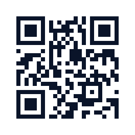
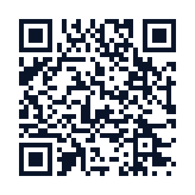
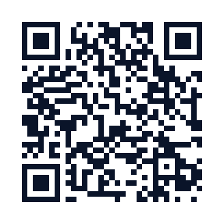

# QR Code & Barcode Scanner

[](https://qrcode-ai.com/)

[Get started](#get-started) · [Examples](#examples) · [Camera scanning](#camera-scanning) · [Documentation](#documentation)

[](https://github.com/qrcode-ai-com/qrcode-barcode-scanner/actions/workflows/ci.yml)
[](https://github.com/qrcode-ai-com/qrcode-barcode-scanner/blob/main/LICENSING.md)

**0.11 is in development.** Published Rust, CLI and npm packages are 0.10.1;
Python's last published release is 0.9.0. [Install a released version](#get-started)
or [explore the 0.11 examples](https://github.com/qrcode-ai-com/qrcode-barcode-scanner/blob/codex/scanner-0.11/crates/qrcode-ai-scanner-wasm/examples/README.md).

## Examples

### Different codes. One image.

[](https://github.com/qrcode-ai-com/qrcode-barcode-scanner/blob/main/docs/assets/readme/scan-replay.mp4)

Two QR copies share one payload. The Code 128 carries `STOCK-4827`.
The report keeps their **three physical occurrences** separate.

[MP4 video](https://github.com/qrcode-ai-com/qrcode-barcode-scanner/blob/main/docs/assets/readme/scan-replay.mp4) · [Original reports and provenance](https://github.com/qrcode-ai-com/qrcode-barcode-scanner/blob/main/docs/assets/readme/README.md)

<sub>Recorded 0.11 scan reports with an illustrative selection replay.</sub>

### From everyday labels to artistic QR designs


QR Code, Micro QR, rMQR, Data Matrix, Aztec, PDF417 and linear barcodes.
Browse the [original images and their reports](https://github.com/qrcode-ai-com/qrcode-barcode-scanner/blob/main/docs/assets/readme/README.md).

<details>
<summary><strong>Explore mixed codes and structured payloads</strong></summary>


This image returns QR `https://qrc-ai.com/76xMa` and Code 128 `STOCK-4827`.
The replay above uses a different fixture: two QR copies containing
`https://qrc-ai.com/occurrences`, beside the same barcode.


A QR code can hold a URL, Wi-Fi settings, contact details or a message.
The scanner returns the decoded fields. Your app decides what happens next.

[Payload reports](https://github.com/qrcode-ai-com/qrcode-barcode-scanner/blob/main/docs/assets/readme/scan-results.json) · [GS1 guide](https://github.com/qrcode-ai-com/qrcode-barcode-scanner/blob/main/docs/concepts/gs1.mdx)

</details>

## Get started

Choose the runtime your application uses. These packages are published today:

| Runtime | Package | Version |
|---|---|---|
| Rust | [`qrcode-ai-scanner`](https://crates.io/crates/qrcode-ai-scanner) | 0.10.1 |
| CLI | [`qrcode-ai-scanner-cli`](https://crates.io/crates/qrcode-ai-scanner-cli) | 0.10.1 |
| Node.js | [`@supernovae-st/qrcode-ai-scanner`](https://www.npmjs.com/package/@supernovae-st/qrcode-ai-scanner) | 0.10.1 |
| Browser WASM | [`@supernovae-st/qrcode-ai-scanner-wasm`](https://www.npmjs.com/package/@supernovae-st/qrcode-ai-scanner-wasm) | 0.10.1 |
| Python | [`qrcode-ai-scanner`](https://pypi.org/project/qrcode-ai-scanner/) | 0.9.0 · [source build](https://github.com/qrcode-ai-com/qrcode-barcode-scanner/blob/main/docs/api/python.mdx) |

### Command line

```sh
cargo install qrcode-ai-scanner-cli@0.10.1
qrscan label.png --pretty
qrscan label.png --profile fast
qrscan design.png -s --budget-ms 0
```

Read a label, return the JSON report or inspect a QR design's quality.
The command remains `qrscan` across the package-name migration.
[CLI reference](https://github.com/qrcode-ai-com/qrcode-barcode-scanner/blob/main/docs/api/cli.mdx)

<details>
<summary><strong>Rust example · published 0.10.1</strong></summary>

```sh
cargo add qrcode-ai-scanner@0.10.1
```

```rust
use qrcode_ai_scanner::{ImageInput, ScanProfile, Scanner};

let scanner = Scanner::builder().profile(ScanProfile::Full).build();
let report = scanner.scan(ImageInput::encoded(&image_bytes))?;

for detection in &report.detections {
    println!("{:?}: {}", detection.symbology, detection.content.text);
}
```

Use encoded images or raw `ImageInput::rgba8(&frame, width, height)`.
An empty `detections` list is a valid scan result. [Rust API](https://docs.rs/qrcode-ai-scanner)

</details>

<details>
<summary><strong>Browser example · 0.11 development package</strong></summary>

With a locally built or inspected 0.11 package and an image `File`:

```js
import { loadScanner } from "@qrcode-ai-com/qrcode-barcode-scanner-wasm/auto";

const scanner = await loadScanner();
const bytes = new Uint8Array(await file.arrayBuffer());
const report = scanner.scan_image(bytes, "fast", undefined, undefined, 0);

for (const detection of report.detections) {
  console.log(detection.symbology, detection.content.text);
}
```

Use `scanner.scan_frame(rgba, width, height, "frame", 0)` for raw frames on the
same instance. A zero budget means unbounded work. The supplied
[image example](https://github.com/qrcode-ai-com/qrcode-barcode-scanner/blob/codex/scanner-0.11/crates/qrcode-ai-scanner-wasm/examples/headless.js)
runs decoding in a worker and handles load and scan errors.

</details>

### 0.11 package names · pending publication

The new packages use the `qrcode-barcode-scanner` family. Existing releases
retain their historical names.

| Surface | 0.11 target |
|---|---|
| Rust / CLI | `qrcode-barcode-scanner` / `qrcode-barcode-scanner-cli` |
| Native Node | `@qrcode-ai-com/qrcode-barcode-scanner` and six platform packages |
| Browser | `@qrcode-ai-com/qrcode-barcode-scanner-wasm` |
| Python | `qrcode-barcode-scanner`, imported as `qrcode_barcode_scanner` |
| Container | `ghcr.io/qrcode-ai-com/qrcode-barcode-scanner` |

The browser package includes **one portable WASM and its camera components**.
Native runtimes have their own builds. There are no alias or wrapper packages;
the two CLI crate names install the same command, so uninstall the old one
before switching. [Migration guide](https://github.com/qrcode-ai-com/qrcode-barcode-scanner/blob/codex/scanner-0.11/docs/guides/migrate-to-qrcode-barcode-scanner.mdx)

## Camera scanning

The 0.11 browser package includes camera control, occurrence tracking and an
overlay with shared selection between the scene and the result rail.

Start or stop the camera, switch devices and pass frames to the same WASM used
for image scanning. Repeated QR payloads can remain separate targets.
Optional blur, dimming and highlights change the presentation only.

[Camera example](https://github.com/qrcode-ai-com/qrcode-barcode-scanner/blob/codex/scanner-0.11/crates/qrcode-ai-scanner-wasm/examples/camera.js) · [Browser package](https://github.com/qrcode-ai-com/qrcode-barcode-scanner/blob/codex/scanner-0.11/crates/qrcode-ai-scanner-wasm/README.md) · [Image and SSR examples](https://github.com/qrcode-ai-com/qrcode-barcode-scanner/blob/codex/scanner-0.11/crates/qrcode-ai-scanner-wasm/examples/README.md)

<details>
<summary><strong>Browser modules and measured geometry</strong></summary>

| Export | Use |
|---|---|
| `/auto` | Load the shared portable WASM |
| `/camera` | Camera lifecycle, tracker and projections |
| `/camera-overlay` | Selection, readout, rail and visual styles |
| `/destination` | Optional URL checks through a supplied transport |
| `/destination-node` | Optional Node transport adapter |

The overlay follows measured locations: perspective corners for suitable QR
and matrix-code reads, reading segments for linear barcodes, and partial or
absent locations where the decoder provides less information. It does not
recognize the surrounding product or invent a barcode rectangle.

The examples use a worker. Serve the built package on localhost or HTTPS;
camera access requires the user's permission. Native Node provides encoded
image scanning, not the browser camera API.

A decoded link is never opened automatically. The destination module checks
URLs only through a transport supplied by your app; observed redirects are
not a safety verdict. The replay is not a camera-UI recording or a physical
device qualification. [Media details](https://github.com/qrcode-ai-com/qrcode-barcode-scanner/blob/main/docs/assets/readme/README.md)

</details>

## QR quality, beyond a successful decode

A code can read once and still become difficult to scan when printed smaller
or placed on another background. Full-profile diagnostics test controlled
changes and return practical hints for the design.

- Resolution, blur, contrast, perspective, rotation and lighting tests.
- Finder-pattern, quiet-zone and measured correction-margin checks.
- Erasure recovery for suitable damaged or artistic QR codes.
- Background-placement tests for transparent designs.

Use **Full** for quality work, **Fast** for a shorter decoding-oriented scan
and **Frame** for repeated decoding without scoring. `score: null` means no
complete quality judgment was produced. Scan budgets set limits on work.

These are software diagnostics informed by ISO 15415, not hardware certification.
[Scoring](https://github.com/qrcode-ai-com/qrcode-barcode-scanner/blob/main/docs/SCORING.md) · [Report contract](https://github.com/qrcode-ai-com/qrcode-barcode-scanner/blob/codex/scanner-0.11/spec/01-report.md) · [Architecture](https://github.com/qrcode-ai-com/qrcode-barcode-scanner/blob/main/docs/ARCHITECTURE.md)

## Supported formats

| Family | Formats |
|---|---|
| QR | QR Code, Micro QR, rectangular Micro QR (rMQR) |
| Matrix and stacked | Data Matrix, Aztec, PDF417, MaxiCode |
| Retail | EAN-13, EAN-8, UPC-A, UPC-E |
| Other linear | Code 128, Code 39, Code 93, Codabar, ITF, GS1 DataBar, GS1 DataBar Expanded, Telepen |

GS1 element strings and Digital Link payloads include parsing and validation
details. Recall and geometry vary by format. Known limits include off-centre
Aztec and some rotated Aztec/PDF417 scenes. [0.11 changelog](https://github.com/qrcode-ai-com/qrcode-barcode-scanner/blob/codex/scanner-0.11/CHANGELOG.md)

## Documentation

[Choose a runtime](https://github.com/qrcode-ai-com/qrcode-barcode-scanner/blob/main/docs/guides/choosing-a-surface.mdx) · [Rust API](https://docs.rs/qrcode-ai-scanner) · [Node API](https://github.com/qrcode-ai-com/qrcode-barcode-scanner/blob/main/docs/api/node.mdx) · [Python guide](https://github.com/qrcode-ai-com/qrcode-barcode-scanner/blob/main/docs/api/python.mdx) · [Nuxt integration](https://github.com/qrcode-ai-com/qrcode-barcode-scanner/blob/main/docs/guides/nuxt-verify.mdx)

[Report types](https://github.com/qrcode-ai-com/qrcode-barcode-scanner/blob/codex/scanner-0.11/bindings/report-types.d.ts) · [JSON Schema](https://github.com/qrcode-ai-com/qrcode-barcode-scanner/blob/codex/scanner-0.11/spec/scan-report.schema.json) · [Specification](https://github.com/qrcode-ai-com/qrcode-barcode-scanner/tree/codex/scanner-0.11/spec/) · [Contributing](https://github.com/qrcode-ai-com/qrcode-barcode-scanner/blob/main/CONTRIBUTING.md) · [Release runbook](https://github.com/qrcode-ai-com/qrcode-barcode-scanner/blob/main/RELEASING.md)

<details>
<summary><strong>Containers, MCP, skills and other bindings</strong></summary>

- [ClawHub skill](https://clawhub.ai/qrcode-ai-com/skills/qrcode-barcode-scanner): documentation-only 0.1.1, still referencing engine 0.10.0.
- [MCP and skill downloads](https://github.com/qrcode-ai-com/qrcode-barcode-scanner/releases/tag/agents-v0.1.0) and [distribution guide](https://github.com/qrcode-ai-com/qrcode-barcode-scanner/blob/main/distribution/README.md).
- Historical 0.10.0 containers on [GHCR](https://github.com/orgs/supernovae-st/packages/container/package/qrcode-ai-scanner) and [Docker Hub](https://hub.docker.com/r/thibautmelen/qrcode-ai-scanner). The new 0.11 container target is GHCR only.
- [Flutter](https://github.com/qrcode-ai-com/qrcode-barcode-scanner/tree/main/bindings/flutter/), [Kotlin](https://github.com/qrcode-ai-com/qrcode-barcode-scanner/tree/main/bindings/kotlin/) and [Swift](https://github.com/qrcode-ai-com/qrcode-barcode-scanner/tree/main/bindings/swift/) have separate source-build instructions and qualification limits. These are bindings, not mobile applications.

</details>

## QR Code AI

Built for [QR Code AI](https://qrcode-ai.com/) by [SuperNovae Studio](https://github.com/supernovae-st).

<table>
  <tr><th><a href="https://qrcode-ai.com/">QR Code AI</a></th><th><a href="https://qrcode-ai.com/en-US/qr-code-scanner">QR code scanner</a></th><th><a href="https://qrcode-ai.com/en-US/barcode-scanner">Barcode scanner</a></th></tr>
  <tr>
    <td align="center"><a href="https://qrcode-ai.com/"></a></td>
    <td align="center"><a href="https://qrcode-ai.com/en-US/qr-code-scanner"></a></td>
    <td align="center"><a href="https://qrcode-ai.com/en-US/barcode-scanner"></a></td>
  </tr>
</table>

AGPL-3.0-or-later or a separate commercial license. [Licensing](https://github.com/qrcode-ai-com/qrcode-barcode-scanner/blob/main/LICENSING.md)
· [Code of Conduct](https://github.com/qrcode-ai-com/qrcode-barcode-scanner/blob/main/CODE_OF_CONDUCT.md) · [Security policy](https://github.com/qrcode-ai-com/qrcode-barcode-scanner/blob/main/SECURITY.md)
· Commercial enquiries: `studio.supernovae@gmail.com`.

© SuperNovae Studio.

<details>
<summary><strong>Historical corpus observations · 13 October 2026</strong></summary>

Regenerated by `cargo run -p xtask -- corpus-report --write` · never
hand-typed. Exact results use only entries with known truth; negative samples
and frontier observations have separate counts. A held frontier is an
unlabelled blind spot, not a correct decode.

Measured on 13 October 2026 with the verified native diagnostic from
`2da72aee98c4cdbee93d789d96196262c37b99c3` (release, no LTO, 8 codegen units,
1 build job; release package overflow checks retained). These corpus observations do
not qualify shipped-package performance; trace timings are exploratory.

<!-- corpus-report:begin -->
| category | images | exact / truth | negative held / negatives | unlabelled decoded / blind / total | frontier held / gained | scan errors | avg ms (ladder-only trace.total_ms, exploratory, not a gate) |
|---|---|---|---|---|---|---|---|
| artistic | 2 | 2 / 2 | 0 / 0 | 0 / 0 / 0 | 0 / 0 | 0 | 637 |
| clean | 13 | 13 / 13 | 0 / 0 | 0 / 0 / 0 | 0 / 0 | 0 | 4 |
| degraded | 7 | 7 / 7 | 0 / 0 | 0 / 0 / 0 | 0 / 0 | 0 | 24 |
| frontier | 7 | 0 / 0 | 0 / 0 | 0 / 7 / 7 | 7 / 0 | 0 | 921 |
| symbology | 12 | 12 / 12 | 0 / 0 | 0 / 0 / 0 | 0 / 0 | 0 | 1 |
<!-- corpus-report:end -->

### External corpus observations

[`corpus-external.tsv`](https://github.com/qrcode-ai-com/qrcode-barcode-scanner/blob/main/corpus-external.tsv) pins file hashes and measured
decode states. A state pin is not content truth for an unlabelled image. The
corpora themselves are not vendored: they contain third-party test images and
private production exports. The 13 October diagnostic used the same original
pixels and retained qualified truth amendments; strict complete-output results
and exploratory any-text matches are separate measures.

| corpus | observed result | scope |
|---|---|---|
| ZXing blackbox qrcode-1…6 | **169/179 strict exact**, 9 missed, 1 ambiguous | The nested qrcode-2/16 scene has incomplete truth; it is not an exact success. No blocking wrong/extra output or scan error under the qualified truth/dispositions. |
| ZXing exploratory tripwire | **170/179 any-text matches** | Per-suite 20 · 35 · 42 · 39 · 19 · 15. Historical ZXing 0° pass thresholds total 157; these are context, not a contemporary comparator ranking. |
| Production templates (15 single-symbol styles) | **15/15 decoded observations** | No qualified content truth; part of the unlabelled gallery set. |
| Full artistic gallery | **56/161 decoded**, 105 blind | Detection observations, not exact-content successes. Six gallery images are also retained as vendored frontier fixtures. |

The complete strict run judged 381 images: 179 ZXing, 161 unlabelled gallery
and 41 vendored. All 522 external file hashes and 41 vendored inputs verified.
Vendored truth comprises 34 labelled images, 0 verified negatives and 7
unlabelled frontiers. One caught rqrr geometry panic on qrcode-6/7 is retained
in the report trace; it is not a scan error or hidden as a zero-cost sample.
Separate earlier center-logo experiments demonstrated errors-and-erasures rescue
through 30% radius on v5-H; that synthetic observation is not this corpus result
or a new comparative correctness/performance qualification.

One historical ZXing wrong label was a **truth conflict** on `qrcode-2/13.png`:
the upstream `.txt` reads "photograph", while independently executed external
ZXing-C++ and C quirc readers confirmed "photography" on original-derived
pixels. The [pinned text amendment](https://github.com/qrcode-ai-com/qrcode-barcode-scanner/blob/main/spec/corpus-truth-amendments.md#zxing-qrcode-2-13)
preserves the original image and truth hashes, uses the confirmed text in all
corpus instruments and records the historical `known_wrong` disposition as
`superseded` only when those exact inputs validate. Wrong and extra outputs
still block. This is text confirmation, not proof of ECI/FNC1 declarations or
native QR byte length; a zero correction margin alone proves neither text.

For suites 1 through 6, the historical ZXing 0° pass
thresholds 17 · 32 · 38 · 36 · 19 · 15 (`QRCodeBlackBox1…6TestCase`, 157 in all)
provide context for the observations above. Strict complete-output verdicts and
exploratory any-text matches remain separate measures.

#### Reproducing the headline numbers

Place the corpora at the repo root (layout below), then run the gate:

```
corpus-external/
├── zxing-blackbox/qrcode-{1..6}/   # zxing core/src/test/resources/blackbox · images + .txt ground truth
└── qrcode-ai/                      # qrcode-ai.com production gallery exports (private)
```

```sh
cargo run --release -p xtask -- corpus-report --external
```

A downloaded `xtask` can use `QRSCAN_REPO_ROOT=/absolute/source/checkout`
to read that checkout's manifests and vendored fixtures. The directory must
exist and both `corpus.toml` and `corpus-external.tsv` must be readable,
nonempty and valid; an invalid override exits 2. Without the variable, the
root embedded at build time remains the default. The strict oracle records
the selected checkout's Git SHA and tree state; the runner must separately
verify that the downloaded artifact belongs to that source revision.
`QRSCAN_EXTERNAL_CORPUS` (or `oracle --corpus-root`) independently selects
the external images. For example, after verifying the artifact:

```sh
QRSCAN_REPO_ROOT=/absolute/source/checkout /absolute/artifacts/xtask corpus-report
QRSCAN_REPO_ROOT=/absolute/source/checkout /absolute/artifacts/xtask oracle \
  --corpus-root /absolute/corpus-external --json /absolute/receipts/oracle.json
```

Verifies presence + sha256 of every manifested file, rescans every image
(budget-free full ladder, so no machine's speed decides a result · the
determinism contract holds per platform; scoring off), prints the
per-suite table, and exits non-zero on any divergence: a regression AND
a fresh decode of a pinned-blind image both fail, so pins are flipped
deliberately by regenerating —
`cargo run --release -p xtask -- gen-external-manifest` (~20 s) · and
committing the diff. When `corpus-external/` is absent (CI checkouts) the
gate skips gracefully but loudly, printing exactly how many pins went
unverified. `scripts/batch-scan.py` and `scripts/zxing-blackbox.py` stay
as exploratory reporters.

</details>
