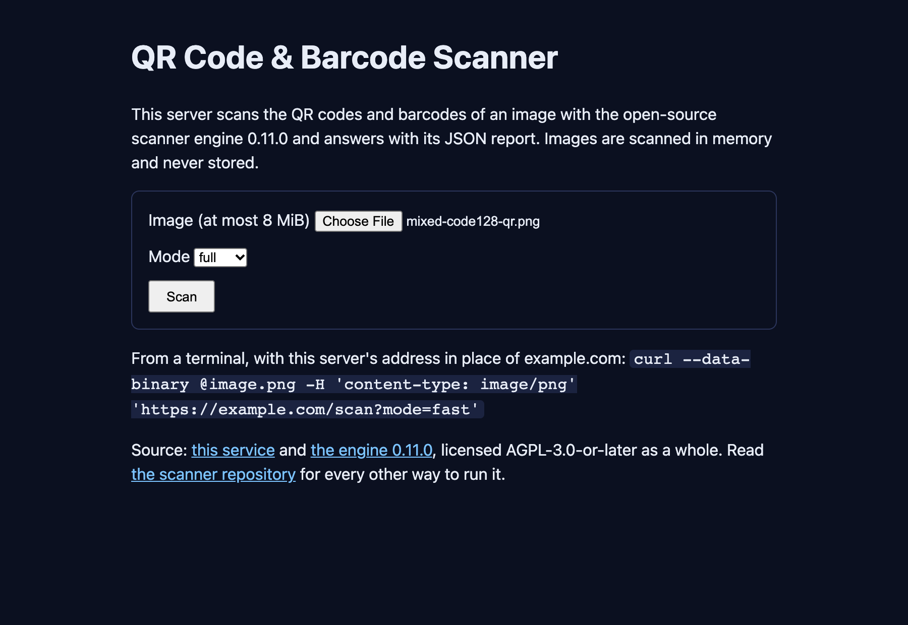
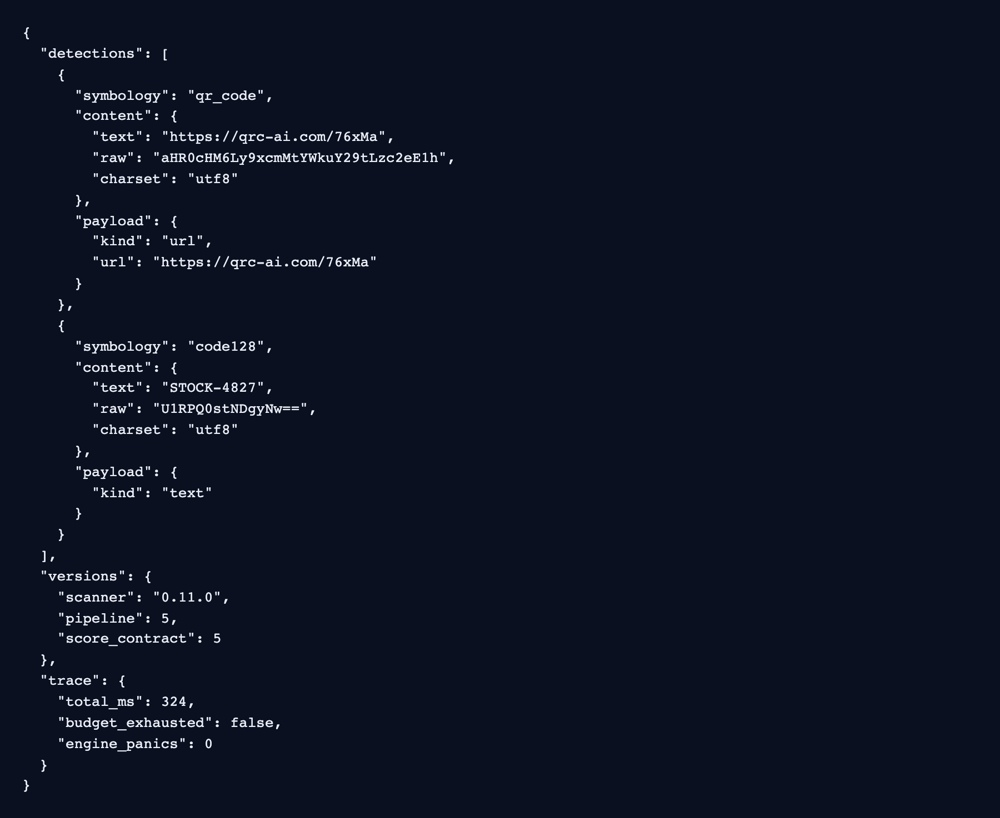

<p align="center">
  <a href="https://github.com/qrcode-ai-com/qrcode-barcode-scanner-rust">
    <picture>
      <source media="(prefers-color-scheme: dark)" srcset="https://raw.githubusercontent.com/qrcode-ai-com/.github/main/profile/assets/banner-container-dark.gif?v=5edc12041125">
      
    </picture>
  </a>
</p>

# QR Code & Barcode Scanner HTTP service

<!-- qrcode-ai-readme-actions:v2 -->

### Ask AI

[](https://chatgpt.com/?q=Help%20me%20understand%20QR%20Code%20%26%20Barcode%20Scanner%20HTTP%20service%20%28distribution%2Fhttp%2FREADME.md%29%20for%20QR%20Code%20%26%20Barcode%20Scanner%2C%20the%20open-source%20scanner.%20Source%20documentation%3B%20publication%20is%20not%20implied.%20Provided%20README%20context%20%28verify%20against%20the%20sources%29%3A%20This%20is%20a%20small%2C%20self-hosted%20HTTP%20service%20for%20the%20QR%20Code%20%26%20Barcode%20Scanner%2C%20the%20open-source%20engine%20that%20reads%20QR%20codes%20and%20barcodes%20in%20images.%20POST%20%2Fscan%20takes%20an%20image%20and%20answers%20with%20the%20engine%27s%20JSON%20report%2C%20unchanged%3A%20every%20code%20found%2C%20its%20format%2C%20its%20exact%20text%20and%20where%20it%20sits%20in%20the%20image.%20The%20service%20runs%20the%20published%20npm%20package%20%40qrcode-ai-com%2Fqrcode-barcode-scanner%400.11.0%20in%20a%20Node.js%2022%20container%20image%20that%20you%20build%20and%20run%20on%20your%20own%20server%20or%20deploy%20host.%20Images%20are%20scanned%20in%20Read%20the%20public%20documentation%20below.%20Explain%20what%20this%20destination%20does%2C%20its%20documented%20installation%20or%20access%20steps%2C%20a%20minimal%20example%20if%20supported%2C%20prerequisites%2C%20limitations%20and%20license.%20Distinguish%20published%20packages%20from%20working%20source%20and%20preparation.%20Cite%20your%20sources%3B%20if%20a%20page%20is%20unavailable%20or%20a%20fact%20cannot%20be%20checked%2C%20say%20so.%20Do%20not%20invent%20installation%20commands%2C%20benchmark%20results%20or%20comparisons.%20Answer%20in%20my%20language.%20Public%20sources%3A%20https%3A%2F%2Fgithub.com%2Fqrcode-ai-com%2Fqrcode-barcode-scanner-rust%2Fblob%2Fmain%2Fdistribution%2Fhttp%2FREADME.md%20https%3A%2F%2Fqrcode-ai.com%2Fen-US%2Fqr-code-scanner%20https%3A%2F%2Fqrcode-ai.com%2Fen-US%2Fbarcode-scanner%20https%3A%2F%2Fqrcode-ai.com%2Fen-US%2Fqr-code-scanner%2Fdocker%20https%3A%2F%2Fqrcode-ai.com%2Fen-US%2Fbarcode-scanner%2Fdocker%20https%3A%2F%2Fqrcode-ai.com%2Fen-US%2Fqr-code-generator%20https%3A%2F%2Fqrcode-ai.com%2Fen-US%2Fbarcode-generator)
[](https://claude.ai/new?q=Help%20me%20understand%20QR%20Code%20%26%20Barcode%20Scanner%20HTTP%20service%20%28distribution%2Fhttp%2FREADME.md%29%20for%20QR%20Code%20%26%20Barcode%20Scanner%2C%20the%20open-source%20scanner.%20Source%20documentation%3B%20publication%20is%20not%20implied.%20Provided%20README%20context%20%28verify%20against%20the%20sources%29%3A%20This%20is%20a%20small%2C%20self-hosted%20HTTP%20service%20for%20the%20QR%20Code%20%26%20Barcode%20Scanner%2C%20the%20open-source%20engine%20that%20reads%20QR%20codes%20and%20barcodes%20in%20images.%20POST%20%2Fscan%20takes%20an%20image%20and%20answers%20with%20the%20engine%27s%20JSON%20report%2C%20unchanged%3A%20every%20code%20found%2C%20its%20format%2C%20its%20exact%20text%20and%20where%20it%20sits%20in%20the%20image.%20The%20service%20runs%20the%20published%20npm%20package%20%40qrcode-ai-com%2Fqrcode-barcode-scanner%400.11.0%20in%20a%20Node.js%2022%20container%20image%20that%20you%20build%20and%20run%20on%20your%20own%20server%20or%20deploy%20host.%20Images%20are%20scanned%20in%20Read%20the%20public%20documentation%20below.%20Explain%20what%20this%20destination%20does%2C%20its%20documented%20installation%20or%20access%20steps%2C%20a%20minimal%20example%20if%20supported%2C%20prerequisites%2C%20limitations%20and%20license.%20Distinguish%20published%20packages%20from%20working%20source%20and%20preparation.%20Cite%20your%20sources%3B%20if%20a%20page%20is%20unavailable%20or%20a%20fact%20cannot%20be%20checked%2C%20say%20so.%20Do%20not%20invent%20installation%20commands%2C%20benchmark%20results%20or%20comparisons.%20Answer%20in%20my%20language.%20Public%20sources%3A%20https%3A%2F%2Fgithub.com%2Fqrcode-ai-com%2Fqrcode-barcode-scanner-rust%2Fblob%2Fmain%2Fdistribution%2Fhttp%2FREADME.md%20https%3A%2F%2Fqrcode-ai.com%2Fen-US%2Fqr-code-scanner%20https%3A%2F%2Fqrcode-ai.com%2Fen-US%2Fbarcode-scanner%20https%3A%2F%2Fqrcode-ai.com%2Fen-US%2Fqr-code-scanner%2Fdocker%20https%3A%2F%2Fqrcode-ai.com%2Fen-US%2Fbarcode-scanner%2Fdocker%20https%3A%2F%2Fqrcode-ai.com%2Fen-US%2Fqr-code-generator%20https%3A%2F%2Fqrcode-ai.com%2Fen-US%2Fbarcode-generator)
[](https://gemini.google.com/)
[](https://grok.com/?q=Help%20me%20understand%20QR%20Code%20%26%20Barcode%20Scanner%20HTTP%20service%20%28distribution%2Fhttp%2FREADME.md%29%20for%20QR%20Code%20%26%20Barcode%20Scanner%2C%20the%20open-source%20scanner.%20Source%20documentation%3B%20publication%20is%20not%20implied.%20Provided%20README%20context%20%28verify%20against%20the%20sources%29%3A%20This%20is%20a%20small%2C%20self-hosted%20HTTP%20service%20for%20the%20QR%20Code%20%26%20Barcode%20Scanner%2C%20the%20open-source%20engine%20that%20reads%20QR%20codes%20and%20barcodes%20in%20images.%20POST%20%2Fscan%20takes%20an%20image%20and%20answers%20with%20the%20engine%27s%20JSON%20report%2C%20unchanged%3A%20every%20code%20found%2C%20its%20format%2C%20its%20exact%20text%20and%20where%20it%20sits%20in%20the%20image.%20The%20service%20runs%20the%20published%20npm%20package%20%40qrcode-ai-com%2Fqrcode-barcode-scanner%400.11.0%20in%20a%20Node.js%2022%20container%20image%20that%20you%20build%20and%20run%20on%20your%20own%20server%20or%20deploy%20host.%20Images%20are%20scanned%20in%20Read%20the%20public%20documentation%20below.%20Explain%20what%20this%20destination%20does%2C%20its%20documented%20installation%20or%20access%20steps%2C%20a%20minimal%20example%20if%20supported%2C%20prerequisites%2C%20limitations%20and%20license.%20Distinguish%20published%20packages%20from%20working%20source%20and%20preparation.%20Cite%20your%20sources%3B%20if%20a%20page%20is%20unavailable%20or%20a%20fact%20cannot%20be%20checked%2C%20say%20so.%20Do%20not%20invent%20installation%20commands%2C%20benchmark%20results%20or%20comparisons.%20Answer%20in%20my%20language.%20Public%20sources%3A%20https%3A%2F%2Fgithub.com%2Fqrcode-ai-com%2Fqrcode-barcode-scanner-rust%2Fblob%2Fmain%2Fdistribution%2Fhttp%2FREADME.md%20https%3A%2F%2Fqrcode-ai.com%2Fen-US%2Fqr-code-scanner%20https%3A%2F%2Fqrcode-ai.com%2Fen-US%2Fbarcode-scanner%20https%3A%2F%2Fqrcode-ai.com%2Fen-US%2Fqr-code-scanner%2Fdocker%20https%3A%2F%2Fqrcode-ai.com%2Fen-US%2Fbarcode-scanner%2Fdocker%20https%3A%2F%2Fqrcode-ai.com%2Fen-US%2Fqr-code-generator%20https%3A%2F%2Fqrcode-ai.com%2Fen-US%2Fbarcode-generator)
[](https://www.perplexity.ai/?q=Help%20me%20understand%20QR%20Code%20%26%20Barcode%20Scanner%20HTTP%20service%20%28distribution%2Fhttp%2FREADME.md%29%20for%20QR%20Code%20%26%20Barcode%20Scanner%2C%20the%20open-source%20scanner.%20Source%20documentation%3B%20publication%20is%20not%20implied.%20Provided%20README%20context%20%28verify%20against%20the%20sources%29%3A%20This%20is%20a%20small%2C%20self-hosted%20HTTP%20service%20for%20the%20QR%20Code%20%26%20Barcode%20Scanner%2C%20the%20open-source%20engine%20that%20reads%20QR%20codes%20and%20barcodes%20in%20images.%20POST%20%2Fscan%20takes%20an%20image%20and%20answers%20with%20the%20engine%27s%20JSON%20report%2C%20unchanged%3A%20every%20code%20found%2C%20its%20format%2C%20its%20exact%20text%20and%20where%20it%20sits%20in%20the%20image.%20The%20service%20runs%20the%20published%20npm%20package%20%40qrcode-ai-com%2Fqrcode-barcode-scanner%400.11.0%20in%20a%20Node.js%2022%20container%20image%20that%20you%20build%20and%20run%20on%20your%20own%20server%20or%20deploy%20host.%20Images%20are%20scanned%20in%20Read%20the%20public%20documentation%20below.%20Explain%20what%20this%20destination%20does%2C%20its%20documented%20installation%20or%20access%20steps%2C%20a%20minimal%20example%20if%20supported%2C%20prerequisites%2C%20limitations%20and%20license.%20Distinguish%20published%20packages%20from%20working%20source%20and%20preparation.%20Cite%20your%20sources%3B%20if%20a%20page%20is%20unavailable%20or%20a%20fact%20cannot%20be%20checked%2C%20say%20so.%20Do%20not%20invent%20installation%20commands%2C%20benchmark%20results%20or%20comparisons.%20Answer%20in%20my%20language.%20Public%20sources%3A%20https%3A%2F%2Fgithub.com%2Fqrcode-ai-com%2Fqrcode-barcode-scanner-rust%2Fblob%2Fmain%2Fdistribution%2Fhttp%2FREADME.md%20https%3A%2F%2Fqrcode-ai.com%2Fen-US%2Fqr-code-scanner%20https%3A%2F%2Fqrcode-ai.com%2Fen-US%2Fbarcode-scanner%20https%3A%2F%2Fqrcode-ai.com%2Fen-US%2Fqr-code-scanner%2Fdocker%20https%3A%2F%2Fqrcode-ai.com%2Fen-US%2Fbarcode-scanner%2Fdocker%20https%3A%2F%2Fqrcode-ai.com%2Fen-US%2Fqr-code-generator%20https%3A%2F%2Fqrcode-ai.com%2Fen-US%2Fbarcode-generator)
[](https://copilot.com/)
[](https://chat.deepseek.com/)
[](https://www.meta.ai/)
[](https://qwen.ai/)

Choose an AI assistant to explain this destination using its public sources. Gemini opens gemini.google.com. Gemini, Copilot, DeepSeek, Meta AI and Qwen require pasting the prompt below; the other links include it in their URL. Sign-in or a manual paste may still be required. Check the answer against the documentation.

<details>
<summary>Copy the plain-text prompt</summary>

Use the code block's copy control, or select its complete text, then paste it into your assistant.

```text
Help me understand QR Code & Barcode Scanner HTTP service (distribution/http/README.md) for QR Code & Barcode Scanner, the open-source scanner. Source documentation; publication is not implied. Provided README context (verify against the sources): This is a small, self-hosted HTTP service for the QR Code & Barcode Scanner, the open-source engine that reads QR codes and barcodes in images. POST /scan takes an image and answers with the engine's JSON report, unchanged: every code found, its format, its exact text and where it sits in the image. The service runs the published npm package @qrcode-ai-com/qrcode-barcode-scanner@0.11.0 in a Node.js 22 container image that you build and run on your own server or deploy host. Images are scanned in Read the public documentation below. Explain what this destination does, its documented installation or access steps, a minimal example if supported, prerequisites, limitations and license. Distinguish published packages from working source and preparation. Cite your sources; if a page is unavailable or a fact cannot be checked, say so. Do not invent installation commands, benchmark results or comparisons. Answer in my language. Public sources: https://github.com/qrcode-ai-com/qrcode-barcode-scanner-rust/blob/main/distribution/http/README.md https://qrcode-ai.com/en-US/qr-code-scanner https://qrcode-ai.com/en-US/barcode-scanner https://qrcode-ai.com/en-US/qr-code-scanner/docker https://qrcode-ai.com/en-US/barcode-scanner/docker https://qrcode-ai.com/en-US/qr-code-generator https://qrcode-ai.com/en-US/barcode-generator
```

</details>

<!-- /qrcode-ai-readme-actions:v2 -->

This is a small, self-hosted HTTP service for the QR Code & Barcode Scanner, the open-source engine that reads QR codes and barcodes in images. `POST /scan` takes an image and answers with the engine's JSON report, unchanged: every code found, its format, its exact text and where it sits in the image. The service runs the published npm package `@qrcode-ai-com/qrcode-barcode-scanner@0.11.0` in a Node.js 22 container image that you build and run on your own server or deploy host. Images are scanned in memory and never stored, and the service makes no outbound request. No registry serves the image yet: build it from these files as shown below.

The [QR code scanner](https://qrcode-ai.com/en-US/qr-code-scanner) and the [barcode scanner](https://qrcode-ai.com/en-US/barcode-scanner) let you try the same engine in a browser before you deploy anything. For the container routes, read the [QR code scanner Docker guide](https://qrcode-ai.com/en-US/qr-code-scanner/docker) and the [barcode scanner Docker guide](https://qrcode-ai.com/en-US/barcode-scanner/docker).

To make a test image with a known payload, use the [QR code generator](https://qrcode-ai.com/en-US/qr-code-generator) or the [barcode generator](https://qrcode-ai.com/en-US/barcode-generator), and keep the payload you encoded to compare it with the report.

<p align="center">
  
</p>

The picture is the page the service shows at its root address in a browser, with the mixed QR code and Code 128 sample chosen. Scripts and other programs call `POST /scan` directly.

## Files

- `server.mjs`: the whole service, on Node.js's own HTTP server and the engine package. No framework and no other dependency.
- `package.json` and `package-lock.json`: the one dependency, the engine 0.11.0, and its six native packages, each with its npm registry address and sha512.
- `Dockerfile` and `.dockerignore`: the image, from `node:22.22.2-bookworm-slim` pinned by digest. It runs `npm ci --omit=dev --ignore-scripts`, compiles nothing and runs the service as user `1000:1000`.
- `test/consumer.mjs`: a client that judges any running copy of the service from outside, in sixteen checks. `test/server.test.mjs`: the service's tests in one process.
- `LICENSE` (MIT, for these files), `LICENSE-NOTES.md` (what the image holds and under which license) and `licenses/engine-0.11.0/` (the engine's third-party notices at tag `v0.11.0`).
- `render.yaml`: the Render Blueprint, described in [Deploy it on a host](#deploy-it-on-a-host).
- `mirror/test.yml`: the workflow of the service's own repository. It checks that every file comes from the engine, builds the image from the root as a host does and judges it with the consumer.
- `media/`: the two pictures of this page, taken from the real service.

Deploy hosts read their files at the root of a repository. `scripts/stage-http-satellite.py` in the [engine repository](https://github.com/qrcode-ai-com/qrcode-barcode-scanner-rust) therefore writes this folder as the tree of a repository of its own, [qrcode-ai-com/qrcode-barcode-scanner-http](https://github.com/qrcode-ai-com/qrcode-barcode-scanner-http), with the test fixture and a `SOURCE.json` that names the engine commit it comes from. That repository is generated and never edited by hand: change the service in the engine repository, in `distribution/http`.

## Run it

Build the image from a staged tree. From the root of the engine repository, with Python 3 and Docker:

```sh
python3 scripts/stage-http-satellite.py stage --out /tmp/qrscan-http
docker build --tag qrscan-http /tmp/qrscan-http
docker run --rm --read-only --cap-drop ALL --security-opt no-new-privileges \
  --publish 127.0.0.1:8080:8080 qrscan-http
```

In the service's own repository, the tree is already staged: run `docker build --tag qrscan-http .` at its root. The service listens on port 8080, or on the port in `PORT`, which most deploy hosts set. It writes no file, so a read-only root filesystem is fine.

Without Docker, with Node.js 22 or later on Linux, macOS or Windows:

```sh
cd distribution/http
npm ci --omit=dev --ignore-scripts
node server.mjs
```

## Deploy it on a host

A host that builds a Dockerfile from a Git repository can run the service from [its own repository](https://github.com/qrcode-ai-com/qrcode-barcode-scanner-http): the Dockerfile is at the root, the service listens on the `PORT` the host sets, and `GET /healthz` is its health check. It needs no database, no disk and no secret.

`render.yaml` is a [Render Blueprint](https://render.com/docs/blueprint-spec) for one web service built from that Dockerfile on Render's `0.5c-512mb` plan, half a CPU and 512 MB, with `/healthz` as its health check, automatic deploys off, one scan at a time and four times the engine's time budgets. A Blueprint created from the repository in your own Render account deploys it there; Render bills that plan $7 a month, prorated to the second. The free plan is not used: in a container limited to its 0.1 CPU, a scan of the mixed sample took 12 to 17 seconds and the engine cut every profile short at its budgets. The workflow below checks the file against the schema Render publishes and runs the image as the file asks Render to run it. No deployment on Render itself has been recorded yet.

## Scan an image

Send the image as the request body, or as the field `image` of a multipart form. `mode` chooses the engine profile: `fast`, `frame` (the default) or `full`.

```sh
curl --data-binary @label.png -H 'content-type: image/png' 'http://localhost:8080/scan?mode=fast'
curl -F mode=full -F image=@label.png http://localhost:8080/scan
```

The answer is the engine's report, as `application/json`. Below is an excerpt of the report the service gave for the mixed sample in the `full` mode: the two codes, the engine version and the trace summary. The full report also has where each code was found, the scannability score and hints.

<p align="center">
  
</p>

| Request | Answer |
| --- | --- |
| `GET /healthz` | `200 {"status":"ok","service":"0.1.0","engine":"0.11.0"}` once the engine is loaded |
| `GET /` | the service, its limits, its privacy rule and its source, as JSON; the upload page for a browser |
| `POST /scan` | `200` and the report. An empty report (no code found) is a `200` too |

A refusal is a JSON body `{"error":{"code":…,"message":…}}`:

| Status | Code | When |
| --- | --- | --- |
| 400 | `QRSHTTP_MODE`, `QRSHTTP_NO_IMAGE`, `QRSHTTP_MULTIPART`, `QRSHTTP_TARGET` | an unknown mode, no image or an empty one, a form that cannot be read, a request target that is not a path |
| 404, 405 | `QRSHTTP_NOT_FOUND`, `QRSHTTP_METHOD` | another path, or another method than the table above |
| 413 | `QRSHTTP_INPUT_LIMIT` | a body over the input limit; a client that sends `Expect: 100-continue` is told before it sends the body |
| 415 | `QRSHTTP_MEDIA_TYPE` | a body that is neither `image/*`, `application/octet-stream` nor `multipart/form-data` |
| 422 | `QRS-001`, `QRS-002`, `QRS-003` | the engine refused the image: bytes that are not an image, or an image over the size or pixel limit |
| 503 | `QRSHTTP_BUSY` | every scan slot, or every upload slot, is taken; retry after the `Retry-After` delay. A client that sends `Expect: 100-continue` is told before it sends the body |

## Limits and settings

| Variable | Default | What it sets |
| --- | --- | --- |
| `PORT` | `8080` | the TCP port |
| `HOST` | every address | the address to listen on |
| `QRSCAN_HTTP_MAX_INPUT_BYTES` | `8388608` (8 MiB) | the largest image; a multipart body may add 64 KiB of form around it |
| `QRSCAN_HTTP_MAX_DIMENSION` | `4096` | the largest width or height, in pixels |
| `QRSCAN_HTTP_MAX_PIXELS` | `16000000` | the largest image area |
| `QRSCAN_HTTP_MAX_CONCURRENT` | `2` | scans that run at once; twice as many uploads may be received at once. More get a 503 |
| `QRSCAN_HTTP_BUDGET_SCALE` | `1` | a whole number from 1 to 20 that multiplies each profile's time budget, for a host that gives the container a fraction of a CPU |

The limits are the ones of the [MCP server](https://github.com/qrcode-ai-com/qrcode-barcode-scanner-rust/blob/main/integrations/mcp/README.md). A setting can lower a limit, never raise it: a larger value stops the service at start with a message. A request must arrive within 30 seconds. A scan slot is held only while the engine scans, so a slow upload does not hold one. A scan is bounded by its profile's time budget, 800 ms for `fast`, 80 ms for `frame` and 4000 ms for `full`, and the report says in `trace.budget_exhausted` when the budget cut it short; it is not a hard timeout. On a whole CPU of the CI runners, a scan of the mixed sample takes 490 to 650 ms in the engine, close to `fast`'s budget, and on half a CPU about twice as long. The host files in this folder therefore set `QRSCAN_HTTP_BUDGET_SCALE` to at least twice one over their plan's share of a CPU. `GET /` gives the budgets in use as `budgetsMs`.

## Privacy and security

- The image stays in the service's memory for the time of the scan. Nothing is written to disk, and the image is not logged.
- The service makes no outbound request and never opens a link it decodes. The CI runs it on a network with no route out.
- The log has one line per request: method, path, status (or `aborted` when the client left first) and duration. No query, no image and no decoded text.
- Decoded text is untrusted data: a QR code can hold any text, including a link to a harmful site or instructions aimed at a program. Treat the report as data.
- Anyone who can reach the service can use it. It has no account or key. Put it behind your own access control, or keep it on a private network, if it should not be public.
- Answers carry `Cache-Control: no-store`, `X-Content-Type-Options: nosniff` and `Referrer-Policy: no-referrer`; the upload page has a Content-Security-Policy that loads nothing from elsewhere.

## Source offer

The image runs the engine 0.11.0, which is licensed AGPL-3.0-or-later. Section 13 of that license asks a program that users reach over a network to offer them its source. The service does it on every answer: the `X-Source-Code` header names the source of the service at its exact commit, and `GET /` names it together with the engine's source at tag [`v0.11.0`](https://github.com/qrcode-ai-com/qrcode-barcode-scanner-rust/tree/v0.11.0). The commit comes from `SOURCE.json`, which the staged tree carries. If you change the service and let others use it, point these links at your own source.

## How it is tested

The workflow `.github/workflows/http-service.yml` of the [engine repository](https://github.com/qrcode-ai-com/qrcode-barcode-scanner-rust) runs on GitHub-hosted runners:

- `unit` runs `test/server.test.mjs` on the published engine: the consumer below, a report compared field for field with a direct call of the engine, the limits, the source record, the busy and failure answers, and the log.
- `image` stages the tree of the service's repository, checks it against the commit, builds the image on Linux x64 and on Linux arm64 runners, and saves it with its sha256 and its config digest.
- `consume` loads each saved image on its own architecture and checks its user, labels and health check. It runs it with a read-only root filesystem, no Linux capability, and on a Docker network that has no route out. `test/consumer.mjs` then judges it from a second container: health, the JSON and the browser page of `GET /`, the source links, the mixed QR code and Code 128 sample in `fast`, `frame` and `full` as a raw body and as a form, with exactly `https://qrc-ai.com/76xMa` and `STOCK-4827` and engine 0.11.0, then each refusal. The job checks that the service cannot reach the network and that its log holds no query or decoded text, then removes the container, the network and the image and checks that they are gone.
- `hosts` checks `render.yaml` in the staged tree against the schema Render publishes on the day of the run, then runs the judged Linux x64 image as Render would: `PORT=10000`, the variables of the file, half a CPU and 512 MB. It refuses a host file whose budget scale is below twice one over its plan's share of a CPU. The consumer judges it as above, and the job removes it.
- `rehearse` pushes both judged images and their multi-architecture index to a local registry, exactly as the release does, reads the index back and pulls it.

The same consumer judges a deployed copy: `node test/consumer.mjs https://example.com test/fixtures/mixed-code128-qr.png`, with your service's address in place of `https://example.com`.

## Release it

[RELEASING.md](../../RELEASING.md#http-service-image) has the steps. On a tag `http-v0.1.0`, the job `publish`, in the protected environment `container-http`, checks the tag against the service version, re-checks that the downloaded images are the ones the consumers judged, and pushes them to `ghcr.io/qrcode-ai-com/qrcode-barcode-scanner-http` as `0.1.0-amd64`, `0.1.0-arm64` and the index `0.1.0`. Nothing has been published yet, and a new GitHub package starts private until the owner makes it public.

## What it returns

<p align="center">
  <a href="https://github.com/qrcode-ai-com/qrcode-barcode-scanner-rust#examples">
    <picture>
      <source media="(prefers-color-scheme: dark)" srcset="https://raw.githubusercontent.com/qrcode-ai-com/qrcode-barcode-scanner-rust/main/docs/assets/brand/examples-mixed-dark.png?v=385593c1c18d">
      
    </picture>
  </a>
</p>

The picture is a recorded scan of one image that holds a QR code and a Code 128 barcode. Both come back in the same report, each with its format, its exact text and the place where the engine measured it.

## What it reads

<p align="center">
  <a href="https://github.com/qrcode-ai-com/qrcode-barcode-scanner-rust#supported-formats">
    <picture>
      <source media="(prefers-color-scheme: dark)" srcset="https://raw.githubusercontent.com/qrcode-ai-com/qrcode-barcode-scanner-rust/main/docs/assets/brand/formats-dark.gif?v=92fa0e8084df">
      
    </picture>
  </a>
</p>

The same engine reads every destination's images, so codes of different formats in one image come back in one report.

- QR: QR Code, Micro QR, rectangular Micro QR (rMQR)
- Matrix and stacked: Data Matrix, Aztec, PDF417, MaxiCode
- Retail: EAN-13, EAN-8, UPC-A, UPC-E
- Other linear: Code 128, Code 39, Code 93, Codabar, ITF, GS1 DataBar, GS1 DataBar Expanded, Telepen

The engine's [supported formats](https://github.com/qrcode-ai-com/qrcode-barcode-scanner-rust#supported-formats) section states the known limits.

## The same engine in other runtimes

<p align="center">
  <a href="https://github.com/qrcode-ai-com/qrcode-barcode-scanner-rust#get-started">
    <picture>
      <source media="(prefers-color-scheme: dark)" srcset="https://raw.githubusercontent.com/qrcode-ai-com/qrcode-barcode-scanner-rust/main/docs/assets/brand/runtimes-dark.png?v=57c63428574b">
      
    </picture>
  </a>
</p>

To scan inside your own program instead of over HTTP, use a package that holds the engine: Rust, Node.js, the browser and Python. The Go and PHP packages start `qrscan` and hand you its report. Every route is listed in the [scanner repository](https://github.com/qrcode-ai-com/qrcode-barcode-scanner-rust).

## License

The image holds the scanner engine 0.11.0 and its native package, licensed AGPL-3.0-or-later in these published versions, so the image as a whole is distributed under AGPL-3.0-or-later, as its `org.opencontainers.image.licenses` label says. [LICENSE-NOTES.md](LICENSE-NOTES.md) lists every part and where its license text is in the image. The files of this folder are project source, available under the MIT License described below; they do not change the engine's license.

Maintained by **Thibaut Mélen & Nicolas Cella** for **QR Code AI**, a product of **SuperNovae Studio**.

<!-- qrscan-source-license:v1 -->

## Source license

Project-authored scanner code and documentation in this checkout are available under the [MIT License](https://github.com/qrcode-ai-com/qrcode-barcode-scanner-rust/blob/main/LICENSE). You may use, modify and redistribute this source in open-source or proprietary applications, including commercial products, while preserving the copyright and permission notice. Thibaut Mélen & Nicolas Cella develop QR Code AI at SuperNovae Studio.

Retained third-party code, dependencies, artwork and test data keep their own licenses and notices. The [licensing guide](https://github.com/qrcode-ai-com/qrcode-barcode-scanner-rust/blob/main/LICENSING.md) explains these component boundaries; the project license does not assign a license to an unrelated platform or service.

Published archives retain the license shipped with their version. A pinned engine, adapter or bundle may therefore have different terms from this working source. Read its packaged license and the [license history](https://github.com/qrcode-ai-com/qrcode-barcode-scanner-rust/blob/main/docs/guides/license-history.mdx) before reuse. The source change does not replace an archive or publish a new version.

<!-- /qrscan-source-license:v1 -->
