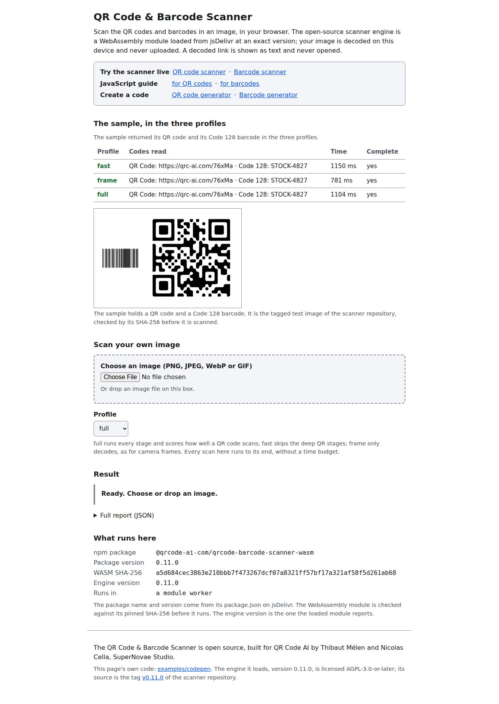

<p align="center">
  <a href="https://www.npmjs.com/package/@qrcode-ai-com/qrcode-barcode-scanner-wasm">
    <picture>
      <source media="(prefers-color-scheme: dark)" srcset="https://raw.githubusercontent.com/qrcode-ai-com/.github/main/profile/assets/banner-browser-dark.gif?v=74f967bc6d23">
      
    </picture>
  </a>
</p>

# CodePen demo: scan QR codes and barcodes in the browser

<!-- qrcode-ai-readme-actions:v2 -->

### Ask AI

[](https://chatgpt.com/?q=Help%20me%20understand%20CodePen%20demo%3A%20scan%20QR%20codes%20and%20barcodes%20in%20the%20browser%20%28examples%2Fcodepen%2FREADME.md%29%20for%20QR%20Code%20%26%20Barcode%20Scanner%2C%20the%20open-source%20scanner.%20Source%20documentation%3B%20publication%20is%20not%20implied.%20Provided%20README%20context%20%28verify%20against%20the%20sources%29%3A%20Use%20this%20demo%20as%20a%20Pen%20that%20needs%20no%20build%20step%3A%20three%20files%2C%20an%20HTML%20page%2C%20its%20style%20sheet%20and%20its%20script%2C%20that%20load%20the%20published%20WebAssembly%20package%20of%20the%20open-source%20scanner%20from%20jsDelivr%20at%20an%20exact%20version.%20The%20image%20a%20visitor%20chooses%20is%20decoded%20on%20their%20device%20and%20never%20uploaded.%20A%20decoded%20link%20is%20shown%20as%20text%20and%20never%20opened.%20Read%20the%20public%20documentation%20below.%20Explain%20what%20this%20destination%20does%2C%20its%20documented%20installation%20or%20access%20steps%2C%20a%20minimal%20example%20if%20supported%2C%20prerequisites%2C%20limitations%20and%20license.%20Distinguish%20published%20packages%20from%20working%20source%20and%20preparation.%20Cite%20your%20sources%3B%20if%20a%20page%20is%20unavailable%20or%20a%20fact%20cannot%20be%20checked%2C%20say%20so.%20Do%20not%20invent%20installation%20commands%2C%20benchmark%20results%20or%20comparisons.%20Answer%20in%20my%20language.%20Public%20sources%3A%20https%3A%2F%2Fgithub.com%2Fqrcode-ai-com%2Fqrcode-barcode-scanner-rust%2Fblob%2Fmain%2Fexamples%2Fcodepen%2FREADME.md%20https%3A%2F%2Fqrcode-ai.com%2Fen-US%2Fqr-code-scanner%20https%3A%2F%2Fqrcode-ai.com%2Fen-US%2Fbarcode-scanner%20https%3A%2F%2Fqrcode-ai.com%2Fen-US%2Fqr-code-scanner%2Fsdk%2Fjavascript%20https%3A%2F%2Fqrcode-ai.com%2Fen-US%2Fbarcode-scanner%2Fsdk%2Fjavascript%20https%3A%2F%2Fqrcode-ai.com%2Fen-US%2Fqr-code-generator%20https%3A%2F%2Fqrcode-ai.com%2Fen-US%2Fbarcode-generator)
[](https://claude.ai/new?q=Help%20me%20understand%20CodePen%20demo%3A%20scan%20QR%20codes%20and%20barcodes%20in%20the%20browser%20%28examples%2Fcodepen%2FREADME.md%29%20for%20QR%20Code%20%26%20Barcode%20Scanner%2C%20the%20open-source%20scanner.%20Source%20documentation%3B%20publication%20is%20not%20implied.%20Provided%20README%20context%20%28verify%20against%20the%20sources%29%3A%20Use%20this%20demo%20as%20a%20Pen%20that%20needs%20no%20build%20step%3A%20three%20files%2C%20an%20HTML%20page%2C%20its%20style%20sheet%20and%20its%20script%2C%20that%20load%20the%20published%20WebAssembly%20package%20of%20the%20open-source%20scanner%20from%20jsDelivr%20at%20an%20exact%20version.%20The%20image%20a%20visitor%20chooses%20is%20decoded%20on%20their%20device%20and%20never%20uploaded.%20A%20decoded%20link%20is%20shown%20as%20text%20and%20never%20opened.%20Read%20the%20public%20documentation%20below.%20Explain%20what%20this%20destination%20does%2C%20its%20documented%20installation%20or%20access%20steps%2C%20a%20minimal%20example%20if%20supported%2C%20prerequisites%2C%20limitations%20and%20license.%20Distinguish%20published%20packages%20from%20working%20source%20and%20preparation.%20Cite%20your%20sources%3B%20if%20a%20page%20is%20unavailable%20or%20a%20fact%20cannot%20be%20checked%2C%20say%20so.%20Do%20not%20invent%20installation%20commands%2C%20benchmark%20results%20or%20comparisons.%20Answer%20in%20my%20language.%20Public%20sources%3A%20https%3A%2F%2Fgithub.com%2Fqrcode-ai-com%2Fqrcode-barcode-scanner-rust%2Fblob%2Fmain%2Fexamples%2Fcodepen%2FREADME.md%20https%3A%2F%2Fqrcode-ai.com%2Fen-US%2Fqr-code-scanner%20https%3A%2F%2Fqrcode-ai.com%2Fen-US%2Fbarcode-scanner%20https%3A%2F%2Fqrcode-ai.com%2Fen-US%2Fqr-code-scanner%2Fsdk%2Fjavascript%20https%3A%2F%2Fqrcode-ai.com%2Fen-US%2Fbarcode-scanner%2Fsdk%2Fjavascript%20https%3A%2F%2Fqrcode-ai.com%2Fen-US%2Fqr-code-generator%20https%3A%2F%2Fqrcode-ai.com%2Fen-US%2Fbarcode-generator)
[](https://gemini.google.com/)
[](https://grok.com/?q=Help%20me%20understand%20CodePen%20demo%3A%20scan%20QR%20codes%20and%20barcodes%20in%20the%20browser%20%28examples%2Fcodepen%2FREADME.md%29%20for%20QR%20Code%20%26%20Barcode%20Scanner%2C%20the%20open-source%20scanner.%20Source%20documentation%3B%20publication%20is%20not%20implied.%20Provided%20README%20context%20%28verify%20against%20the%20sources%29%3A%20Use%20this%20demo%20as%20a%20Pen%20that%20needs%20no%20build%20step%3A%20three%20files%2C%20an%20HTML%20page%2C%20its%20style%20sheet%20and%20its%20script%2C%20that%20load%20the%20published%20WebAssembly%20package%20of%20the%20open-source%20scanner%20from%20jsDelivr%20at%20an%20exact%20version.%20The%20image%20a%20visitor%20chooses%20is%20decoded%20on%20their%20device%20and%20never%20uploaded.%20A%20decoded%20link%20is%20shown%20as%20text%20and%20never%20opened.%20Read%20the%20public%20documentation%20below.%20Explain%20what%20this%20destination%20does%2C%20its%20documented%20installation%20or%20access%20steps%2C%20a%20minimal%20example%20if%20supported%2C%20prerequisites%2C%20limitations%20and%20license.%20Distinguish%20published%20packages%20from%20working%20source%20and%20preparation.%20Cite%20your%20sources%3B%20if%20a%20page%20is%20unavailable%20or%20a%20fact%20cannot%20be%20checked%2C%20say%20so.%20Do%20not%20invent%20installation%20commands%2C%20benchmark%20results%20or%20comparisons.%20Answer%20in%20my%20language.%20Public%20sources%3A%20https%3A%2F%2Fgithub.com%2Fqrcode-ai-com%2Fqrcode-barcode-scanner-rust%2Fblob%2Fmain%2Fexamples%2Fcodepen%2FREADME.md%20https%3A%2F%2Fqrcode-ai.com%2Fen-US%2Fqr-code-scanner%20https%3A%2F%2Fqrcode-ai.com%2Fen-US%2Fbarcode-scanner%20https%3A%2F%2Fqrcode-ai.com%2Fen-US%2Fqr-code-scanner%2Fsdk%2Fjavascript%20https%3A%2F%2Fqrcode-ai.com%2Fen-US%2Fbarcode-scanner%2Fsdk%2Fjavascript%20https%3A%2F%2Fqrcode-ai.com%2Fen-US%2Fqr-code-generator%20https%3A%2F%2Fqrcode-ai.com%2Fen-US%2Fbarcode-generator)
[](https://www.perplexity.ai/?q=Help%20me%20understand%20CodePen%20demo%3A%20scan%20QR%20codes%20and%20barcodes%20in%20the%20browser%20%28examples%2Fcodepen%2FREADME.md%29%20for%20QR%20Code%20%26%20Barcode%20Scanner%2C%20the%20open-source%20scanner.%20Source%20documentation%3B%20publication%20is%20not%20implied.%20Provided%20README%20context%20%28verify%20against%20the%20sources%29%3A%20Use%20this%20demo%20as%20a%20Pen%20that%20needs%20no%20build%20step%3A%20three%20files%2C%20an%20HTML%20page%2C%20its%20style%20sheet%20and%20its%20script%2C%20that%20load%20the%20published%20WebAssembly%20package%20of%20the%20open-source%20scanner%20from%20jsDelivr%20at%20an%20exact%20version.%20The%20image%20a%20visitor%20chooses%20is%20decoded%20on%20their%20device%20and%20never%20uploaded.%20A%20decoded%20link%20is%20shown%20as%20text%20and%20never%20opened.%20Read%20the%20public%20documentation%20below.%20Explain%20what%20this%20destination%20does%2C%20its%20documented%20installation%20or%20access%20steps%2C%20a%20minimal%20example%20if%20supported%2C%20prerequisites%2C%20limitations%20and%20license.%20Distinguish%20published%20packages%20from%20working%20source%20and%20preparation.%20Cite%20your%20sources%3B%20if%20a%20page%20is%20unavailable%20or%20a%20fact%20cannot%20be%20checked%2C%20say%20so.%20Do%20not%20invent%20installation%20commands%2C%20benchmark%20results%20or%20comparisons.%20Answer%20in%20my%20language.%20Public%20sources%3A%20https%3A%2F%2Fgithub.com%2Fqrcode-ai-com%2Fqrcode-barcode-scanner-rust%2Fblob%2Fmain%2Fexamples%2Fcodepen%2FREADME.md%20https%3A%2F%2Fqrcode-ai.com%2Fen-US%2Fqr-code-scanner%20https%3A%2F%2Fqrcode-ai.com%2Fen-US%2Fbarcode-scanner%20https%3A%2F%2Fqrcode-ai.com%2Fen-US%2Fqr-code-scanner%2Fsdk%2Fjavascript%20https%3A%2F%2Fqrcode-ai.com%2Fen-US%2Fbarcode-scanner%2Fsdk%2Fjavascript%20https%3A%2F%2Fqrcode-ai.com%2Fen-US%2Fqr-code-generator%20https%3A%2F%2Fqrcode-ai.com%2Fen-US%2Fbarcode-generator)
[](https://copilot.com/)
[](https://chat.deepseek.com/)
[](https://www.meta.ai/)
[](https://qwen.ai/)

Choose an AI assistant to explain this destination using its public sources. Gemini opens gemini.google.com. Gemini, Copilot, DeepSeek, Meta AI and Qwen require pasting the prompt below; the other links include it in their URL. Sign-in or a manual paste may still be required. Check the answer against the documentation.

<details>
<summary>Copy the plain-text prompt</summary>

Use the code block's copy control, or select its complete text, then paste it into your assistant.

```text
Help me understand CodePen demo: scan QR codes and barcodes in the browser (examples/codepen/README.md) for QR Code & Barcode Scanner, the open-source scanner. Source documentation; publication is not implied. Provided README context (verify against the sources): Use this demo as a Pen that needs no build step: three files, an HTML page, its style sheet and its script, that load the published WebAssembly package of the open-source scanner from jsDelivr at an exact version. The image a visitor chooses is decoded on their device and never uploaded. A decoded link is shown as text and never opened. Read the public documentation below. Explain what this destination does, its documented installation or access steps, a minimal example if supported, prerequisites, limitations and license. Distinguish published packages from working source and preparation. Cite your sources; if a page is unavailable or a fact cannot be checked, say so. Do not invent installation commands, benchmark results or comparisons. Answer in my language. Public sources: https://github.com/qrcode-ai-com/qrcode-barcode-scanner-rust/blob/main/examples/codepen/README.md https://qrcode-ai.com/en-US/qr-code-scanner https://qrcode-ai.com/en-US/barcode-scanner https://qrcode-ai.com/en-US/qr-code-scanner/sdk/javascript https://qrcode-ai.com/en-US/barcode-scanner/sdk/javascript https://qrcode-ai.com/en-US/qr-code-generator https://qrcode-ai.com/en-US/barcode-generator
```

</details>

<!-- /qrcode-ai-readme-actions:v2 -->

Use this demo as a Pen that needs no build step: three files, an HTML page, its style sheet and its script, that load the published WebAssembly package of the open-source scanner from jsDelivr at an exact version. The image a visitor chooses is decoded on their device and never uploaded. A decoded link is shown as text and never opened.

The [QR code scanner](https://qrcode-ai.com/en-US/qr-code-scanner) and [barcode scanner](https://qrcode-ai.com/en-US/barcode-scanner) are QR Code AI’s browser scanning entry points. For the corresponding development route, the [QR code scanner JavaScript guide](https://qrcode-ai.com/en-US/qr-code-scanner/sdk/javascript) and [barcode scanner JavaScript guide](https://qrcode-ai.com/en-US/barcode-scanner/sdk/javascript) connect this documentation to the two product journeys. If a product page is unavailable, the instructions and references in this README remain the starting point for this source directory.

To prepare a label to drop on the Pen, use the [QR code generator](https://qrcode-ai.com/en-US/qr-code-generator) or the [barcode generator](https://qrcode-ai.com/en-US/barcode-generator). Keep the original payload with the exported image so that you can compare the scan result with the value you intended to encode.

The Pen is not on CodePen yet: the owner creates it from [`prefill.html`](prefill.html), as
[`LISTING.md`](LISTING.md) describes. Until then, the same three files run on any static server.

<p align="center">
  
</p>

The page in Chrome on a CI runner, captured by
[run 44882425338](https://github.com/qrcode-ai-com/qrcode-barcode-scanner-rust/actions/runs/44882425338)
of the workflow below.

## Run it on your machine

You need Python 3 for the static server, and a browser with WebAssembly and module workers.

```sh
git clone https://github.com/qrcode-ai-com/qrcode-barcode-scanner-rust.git
cd qrcode-barcode-scanner-rust/examples/codepen
python3 -m http.server 8000 --bind 127.0.0.1
```

Open <http://127.0.0.1:8000/>. The page needs the network for jsDelivr and for the sample.

## What the page does

1. It reads the package's `package.json` from jsDelivr and shows the package name and version.
2. It downloads the WebAssembly module and computes its SHA-256 in the browser. A module whose
   digest is not the pinned one is refused before it runs: nothing is scanned.
3. It starts a module worker that imports the package's `auto.js` loader and receives the
   checked bytes. When the browser cannot start that worker, the same loader runs on the page.
4. It downloads the sample from the `v0.11.0` tag of this repository, through jsDelivr, checks
   its SHA-256, and scans it with the `fast`, `frame` and `full` profiles. Each row of the table
   shows the codes read, the time and whether the scan ran to its end.
5. It scans the image you choose or drop on the page, with the profile you select, and shows each
   code with its symbology, the kind of payload and the decoded text. **Full report (JSON)** shows
   the complete report the scanner returned.

Every scan runs to its end, without a time budget (`budget_ms` 0). The sample holds two codes:
the QR code `https://qrc-ai.com/76xMa` and the Code 128 `STOCK-4827`. A file that is not an image
gives an input error, `QRS-001`.

## Files

| File | Role |
| --- | --- |
| `index.html` | The page, a complete HTML document. CodePen's HTML panel takes it as it is. |
| `style.css` | The style sheet, light and dark. |
| `script.js` | The page script. A classic script with no `import`, so it runs whether the Pen loads it as a script or as a module. |
| `prefill.html` | Two forms that create the Pen from the three files above, through CodePen's prefill API. Generated by `build-prefill.py`. |
| `build-prefill.py` | Writes `prefill.html` from the three files, or checks it with `--check`. Python standard library only. |
| `LISTING.md` | The owner's steps to create and record the public Pen. |
| `test/pen.mjs`, `test/prefill.mjs` | The browser checks the workflow runs. |
| `screenshot.png` | The page as the workflow captured it. Not part of the Pen. |

The page loads five addresses, and nothing else:

| Address | Pinned by |
| --- | --- |
| `https://cdn.jsdelivr.net/npm/@qrcode-ai-com/qrcode-barcode-scanner-wasm@0.11.0/auto.js` | the exact version |
| `https://cdn.jsdelivr.net/npm/@qrcode-ai-com/qrcode-barcode-scanner-wasm@0.11.0/qrcode-barcode-scanner.js`, imported by `auto.js` | the exact version |
| `https://cdn.jsdelivr.net/npm/@qrcode-ai-com/qrcode-barcode-scanner-wasm@0.11.0/qrcode-barcode-scanner_bg.wasm` | the version and SHA-256 `a5d684cec3863e210bbb7f473267dcf07a8321ff57bf17a321af58f5d261ab68` |
| `https://cdn.jsdelivr.net/npm/@qrcode-ai-com/qrcode-barcode-scanner-wasm@0.11.0/package.json` | the exact version |
| `https://cdn.jsdelivr.net/gh/qrcode-ai-com/qrcode-barcode-scanner-rust@v0.11.0/fixtures/symbology/mixed-code128-qr.png`, this repository's file at the tag | the tag and SHA-256 `c636e8d56df483ff1ec06dbe9b5bcba226c579f8fc1c3d10c4ccf4e100762ec8` |

The two JavaScript files are pinned by their version only: a browser cannot check the digest of
a module it imports. The WebAssembly module, which holds the engine, is checked byte for byte;
its digest is the `wasm.sha256` that the package's `build-info.json` records.

To move the demo to another version, change the version, the tag and the two digests in
`script.js`, the version and the tag in the footer of `index.html`, in the description of
`build-prefill.py`, in `test/pen.mjs` and in
the workflow. Then run `python3 examples/codepen/build-prefill.py` from the repository root so
that `prefill.html` carries the new files. The public Pen keeps its files until the owner pastes
the new ones into its three panels; a fork someone saved keeps the version it was made from.

## Checked on every change

The workflow [`demo-codepen.yml`](../../.github/workflows/demo-codepen.yml) serves this folder on
the runner and opens it in Chrome. The
[destination acceptance contract](../../distribution/acceptance/README.md) scans the sample
through the page with the three profiles and judges the reports. `test/pen.mjs` then checks the
sample table, a dropped file, a file that is not an image, a browser that refuses the worker and a
module whose bytes are not the pinned ones, and keeps a screenshot. `test/prefill.mjs` submits both
prefill forms: every request to codepen.io is answered on the runner, never sent, and the three
files it carries must equal the files of this folder byte for byte.

## Privacy

The page sends nothing about your image anywhere. Its only requests are the five addresses above.
All five are on jsDelivr, which sees those requests as it sees any visitor's; CodePen hosts the page
itself.

## License

MIT for this folder: the three files, the prefill form and the checks. A public Pen is MIT-licensed
on CodePen as well. The engine the page loads, the published package 0.11.0, keeps its packaged
license, AGPL-3.0-or-later; its source is the tag
[`v0.11.0`](https://github.com/qrcode-ai-com/qrcode-barcode-scanner-rust/tree/v0.11.0) of this
repository. See [Licensing](../../LICENSING.md).

Maintained by **Thibaut Mélen & Nicolas Cella** for **QR Code AI**, a product of **SuperNovae Studio**. The license of each component is stated in its own license files.

<!-- qrscan-source-license:v1 -->

## Source license

Project-authored scanner code and documentation in this checkout are available under the [MIT License](https://github.com/qrcode-ai-com/qrcode-barcode-scanner-rust/blob/main/LICENSE). You may use, modify and redistribute this source in open-source or proprietary applications, including commercial products, while preserving the copyright and permission notice. Thibaut Mélen & Nicolas Cella develop QR Code AI at SuperNovae Studio.

Retained third-party code, dependencies, artwork and test data keep their own licenses and notices. The [licensing guide](https://github.com/qrcode-ai-com/qrcode-barcode-scanner-rust/blob/main/LICENSING.md) explains these component boundaries; the project license does not assign a license to an unrelated platform or service.

Published archives retain the license shipped with their version. A pinned engine, adapter or bundle may therefore have different terms from this working source. Read its packaged license and the [license history](https://github.com/qrcode-ai-com/qrcode-barcode-scanner-rust/blob/main/docs/guides/license-history.mdx) before reuse. The source change does not replace an archive or publish a new version.

<!-- /qrscan-source-license:v1 -->
