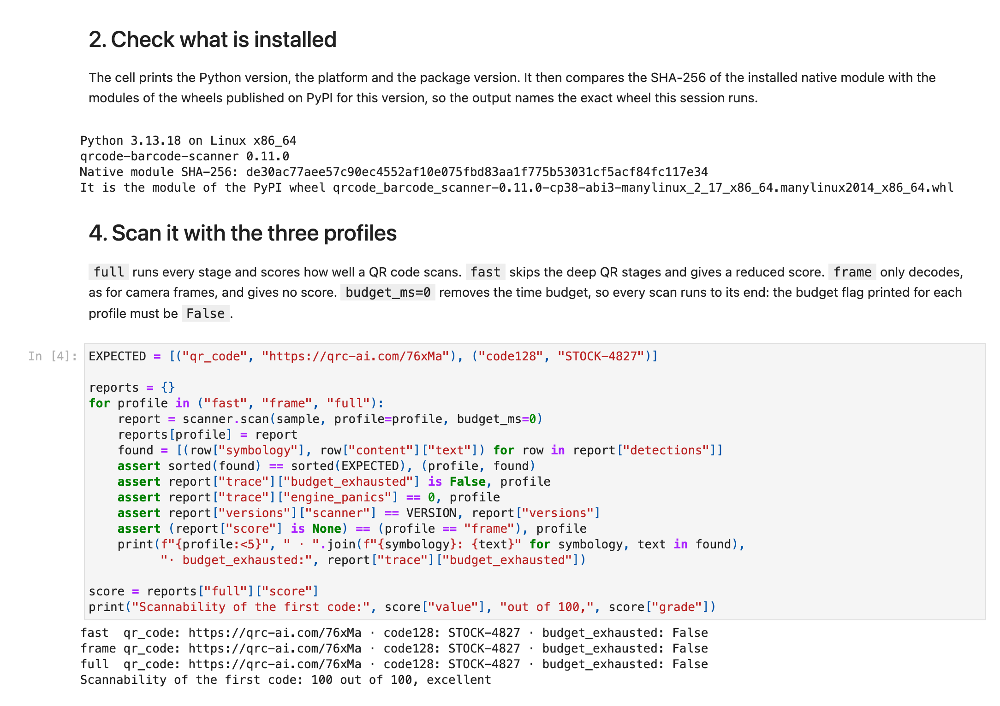

<p align="center">
  <a href="https://github.com/qrcode-ai-com/qrcode-barcode-scanner-rust">
    <picture>
      <source media="(prefers-color-scheme: dark)" srcset="https://raw.githubusercontent.com/qrcode-ai-com/.github/main/profile/assets/banner-kaggle-dark.gif?v=faa11cc60a1e">
      
    </picture>
  </a>
</p>

# Scan QR codes and barcodes in a Kaggle notebook

<!-- qrcode-ai-readme-actions:v2 -->

### Ask AI

[](https://chatgpt.com/?q=Help%20me%20understand%20Scan%20QR%20codes%20and%20barcodes%20in%20a%20Kaggle%20notebook%20%28examples%2Fkaggle%2FREADME.md%29%20for%20QR%20Code%20%26%20Barcode%20Scanner%2C%20the%20open-source%20scanner.%20Source%20documentation%3B%20publication%20is%20not%20implied.%20Provided%20README%20context%20%28verify%20against%20the%20sources%29%3A%20A%20Kaggle%20notebook%20that%20reads%20a%20QR%20code%20and%20a%20Code%20128%20barcode%20with%20the%20open-source%20Python%20package%20qrcode-barcode-scanner.%20It%20installs%20the%20published%20package%20from%20PyPI%2C%20checks%20that%20the%20installed%20native%20module%20is%20a%20published%20wheel%2C%20scans%20one%20sample%20image%20with%20the%20fast%2C%20frame%20and%20full%20profiles%2C%20saves%20the%20three%20reports%20as%20notebook%20outputs%2C%20and%20ends%20by%20uninstalling%20the%20package%20and%20proving%20it%20is%20gone.%20On%20Kaggle%2C%20the%20image%20is%20decoded%20in%20the%20Kaggle%20session%2C%20not%20on%20the%20reader%27s%20computer.%20Read%20the%20public%20documentation%20below.%20Explain%20what%20this%20destination%20does%2C%20its%20documented%20installation%20or%20access%20steps%2C%20a%20minimal%20example%20if%20supported%2C%20prerequisites%2C%20limitations%20and%20license.%20Distinguish%20published%20packages%20from%20working%20source%20and%20preparation.%20Cite%20your%20sources%3B%20if%20a%20page%20is%20unavailable%20or%20a%20fact%20cannot%20be%20checked%2C%20say%20so.%20Do%20not%20invent%20installation%20commands%2C%20benchmark%20results%20or%20comparisons.%20Answer%20in%20my%20language.%20Public%20sources%3A%20https%3A%2F%2Fgithub.com%2Fqrcode-ai-com%2Fqrcode-barcode-scanner-rust%2Fblob%2Fmain%2Fexamples%2Fkaggle%2FREADME.md%20https%3A%2F%2Fqrcode-ai.com%2Fen-US%2Fqr-code-scanner%20https%3A%2F%2Fqrcode-ai.com%2Fen-US%2Fbarcode-scanner%20https%3A%2F%2Fqrcode-ai.com%2Fen-US%2Fqr-code-scanner%2Fsdk%2Fpython%20https%3A%2F%2Fqrcode-ai.com%2Fen-US%2Fbarcode-scanner%2Fsdk%2Fpython%20https%3A%2F%2Fqrcode-ai.com%2Fen-US%2Fqr-code-generator%20https%3A%2F%2Fqrcode-ai.com%2Fen-US%2Fbarcode-generator)
[](https://claude.ai/new?q=Help%20me%20understand%20Scan%20QR%20codes%20and%20barcodes%20in%20a%20Kaggle%20notebook%20%28examples%2Fkaggle%2FREADME.md%29%20for%20QR%20Code%20%26%20Barcode%20Scanner%2C%20the%20open-source%20scanner.%20Source%20documentation%3B%20publication%20is%20not%20implied.%20Provided%20README%20context%20%28verify%20against%20the%20sources%29%3A%20A%20Kaggle%20notebook%20that%20reads%20a%20QR%20code%20and%20a%20Code%20128%20barcode%20with%20the%20open-source%20Python%20package%20qrcode-barcode-scanner.%20It%20installs%20the%20published%20package%20from%20PyPI%2C%20checks%20that%20the%20installed%20native%20module%20is%20a%20published%20wheel%2C%20scans%20one%20sample%20image%20with%20the%20fast%2C%20frame%20and%20full%20profiles%2C%20saves%20the%20three%20reports%20as%20notebook%20outputs%2C%20and%20ends%20by%20uninstalling%20the%20package%20and%20proving%20it%20is%20gone.%20On%20Kaggle%2C%20the%20image%20is%20decoded%20in%20the%20Kaggle%20session%2C%20not%20on%20the%20reader%27s%20computer.%20Read%20the%20public%20documentation%20below.%20Explain%20what%20this%20destination%20does%2C%20its%20documented%20installation%20or%20access%20steps%2C%20a%20minimal%20example%20if%20supported%2C%20prerequisites%2C%20limitations%20and%20license.%20Distinguish%20published%20packages%20from%20working%20source%20and%20preparation.%20Cite%20your%20sources%3B%20if%20a%20page%20is%20unavailable%20or%20a%20fact%20cannot%20be%20checked%2C%20say%20so.%20Do%20not%20invent%20installation%20commands%2C%20benchmark%20results%20or%20comparisons.%20Answer%20in%20my%20language.%20Public%20sources%3A%20https%3A%2F%2Fgithub.com%2Fqrcode-ai-com%2Fqrcode-barcode-scanner-rust%2Fblob%2Fmain%2Fexamples%2Fkaggle%2FREADME.md%20https%3A%2F%2Fqrcode-ai.com%2Fen-US%2Fqr-code-scanner%20https%3A%2F%2Fqrcode-ai.com%2Fen-US%2Fbarcode-scanner%20https%3A%2F%2Fqrcode-ai.com%2Fen-US%2Fqr-code-scanner%2Fsdk%2Fpython%20https%3A%2F%2Fqrcode-ai.com%2Fen-US%2Fbarcode-scanner%2Fsdk%2Fpython%20https%3A%2F%2Fqrcode-ai.com%2Fen-US%2Fqr-code-generator%20https%3A%2F%2Fqrcode-ai.com%2Fen-US%2Fbarcode-generator)
[](https://gemini.google.com/)
[](https://grok.com/?q=Help%20me%20understand%20Scan%20QR%20codes%20and%20barcodes%20in%20a%20Kaggle%20notebook%20%28examples%2Fkaggle%2FREADME.md%29%20for%20QR%20Code%20%26%20Barcode%20Scanner%2C%20the%20open-source%20scanner.%20Source%20documentation%3B%20publication%20is%20not%20implied.%20Provided%20README%20context%20%28verify%20against%20the%20sources%29%3A%20A%20Kaggle%20notebook%20that%20reads%20a%20QR%20code%20and%20a%20Code%20128%20barcode%20with%20the%20open-source%20Python%20package%20qrcode-barcode-scanner.%20It%20installs%20the%20published%20package%20from%20PyPI%2C%20checks%20that%20the%20installed%20native%20module%20is%20a%20published%20wheel%2C%20scans%20one%20sample%20image%20with%20the%20fast%2C%20frame%20and%20full%20profiles%2C%20saves%20the%20three%20reports%20as%20notebook%20outputs%2C%20and%20ends%20by%20uninstalling%20the%20package%20and%20proving%20it%20is%20gone.%20On%20Kaggle%2C%20the%20image%20is%20decoded%20in%20the%20Kaggle%20session%2C%20not%20on%20the%20reader%27s%20computer.%20Read%20the%20public%20documentation%20below.%20Explain%20what%20this%20destination%20does%2C%20its%20documented%20installation%20or%20access%20steps%2C%20a%20minimal%20example%20if%20supported%2C%20prerequisites%2C%20limitations%20and%20license.%20Distinguish%20published%20packages%20from%20working%20source%20and%20preparation.%20Cite%20your%20sources%3B%20if%20a%20page%20is%20unavailable%20or%20a%20fact%20cannot%20be%20checked%2C%20say%20so.%20Do%20not%20invent%20installation%20commands%2C%20benchmark%20results%20or%20comparisons.%20Answer%20in%20my%20language.%20Public%20sources%3A%20https%3A%2F%2Fgithub.com%2Fqrcode-ai-com%2Fqrcode-barcode-scanner-rust%2Fblob%2Fmain%2Fexamples%2Fkaggle%2FREADME.md%20https%3A%2F%2Fqrcode-ai.com%2Fen-US%2Fqr-code-scanner%20https%3A%2F%2Fqrcode-ai.com%2Fen-US%2Fbarcode-scanner%20https%3A%2F%2Fqrcode-ai.com%2Fen-US%2Fqr-code-scanner%2Fsdk%2Fpython%20https%3A%2F%2Fqrcode-ai.com%2Fen-US%2Fbarcode-scanner%2Fsdk%2Fpython%20https%3A%2F%2Fqrcode-ai.com%2Fen-US%2Fqr-code-generator%20https%3A%2F%2Fqrcode-ai.com%2Fen-US%2Fbarcode-generator)
[](https://www.perplexity.ai/?q=Help%20me%20understand%20Scan%20QR%20codes%20and%20barcodes%20in%20a%20Kaggle%20notebook%20%28examples%2Fkaggle%2FREADME.md%29%20for%20QR%20Code%20%26%20Barcode%20Scanner%2C%20the%20open-source%20scanner.%20Source%20documentation%3B%20publication%20is%20not%20implied.%20Provided%20README%20context%20%28verify%20against%20the%20sources%29%3A%20A%20Kaggle%20notebook%20that%20reads%20a%20QR%20code%20and%20a%20Code%20128%20barcode%20with%20the%20open-source%20Python%20package%20qrcode-barcode-scanner.%20It%20installs%20the%20published%20package%20from%20PyPI%2C%20checks%20that%20the%20installed%20native%20module%20is%20a%20published%20wheel%2C%20scans%20one%20sample%20image%20with%20the%20fast%2C%20frame%20and%20full%20profiles%2C%20saves%20the%20three%20reports%20as%20notebook%20outputs%2C%20and%20ends%20by%20uninstalling%20the%20package%20and%20proving%20it%20is%20gone.%20On%20Kaggle%2C%20the%20image%20is%20decoded%20in%20the%20Kaggle%20session%2C%20not%20on%20the%20reader%27s%20computer.%20Read%20the%20public%20documentation%20below.%20Explain%20what%20this%20destination%20does%2C%20its%20documented%20installation%20or%20access%20steps%2C%20a%20minimal%20example%20if%20supported%2C%20prerequisites%2C%20limitations%20and%20license.%20Distinguish%20published%20packages%20from%20working%20source%20and%20preparation.%20Cite%20your%20sources%3B%20if%20a%20page%20is%20unavailable%20or%20a%20fact%20cannot%20be%20checked%2C%20say%20so.%20Do%20not%20invent%20installation%20commands%2C%20benchmark%20results%20or%20comparisons.%20Answer%20in%20my%20language.%20Public%20sources%3A%20https%3A%2F%2Fgithub.com%2Fqrcode-ai-com%2Fqrcode-barcode-scanner-rust%2Fblob%2Fmain%2Fexamples%2Fkaggle%2FREADME.md%20https%3A%2F%2Fqrcode-ai.com%2Fen-US%2Fqr-code-scanner%20https%3A%2F%2Fqrcode-ai.com%2Fen-US%2Fbarcode-scanner%20https%3A%2F%2Fqrcode-ai.com%2Fen-US%2Fqr-code-scanner%2Fsdk%2Fpython%20https%3A%2F%2Fqrcode-ai.com%2Fen-US%2Fbarcode-scanner%2Fsdk%2Fpython%20https%3A%2F%2Fqrcode-ai.com%2Fen-US%2Fqr-code-generator%20https%3A%2F%2Fqrcode-ai.com%2Fen-US%2Fbarcode-generator)
[](https://copilot.com/)
[](https://chat.deepseek.com/)
[](https://www.meta.ai/)
[](https://qwen.ai/)

Choose an AI assistant to explain this destination using its public sources. Gemini opens gemini.google.com. Gemini, Copilot, DeepSeek, Meta AI and Qwen require pasting the prompt below; the other links include it in their URL. Sign-in or a manual paste may still be required. Check the answer against the documentation.

<details>
<summary>Copy the plain-text prompt</summary>

Use the code block's copy control, or select its complete text, then paste it into your assistant.

```text
Help me understand Scan QR codes and barcodes in a Kaggle notebook (examples/kaggle/README.md) for QR Code & Barcode Scanner, the open-source scanner. Source documentation; publication is not implied. Provided README context (verify against the sources): A Kaggle notebook that reads a QR code and a Code 128 barcode with the open-source Python package qrcode-barcode-scanner. It installs the published package from PyPI, checks that the installed native module is a published wheel, scans one sample image with the fast, frame and full profiles, saves the three reports as notebook outputs, and ends by uninstalling the package and proving it is gone. On Kaggle, the image is decoded in the Kaggle session, not on the reader's computer. Read the public documentation below. Explain what this destination does, its documented installation or access steps, a minimal example if supported, prerequisites, limitations and license. Distinguish published packages from working source and preparation. Cite your sources; if a page is unavailable or a fact cannot be checked, say so. Do not invent installation commands, benchmark results or comparisons. Answer in my language. Public sources: https://github.com/qrcode-ai-com/qrcode-barcode-scanner-rust/blob/main/examples/kaggle/README.md https://qrcode-ai.com/en-US/qr-code-scanner https://qrcode-ai.com/en-US/barcode-scanner https://qrcode-ai.com/en-US/qr-code-scanner/sdk/python https://qrcode-ai.com/en-US/barcode-scanner/sdk/python https://qrcode-ai.com/en-US/qr-code-generator https://qrcode-ai.com/en-US/barcode-generator
```

</details>

<!-- /qrcode-ai-readme-actions:v2 -->

A Kaggle notebook that reads a QR code and a Code 128 barcode with the open-source Python package `qrcode-barcode-scanner`. It installs the published package from PyPI, checks that the installed native module is a published wheel, scans one sample image with the fast, frame and full profiles, saves the three reports as notebook outputs, and ends by uninstalling the package and proving it is gone. On Kaggle, the image is decoded in the Kaggle session, not on the reader's computer.

The [QR code scanner](https://qrcode-ai.com/en-US/qr-code-scanner) and the [barcode scanner](https://qrcode-ai.com/en-US/barcode-scanner) are QR Code AI's scanning pages in the browser. The notebook uses the Python package, which has the [QR code scanner Python guide](https://qrcode-ai.com/en-US/qr-code-scanner/sdk/python) and the [barcode scanner Python guide](https://qrcode-ai.com/en-US/barcode-scanner/sdk/python). If a product page is unavailable, this README and the notebook remain the starting point.

To make a test image with a known value, use the [QR code generator](https://qrcode-ai.com/en-US/qr-code-generator) or the [barcode generator](https://qrcode-ai.com/en-US/barcode-generator). Add the exported image to a copy of the notebook and compare the decoded text with the value you encoded.

[`qrcode-barcode-scanner-demo.ipynb`](qrcode-barcode-scanner-demo.ipynb) is the notebook and
[`kernel-metadata.json`](kernel-metadata.json) the settings `kaggle kernels push` reads. The
notebook installs [`qrcode-barcode-scanner`](https://pypi.org/project/qrcode-barcode-scanner/0.11.0/)
0.11.0, the scanner engine written in Rust, which runs inside the notebook's session.

## Status

The notebook is written and run in the engine repository. It is not on Kaggle yet: the account,
the terms and the first push are the owner's, and [`LISTING.md`](LISTING.md) lists every value
and step. Once it is public, this page will link it.

## What a run shows

<p align="center">
  
</p>

The picture is the notebook as `demos.yml` ran it, rendered to a page. Each cell asserts its own
result, so a cell that finishes without an error did what it says.

| Step | Result |
| --- | --- |
| Install | `%pip install qrcode-barcode-scanner==0.11.0`. The package has no dependency. |
| Check what is installed | The Python version, the platform, the package version and the SHA-256 of the installed native module, which must be the module of a wheel published on PyPI. The output names that wheel. |
| Get the sample | One image with a QR code and a Code 128 barcode, downloaded from the release tag `v0.11.0` and checked against its SHA-256. |
| Scan | The `fast`, `frame` and `full` profiles each return the QR code `https://qrc-ai.com/76xMa` and the Code 128 `STOCK-4827`, each once, with `budget_ms=0` and the budget flag printed as `False`. |
| Read a report | The symbology, text, payload kind and measured position of each code. |
| Save the reports | `scan-reports/fast.json`, `frame.json` and `full.json` in the working folder: on Kaggle, `/kaggle/working`, shown under the notebook's **Output**. |
| Other outcomes | A white image gives an empty list. Bytes that are not an image raise `ValueError` with `QRS-001`. |
| Remove it | A new interpreter of the session imports the package, then `pip uninstall` removes it, and the same new interpreter fails with `ModuleNotFoundError` and `PackageNotFoundError`. |

## Run it on your machine

You need Python 3 with its `venv` module. From the root of the repository:

```sh
python3 -m venv .venv
.venv/bin/python -m pip install jupyterlab
.venv/bin/jupyter lab examples/kaggle/qrcode-barcode-scanner-demo.ipynb
```

Choose **Run All**. The first cell installs the package into that environment and the last one
removes it. On Windows the commands are under `.venv\Scripts\`.

## The Kaggle settings

`kernel-metadata.json` holds what Kaggle needs to create the notebook: the title
`QR Code & Barcode Scanner demo`, which gives the slug `qr-code-barcode-scanner-demo`, the
notebook file, Python, public visibility, no accelerator, Internet on for the install and the
sample, the original environment pinned, and four tags. Its `id` names `KAGGLE_USERNAME`, which
the owner replaces with the Kaggle account's username in the copy that is pushed. `kaggle kernels
push` sends only the notebook and the metadata; this README and `LISTING.md` stay here.

The notebook links the source repository and the PyPI page only. Kaggle's terms limit its
services to personal, non-commercial use, so the QR Code AI product links stay out of the
notebook until the owner decides otherwise; `LISTING.md` gives the options.

## Update it for a release

Four places hold the version, as in [`examples/notebooks/`](../notebooks/): the install cell, the
`VERSION` and module table of the second cell, and the sample's tag. Commit the notebook without
outputs. The owner then pushes it again from a shell that holds the Kaggle token.

## Checked on every change

The workflow [`demos.yml`](../../.github/workflows/demos.yml) checks the committed folder with
[`tools/check_folder.py`](tools/check_folder.py): the metadata fields and values, the slug
against the title, a notebook without stored output, the install pin equal to
`binder/requirements.txt`, the sample read from the matching release tag and the links of the
first cell. It then runs the notebook from top to bottom on Python 3.13, the Python of Kaggle's
image, in a new virtual environment with
[`scripts/python-host-consumer.py`](../../scripts/python-host-consumer.py), which gives
[`tools/run_notebook.py`](tools/run_notebook.py) as the scan command. The `tools/` folder is not
pushed to Kaggle. The notebook installs the package itself, as on Kaggle; the three reports it
saves are judged by the
[destination acceptance](../../distribution/acceptance/README.md) contract, and after its last
cell the package must no longer import in that environment. A run on Kaggle itself has not been
made.

## How it works

<p align="center">
  <picture>
    <source media="(prefers-color-scheme: dark)" srcset="https://raw.githubusercontent.com/qrcode-ai-com/.github/main/profile/assets/how-python-dark.gif?v=60b4945fed7e">
    
  </picture>
</p>

The notebook passes the image's bytes to the engine, which runs in the notebook's Python process, in the Kaggle session, and prints what each report holds.

## What it returns

<p align="center">
  <a href="https://github.com/qrcode-ai-com/qrcode-barcode-scanner-rust#examples">
    <picture>
      <source media="(prefers-color-scheme: dark)" srcset="https://raw.githubusercontent.com/qrcode-ai-com/qrcode-barcode-scanner-rust/main/docs/assets/brand/examples-mixed-dark.png?v=385593c1c18d">
      
    </picture>
  </a>
</p>

The picture is a recorded scan of the sample image, which holds a QR code and a Code 128 barcode.
Both come back in one report, each with its format, its exact text and the place where the engine
measured it: `https://qrc-ai.com/76xMa` and `STOCK-4827`.

The notebook prints each code with its format, text, payload kind and measured position, and saves the engine's full report of each profile as JSON under `scan-reports/`.

The report itself is described field by field in the
[report reference](https://github.com/qrcode-ai-com/qrcode-barcode-scanner-rust/blob/v0.11.0/docs/api/report.mdx).
An empty list of detections means the image holds no code the engine could read. A refused file
is an error with a `QRS-` code instead, listed in the
[error codes](https://github.com/qrcode-ai-com/qrcode-barcode-scanner-rust/blob/v0.11.0/docs/api/errors.mdx).

## What it reads

<p align="center">
  <a href="https://github.com/qrcode-ai-com/qrcode-barcode-scanner-rust#supported-formats">
    <picture>
      <source media="(prefers-color-scheme: dark)" srcset="https://raw.githubusercontent.com/qrcode-ai-com/qrcode-barcode-scanner-rust/main/docs/assets/brand/formats-dark.gif?v=92fa0e8084df">
      
    </picture>
  </a>
</p>

| Family | Formats |
|---|---|
| QR | QR Code, Micro QR, rectangular Micro QR (rMQR) |
| Matrix and stacked | Data Matrix, Aztec, PDF417, MaxiCode |
| Retail | EAN-13, EAN-8, UPC-A, UPC-E |
| Other linear | Code 128, Code 39, Code 93, Codabar, ITF, GS1 DataBar, GS1 DataBar Expanded, Telepen |

The notebook reads what the engine reads, from PNG, JPEG, WebP and GIF files. Codes of different formats in one image come back in one report. The engine's
[supported formats](https://github.com/qrcode-ai-com/qrcode-barcode-scanner-rust#supported-formats)
section states the known limits.

## The same engine in other runtimes

<p align="center">
  <a href="https://github.com/qrcode-ai-com/qrcode-barcode-scanner-rust#get-started">
    <picture>
      <source media="(prefers-color-scheme: dark)" srcset="https://raw.githubusercontent.com/qrcode-ai-com/qrcode-barcode-scanner-rust/main/docs/assets/brand/runtimes-dark.png?v=57c63428574b">
      
    </picture>
  </a>
</p>

| Runtime | Package | How it scans |
|---|---|---|
| <picture><source media="(prefers-color-scheme: dark)" srcset="https://raw.githubusercontent.com/qrcode-ai-com/qrcode-barcode-scanner-rust/main/docs/assets/brand/mark-lang-rust-dark.png?v=31b5deebc32e"></picture> Rust | [`qrcode-barcode-scanner`](https://crates.io/crates/qrcode-barcode-scanner) on crates.io | In process |
| <picture><source media="(prefers-color-scheme: dark)" srcset="https://raw.githubusercontent.com/qrcode-ai-com/qrcode-barcode-scanner-rust/main/docs/assets/brand/mark-lang-nodejs-dark.png?v=cf2159524fc6"></picture> Node.js | [`@qrcode-ai-com/qrcode-barcode-scanner`](https://www.npmjs.com/package/@qrcode-ai-com/qrcode-barcode-scanner) on npm | In process, native |
| <picture><source media="(prefers-color-scheme: dark)" srcset="https://raw.githubusercontent.com/qrcode-ai-com/qrcode-barcode-scanner-rust/main/docs/assets/brand/mark-lang-browser-dark.png?v=bbe2f3560a6d"></picture> Browser | [`@qrcode-ai-com/qrcode-barcode-scanner-wasm`](https://www.npmjs.com/package/@qrcode-ai-com/qrcode-barcode-scanner-wasm) on npm | In the page, WebAssembly |
| <picture><source media="(prefers-color-scheme: dark)" srcset="https://raw.githubusercontent.com/qrcode-ai-com/qrcode-barcode-scanner-rust/main/docs/assets/brand/mark-lang-python-dark.png?v=7469c3e0b4fb"></picture> Python | [`qrcode-barcode-scanner`](https://pypi.org/project/qrcode-barcode-scanner/) on PyPI | In process |
| <picture><source media="(prefers-color-scheme: dark)" srcset="https://raw.githubusercontent.com/qrcode-ai-com/qrcode-barcode-scanner-rust/main/docs/assets/brand/mark-lang-go-dark.png?v=b6dbac901176"></picture> Go | [`qrcode-barcode-scanner-go`](https://github.com/qrcode-ai-com/qrcode-barcode-scanner-go) | Through the installed `qrscan` |
| <picture><source media="(prefers-color-scheme: dark)" srcset="https://raw.githubusercontent.com/qrcode-ai-com/qrcode-barcode-scanner-rust/main/docs/assets/brand/mark-lang-php-dark.png?v=3800932934c8"></picture> PHP | [`qrcode-barcode-scanner-php`](https://github.com/qrcode-ai-com/qrcode-barcode-scanner-php) | Through the installed `qrscan` |
| <picture><source media="(prefers-color-scheme: dark)" srcset="https://raw.githubusercontent.com/qrcode-ai-com/qrcode-barcode-scanner-rust/main/docs/assets/brand/mark-terminal-dark.png?v=1e987f0ab278"></picture> Command line | [`qrscan`](https://github.com/qrcode-ai-com/qrcode-barcode-scanner-rust#command-line) | One command, one JSON report |

The Rust, Node.js, browser and Python packages hold the engine. The Go and PHP packages hold no decoder:
each one starts `qrscan` and hands you its report.

<sub>Language and platform names and logos belong to their owners. They identify a runtime or a destination and imply no endorsement.</sub>

## License

MIT for the notebook's project-authored cells, like the rest of this example source. Kaggle shows a
public notebook under Apache 2.0. The notebook installs the engine wheel `qrcode-barcode-scanner`
0.11.0 from PyPI and pastes none of its source; the published engine 0.11.0 keeps the license it
shipped with, AGPL-3.0-or-later. Read the license packaged with the version you install and the
[licensing guide](../../LICENSING.md).

Maintained by **Thibaut Mélen & Nicolas Cella** for **QR Code AI**, a product of **SuperNovae Studio**. The license of each component is stated in its own license files.

<!-- qrscan-source-license:v1 -->

## Source license

Project-authored scanner code and documentation in this checkout are available under the [MIT License](https://github.com/qrcode-ai-com/qrcode-barcode-scanner-rust/blob/main/LICENSE). You may use, modify and redistribute this source in open-source or proprietary applications, including commercial products, while preserving the copyright and permission notice. Thibaut Mélen & Nicolas Cella develop QR Code AI at SuperNovae Studio.

Retained third-party code, dependencies, artwork and test data keep their own licenses and notices. The [licensing guide](https://github.com/qrcode-ai-com/qrcode-barcode-scanner-rust/blob/main/LICENSING.md) explains these component boundaries; the project license does not assign a license to an unrelated platform or service.

Published archives retain the license shipped with their version. A pinned engine, adapter or bundle may therefore have different terms from this working source. Read its packaged license and the [license history](https://github.com/qrcode-ai-com/qrcode-barcode-scanner-rust/blob/main/docs/guides/license-history.mdx) before reuse. The source change does not replace an archive or publish a new version.

<!-- /qrscan-source-license:v1 -->
