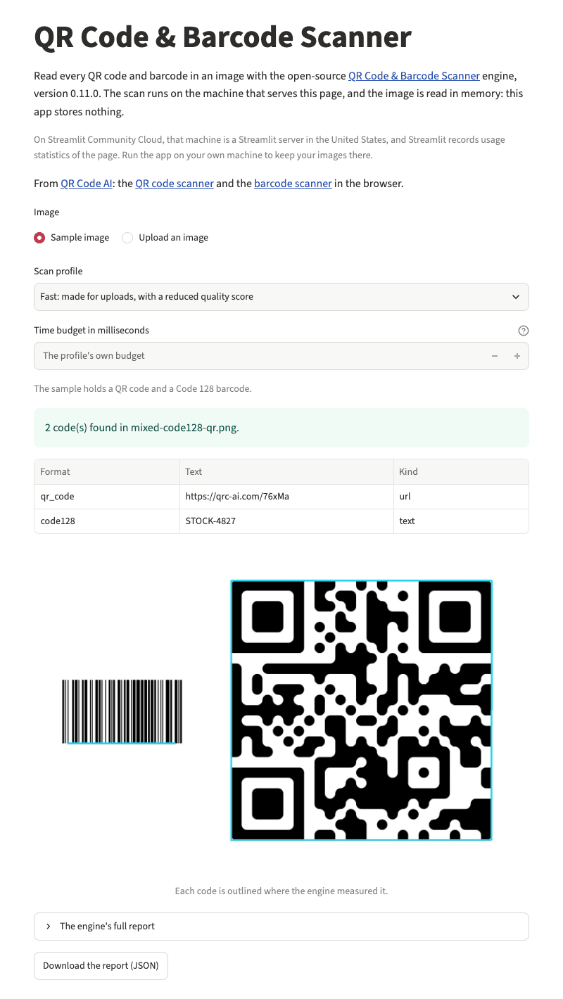

<p align="center">
  <a href="https://github.com/qrcode-ai-com/qrcode-barcode-scanner-rust">
    <picture>
      <source media="(prefers-color-scheme: dark)" srcset="https://raw.githubusercontent.com/qrcode-ai-com/.github/main/profile/assets/banner-streamlit-dark.gif?v=37c9eb844366">
      
    </picture>
  </a>
</p>

# Scan images in a Streamlit app

<!-- qrcode-ai-readme-actions:v2 -->

### Ask AI

[](https://chatgpt.com/?q=Help%20me%20understand%20Scan%20images%20in%20a%20Streamlit%20app%20%28examples%2Fstreamlit%2FREADME.md%29%20for%20QR%20Code%20%26%20Barcode%20Scanner%2C%20the%20open-source%20scanner.%20Source%20documentation%3B%20publication%20is%20not%20implied.%20Provided%20README%20context%20%28verify%20against%20the%20sources%29%3A%20A%20small%20Streamlit%20app%20that%20reads%20every%20QR%20code%20and%20barcode%20in%20an%20image.%20Take%20the%20sample%20or%20upload%20a%20picture%2C%20and%20the%20app%20lists%20each%20code%20beside%20the%20image%2C%20outlines%20it%20where%20the%20engine%20measured%20it%2C%20and%20shows%20the%20full%20report.%20The%20image%20is%20read%20on%20the%20server%20that%20runs%20the%20app%2C%20in%20memory%2C%20and%20the%20app%20stores%20nothing.%20Read%20the%20public%20documentation%20below.%20Explain%20what%20this%20destination%20does%2C%20its%20documented%20installation%20or%20access%20steps%2C%20a%20minimal%20example%20if%20supported%2C%20prerequisites%2C%20limitations%20and%20license.%20Distinguish%20published%20packages%20from%20working%20source%20and%20preparation.%20Cite%20your%20sources%3B%20if%20a%20page%20is%20unavailable%20or%20a%20fact%20cannot%20be%20checked%2C%20say%20so.%20Do%20not%20invent%20installation%20commands%2C%20benchmark%20results%20or%20comparisons.%20Answer%20in%20my%20language.%20Public%20sources%3A%20https%3A%2F%2Fgithub.com%2Fqrcode-ai-com%2Fqrcode-barcode-scanner-rust%2Fblob%2Fmain%2Fexamples%2Fstreamlit%2FREADME.md%20https%3A%2F%2Fqrcode-ai.com%2Fen-US%2Fqr-code-scanner%20https%3A%2F%2Fqrcode-ai.com%2Fen-US%2Fbarcode-scanner%20https%3A%2F%2Fqrcode-ai.com%2Fen-US%2Fqr-code-scanner%2Fsdk%2Fpython%20https%3A%2F%2Fqrcode-ai.com%2Fen-US%2Fbarcode-scanner%2Fsdk%2Fpython%20https%3A%2F%2Fqrcode-ai.com%2Fen-US%2Fqr-code-generator%20https%3A%2F%2Fqrcode-ai.com%2Fen-US%2Fbarcode-generator)
[](https://claude.ai/new?q=Help%20me%20understand%20Scan%20images%20in%20a%20Streamlit%20app%20%28examples%2Fstreamlit%2FREADME.md%29%20for%20QR%20Code%20%26%20Barcode%20Scanner%2C%20the%20open-source%20scanner.%20Source%20documentation%3B%20publication%20is%20not%20implied.%20Provided%20README%20context%20%28verify%20against%20the%20sources%29%3A%20A%20small%20Streamlit%20app%20that%20reads%20every%20QR%20code%20and%20barcode%20in%20an%20image.%20Take%20the%20sample%20or%20upload%20a%20picture%2C%20and%20the%20app%20lists%20each%20code%20beside%20the%20image%2C%20outlines%20it%20where%20the%20engine%20measured%20it%2C%20and%20shows%20the%20full%20report.%20The%20image%20is%20read%20on%20the%20server%20that%20runs%20the%20app%2C%20in%20memory%2C%20and%20the%20app%20stores%20nothing.%20Read%20the%20public%20documentation%20below.%20Explain%20what%20this%20destination%20does%2C%20its%20documented%20installation%20or%20access%20steps%2C%20a%20minimal%20example%20if%20supported%2C%20prerequisites%2C%20limitations%20and%20license.%20Distinguish%20published%20packages%20from%20working%20source%20and%20preparation.%20Cite%20your%20sources%3B%20if%20a%20page%20is%20unavailable%20or%20a%20fact%20cannot%20be%20checked%2C%20say%20so.%20Do%20not%20invent%20installation%20commands%2C%20benchmark%20results%20or%20comparisons.%20Answer%20in%20my%20language.%20Public%20sources%3A%20https%3A%2F%2Fgithub.com%2Fqrcode-ai-com%2Fqrcode-barcode-scanner-rust%2Fblob%2Fmain%2Fexamples%2Fstreamlit%2FREADME.md%20https%3A%2F%2Fqrcode-ai.com%2Fen-US%2Fqr-code-scanner%20https%3A%2F%2Fqrcode-ai.com%2Fen-US%2Fbarcode-scanner%20https%3A%2F%2Fqrcode-ai.com%2Fen-US%2Fqr-code-scanner%2Fsdk%2Fpython%20https%3A%2F%2Fqrcode-ai.com%2Fen-US%2Fbarcode-scanner%2Fsdk%2Fpython%20https%3A%2F%2Fqrcode-ai.com%2Fen-US%2Fqr-code-generator%20https%3A%2F%2Fqrcode-ai.com%2Fen-US%2Fbarcode-generator)
[](https://gemini.google.com/)
[](https://grok.com/?q=Help%20me%20understand%20Scan%20images%20in%20a%20Streamlit%20app%20%28examples%2Fstreamlit%2FREADME.md%29%20for%20QR%20Code%20%26%20Barcode%20Scanner%2C%20the%20open-source%20scanner.%20Source%20documentation%3B%20publication%20is%20not%20implied.%20Provided%20README%20context%20%28verify%20against%20the%20sources%29%3A%20A%20small%20Streamlit%20app%20that%20reads%20every%20QR%20code%20and%20barcode%20in%20an%20image.%20Take%20the%20sample%20or%20upload%20a%20picture%2C%20and%20the%20app%20lists%20each%20code%20beside%20the%20image%2C%20outlines%20it%20where%20the%20engine%20measured%20it%2C%20and%20shows%20the%20full%20report.%20The%20image%20is%20read%20on%20the%20server%20that%20runs%20the%20app%2C%20in%20memory%2C%20and%20the%20app%20stores%20nothing.%20Read%20the%20public%20documentation%20below.%20Explain%20what%20this%20destination%20does%2C%20its%20documented%20installation%20or%20access%20steps%2C%20a%20minimal%20example%20if%20supported%2C%20prerequisites%2C%20limitations%20and%20license.%20Distinguish%20published%20packages%20from%20working%20source%20and%20preparation.%20Cite%20your%20sources%3B%20if%20a%20page%20is%20unavailable%20or%20a%20fact%20cannot%20be%20checked%2C%20say%20so.%20Do%20not%20invent%20installation%20commands%2C%20benchmark%20results%20or%20comparisons.%20Answer%20in%20my%20language.%20Public%20sources%3A%20https%3A%2F%2Fgithub.com%2Fqrcode-ai-com%2Fqrcode-barcode-scanner-rust%2Fblob%2Fmain%2Fexamples%2Fstreamlit%2FREADME.md%20https%3A%2F%2Fqrcode-ai.com%2Fen-US%2Fqr-code-scanner%20https%3A%2F%2Fqrcode-ai.com%2Fen-US%2Fbarcode-scanner%20https%3A%2F%2Fqrcode-ai.com%2Fen-US%2Fqr-code-scanner%2Fsdk%2Fpython%20https%3A%2F%2Fqrcode-ai.com%2Fen-US%2Fbarcode-scanner%2Fsdk%2Fpython%20https%3A%2F%2Fqrcode-ai.com%2Fen-US%2Fqr-code-generator%20https%3A%2F%2Fqrcode-ai.com%2Fen-US%2Fbarcode-generator)
[](https://www.perplexity.ai/?q=Help%20me%20understand%20Scan%20images%20in%20a%20Streamlit%20app%20%28examples%2Fstreamlit%2FREADME.md%29%20for%20QR%20Code%20%26%20Barcode%20Scanner%2C%20the%20open-source%20scanner.%20Source%20documentation%3B%20publication%20is%20not%20implied.%20Provided%20README%20context%20%28verify%20against%20the%20sources%29%3A%20A%20small%20Streamlit%20app%20that%20reads%20every%20QR%20code%20and%20barcode%20in%20an%20image.%20Take%20the%20sample%20or%20upload%20a%20picture%2C%20and%20the%20app%20lists%20each%20code%20beside%20the%20image%2C%20outlines%20it%20where%20the%20engine%20measured%20it%2C%20and%20shows%20the%20full%20report.%20The%20image%20is%20read%20on%20the%20server%20that%20runs%20the%20app%2C%20in%20memory%2C%20and%20the%20app%20stores%20nothing.%20Read%20the%20public%20documentation%20below.%20Explain%20what%20this%20destination%20does%2C%20its%20documented%20installation%20or%20access%20steps%2C%20a%20minimal%20example%20if%20supported%2C%20prerequisites%2C%20limitations%20and%20license.%20Distinguish%20published%20packages%20from%20working%20source%20and%20preparation.%20Cite%20your%20sources%3B%20if%20a%20page%20is%20unavailable%20or%20a%20fact%20cannot%20be%20checked%2C%20say%20so.%20Do%20not%20invent%20installation%20commands%2C%20benchmark%20results%20or%20comparisons.%20Answer%20in%20my%20language.%20Public%20sources%3A%20https%3A%2F%2Fgithub.com%2Fqrcode-ai-com%2Fqrcode-barcode-scanner-rust%2Fblob%2Fmain%2Fexamples%2Fstreamlit%2FREADME.md%20https%3A%2F%2Fqrcode-ai.com%2Fen-US%2Fqr-code-scanner%20https%3A%2F%2Fqrcode-ai.com%2Fen-US%2Fbarcode-scanner%20https%3A%2F%2Fqrcode-ai.com%2Fen-US%2Fqr-code-scanner%2Fsdk%2Fpython%20https%3A%2F%2Fqrcode-ai.com%2Fen-US%2Fbarcode-scanner%2Fsdk%2Fpython%20https%3A%2F%2Fqrcode-ai.com%2Fen-US%2Fqr-code-generator%20https%3A%2F%2Fqrcode-ai.com%2Fen-US%2Fbarcode-generator)
[](https://copilot.com/)
[](https://chat.deepseek.com/)
[](https://www.meta.ai/)
[](https://qwen.ai/)

Choose an AI assistant to explain this destination using its public sources. Gemini opens gemini.google.com. Gemini, Copilot, DeepSeek, Meta AI and Qwen require pasting the prompt below; the other links include it in their URL. Sign-in or a manual paste may still be required. Check the answer against the documentation.

<details>
<summary>Copy the plain-text prompt</summary>

Use the code block's copy control, or select its complete text, then paste it into your assistant.

```text
Help me understand Scan images in a Streamlit app (examples/streamlit/README.md) for QR Code & Barcode Scanner, the open-source scanner. Source documentation; publication is not implied. Provided README context (verify against the sources): A small Streamlit app that reads every QR code and barcode in an image. Take the sample or upload a picture, and the app lists each code beside the image, outlines it where the engine measured it, and shows the full report. The image is read on the server that runs the app, in memory, and the app stores nothing. Read the public documentation below. Explain what this destination does, its documented installation or access steps, a minimal example if supported, prerequisites, limitations and license. Distinguish published packages from working source and preparation. Cite your sources; if a page is unavailable or a fact cannot be checked, say so. Do not invent installation commands, benchmark results or comparisons. Answer in my language. Public sources: https://github.com/qrcode-ai-com/qrcode-barcode-scanner-rust/blob/main/examples/streamlit/README.md https://qrcode-ai.com/en-US/qr-code-scanner https://qrcode-ai.com/en-US/barcode-scanner https://qrcode-ai.com/en-US/qr-code-scanner/sdk/python https://qrcode-ai.com/en-US/barcode-scanner/sdk/python https://qrcode-ai.com/en-US/qr-code-generator https://qrcode-ai.com/en-US/barcode-generator
```

</details>

<!-- /qrcode-ai-readme-actions:v2 -->

A small Streamlit app that reads every QR code and barcode in an image. Take the sample or upload a picture, and the app lists each code beside the image, outlines it where the engine measured it, and shows the full report. The image is read on the server that runs the app, in memory, and the app stores nothing.

The [QR code scanner](https://qrcode-ai.com/en-US/qr-code-scanner) and the [barcode scanner](https://qrcode-ai.com/en-US/barcode-scanner) are [QR Code AI](https://qrcode-ai.com/)'s scanning pages in the browser; the app links all three under its introduction. The app uses the Python package, which has the [QR code scanner Python guide](https://qrcode-ai.com/en-US/qr-code-scanner/sdk/python) and the [barcode scanner Python guide](https://qrcode-ai.com/en-US/barcode-scanner/sdk/python). If a page is not online yet, this README is the reference.

To make a test image with a known value, use the [QR code generator](https://qrcode-ai.com/en-US/qr-code-generator) or the [barcode generator](https://qrcode-ai.com/en-US/barcode-generator). Upload the exported image and compare the text in the table with the value you encoded, leading zeroes included.

[`streamlit_app.py`](streamlit_app.py) is the page. [`scan_view.py`](scan_view.py) holds what it
shows: the scan with its limits, the table and the outlined image. They use the published Python
package [`qrcode-barcode-scanner`](https://pypi.org/project/qrcode-barcode-scanner/0.11.0/) 0.11.0
and Streamlit 1.67.0, pinned in [`requirements.txt`](requirements.txt).

<p align="center">
  
</p>

## Status

The app is built and tested in the engine repository, and it is ready to deploy on Streamlit
Community Cloud from this repository as it is. It is not deployed yet: the public address is
not live. The picture above is the app served on a local machine, after it scanned its sample.

## Run it on your machine

You need Python 3.11 or later, as Streamlit 1.67 does. From the root of the repository:

```sh
python3 -m venv .venv
.venv/bin/python -m pip install -r examples/streamlit/requirements.txt
.venv/bin/streamlit run examples/streamlit/streamlit_app.py
```

Streamlit opens the app in your browser. It starts on the sample image, which holds a QR code and
a Code 128 barcode. Choose **Upload an image** to scan your own.

## Deploy it on Streamlit Community Cloud

Community Cloud runs an app straight from a public GitHub repository, and this folder is laid out
the way it reads one:

| Community Cloud reads | Here |
| --- | --- |
| The main file | `examples/streamlit/streamlit_app.py`, started with `streamlit run` from the root of the repository, which is where the sample image is found |
| The dependencies | [`requirements.txt`](requirements.txt) beside the main file, which wins over any file at the root: Streamlit, Pillow and `qrcode-barcode-scanner==0.11.0`, each at an exact version |
| The configuration | [`.streamlit/config.toml`](.streamlit/config.toml) beside the main file: an 8 MB upload limit, the app's own limit |
| The Python version | No file: it is chosen in the deploy form. Pick 3.12, the version the tests run on |

The steps, for the repository's owner:

1. Sign in at [share.streamlit.io](https://share.streamlit.io/) with an emailed code, Google or
   GitHub, and fill in the account form. Streamlit's
   [terms of use](https://streamlit.io/terms-of-use) govern the hosted app, including what
   personal data it may process.
2. Connect GitHub from **Workspaces**. Read the scopes on GitHub's consent screen first, and do
   not add access to private repositories: this app needs none. Deploying from a repository needs
   admin rights on it, and an organization's repositories need that organization's grant.
3. Click **Create app**, then **Yup, I have an app**. Repository
   `qrcode-ai-com/qrcode-barcode-scanner-rust`, branch `main`, file path
   `examples/streamlit/streamlit_app.py`. App URL: `qrcode-barcode-scanner`, if that subdomain is
   free.
4. Open **Advanced settings**, choose Python 3.12, leave the secrets empty, then **Save** and
   **Deploy**. The Python version cannot change after deployment without deleting the app.
5. Open the address signed out, wait for the app to wake up, and check that the sample shows
   `https://qrc-ai.com/76xMa` and `STOCK-4827` in each profile with version 0.11.0.

[`LISTING.md`](LISTING.md) holds the field values, the owner decisions to settle first and the
checks to read back after the deploy. Once the app is live, add this badge under the title of
this README, with the app's real address:

```markdown
[](https://qrcode-barcode-scanner.streamlit.app)
```

## What it does with an image

- On Streamlit Community Cloud, the image is processed on Streamlit's servers, which are all in
  the United States, and Streamlit records usage statistics of the page whatever the app's
  configuration says. The page states both under its introduction. A copy you run on your own
  machine sends no usage statistics: the configuration beside the app turns them off.
- An uploaded image is sent to the server that runs the app. Streamlit holds it in memory for
  the session, the engine reads it there, and the app writes it nowhere. On a hosted app, the
  host's own terms and logs apply.
- Up to 8 MB per file, PNG, JPEG, WebP or GIF, 4,096 pixels per side and 16 million pixels. A
  larger image is refused with the engine's `QRS-` code.
- The time budget is the profile's own unless you set one: 800 ms for `fast`, 80 ms for `frame`,
  4,000 ms for `full`. `0` removes it. When the budget cuts a scan, the app says that the result
  is not final.
- The app never opens what a code points to. Decoded text is shown as text.

## Develop

The tests drive the app with Streamlit's own test runner, widget by widget:

```sh
.venv/bin/python -m pip install -r examples/streamlit/tests/requirements.txt
.venv/bin/python -m pytest examples/streamlit/tests
```

They check the first visit on the sample, an upload in the three profiles, the upload limits, an
image with no code, a file that is not an image, an oversized image, a cut budget and the
configuration beside the app. Each scan of the mixed image is held to the exact two codes by the
engine repository's [Python host kit](../../scripts/python_host_kit.py).

[`tests/served_smoke.py`](tests/served_smoke.py) also serves the app as Community Cloud does,
with `streamlit run` from the root of the repository. It waits for the health endpoint, checks the
page, runs the tests against the same checkout, and checks that the scans left no file in the
repository:

```sh
.venv/bin/python examples/streamlit/tests/served_smoke.py --port 8501
```

The workflow `integration-python-hosts` runs the tests, then the served smoke in a new virtual
environment through [`python-host-consumer.py`](../../scripts/python-host-consumer.py): it
installs the two requirement files, judges the three acceptance reports, uninstalls the engine
and checks that it no longer imports. A deployed copy has not been tried yet.

## How it works

<p align="center">
  <picture>
    <source media="(prefers-color-scheme: dark)" srcset="https://raw.githubusercontent.com/qrcode-ai-com/.github/main/profile/assets/how-python-dark.gif?v=60b4945fed7e">
    
  </picture>
</p>

The app passes the image's bytes to the engine, which runs in the app's Python process on the server, and draws the outlines from the report.

## What it returns

<p align="center">
  <a href="https://github.com/qrcode-ai-com/qrcode-barcode-scanner-rust#examples">
    <picture>
      <source media="(prefers-color-scheme: dark)" srcset="https://raw.githubusercontent.com/qrcode-ai-com/qrcode-barcode-scanner-rust/main/docs/assets/brand/examples-mixed-dark.png?v=385593c1c18d">
      
    </picture>
  </a>
</p>

The picture is a recorded scan of the sample image, which holds a QR code and a Code 128 barcode.
Both come back in one report, each with its format, its exact text and the place where the engine
measured it: `https://qrc-ai.com/76xMa` and `STOCK-4827`.

The app shows a table of the codes with their format, text and payload kind, the image with each code outlined, and the engine's full report, which you can download as JSON.

The report itself is described field by field in the
[report reference](https://github.com/qrcode-ai-com/qrcode-barcode-scanner-rust/blob/v0.11.0/docs/api/report.mdx).
An empty list of detections means the image holds no code the engine could read. A refused file
is an error with a `QRS-` code instead, listed in the
[error codes](https://github.com/qrcode-ai-com/qrcode-barcode-scanner-rust/blob/v0.11.0/docs/api/errors.mdx).

## What it reads

<p align="center">
  <a href="https://github.com/qrcode-ai-com/qrcode-barcode-scanner-rust#supported-formats">
    <picture>
      <source media="(prefers-color-scheme: dark)" srcset="https://raw.githubusercontent.com/qrcode-ai-com/qrcode-barcode-scanner-rust/main/docs/assets/brand/formats-dark.gif?v=92fa0e8084df">
      
    </picture>
  </a>
</p>

| Family | Formats |
|---|---|
| QR | QR Code, Micro QR, rectangular Micro QR (rMQR) |
| Matrix and stacked | Data Matrix, Aztec, PDF417, MaxiCode |
| Retail | EAN-13, EAN-8, UPC-A, UPC-E |
| Other linear | Code 128, Code 39, Code 93, Codabar, ITF, GS1 DataBar, GS1 DataBar Expanded, Telepen |

The app reads what the engine reads, from PNG, JPEG, WebP and GIF files. Codes of different formats in one image come back in one report. The engine's
[supported formats](https://github.com/qrcode-ai-com/qrcode-barcode-scanner-rust#supported-formats)
section states the known limits.

## The same engine in other runtimes

<p align="center">
  <a href="https://github.com/qrcode-ai-com/qrcode-barcode-scanner-rust#get-started">
    <picture>
      <source media="(prefers-color-scheme: dark)" srcset="https://raw.githubusercontent.com/qrcode-ai-com/qrcode-barcode-scanner-rust/main/docs/assets/brand/runtimes-dark.png?v=57c63428574b">
      
    </picture>
  </a>
</p>

| Runtime | Package | How it scans |
|---|---|---|
| <picture><source media="(prefers-color-scheme: dark)" srcset="https://raw.githubusercontent.com/qrcode-ai-com/qrcode-barcode-scanner-rust/main/docs/assets/brand/mark-lang-rust-dark.png?v=31b5deebc32e"></picture> Rust | [`qrcode-barcode-scanner`](https://crates.io/crates/qrcode-barcode-scanner) on crates.io | In process |
| <picture><source media="(prefers-color-scheme: dark)" srcset="https://raw.githubusercontent.com/qrcode-ai-com/qrcode-barcode-scanner-rust/main/docs/assets/brand/mark-lang-nodejs-dark.png?v=cf2159524fc6"></picture> Node.js | [`@qrcode-ai-com/qrcode-barcode-scanner`](https://www.npmjs.com/package/@qrcode-ai-com/qrcode-barcode-scanner) on npm | In process, native |
| <picture><source media="(prefers-color-scheme: dark)" srcset="https://raw.githubusercontent.com/qrcode-ai-com/qrcode-barcode-scanner-rust/main/docs/assets/brand/mark-lang-browser-dark.png?v=bbe2f3560a6d"></picture> Browser | [`@qrcode-ai-com/qrcode-barcode-scanner-wasm`](https://www.npmjs.com/package/@qrcode-ai-com/qrcode-barcode-scanner-wasm) on npm | In the page, WebAssembly |
| <picture><source media="(prefers-color-scheme: dark)" srcset="https://raw.githubusercontent.com/qrcode-ai-com/qrcode-barcode-scanner-rust/main/docs/assets/brand/mark-lang-python-dark.png?v=7469c3e0b4fb"></picture> Python | [`qrcode-barcode-scanner`](https://pypi.org/project/qrcode-barcode-scanner/) on PyPI | In process |
| <picture><source media="(prefers-color-scheme: dark)" srcset="https://raw.githubusercontent.com/qrcode-ai-com/qrcode-barcode-scanner-rust/main/docs/assets/brand/mark-lang-go-dark.png?v=b6dbac901176"></picture> Go | [`qrcode-barcode-scanner-go`](https://github.com/qrcode-ai-com/qrcode-barcode-scanner-go) | Through the installed `qrscan` |
| <picture><source media="(prefers-color-scheme: dark)" srcset="https://raw.githubusercontent.com/qrcode-ai-com/qrcode-barcode-scanner-rust/main/docs/assets/brand/mark-lang-php-dark.png?v=3800932934c8"></picture> PHP | [`qrcode-barcode-scanner-php`](https://github.com/qrcode-ai-com/qrcode-barcode-scanner-php) | Through the installed `qrscan` |
| <picture><source media="(prefers-color-scheme: dark)" srcset="https://raw.githubusercontent.com/qrcode-ai-com/qrcode-barcode-scanner-rust/main/docs/assets/brand/mark-terminal-dark.png?v=1e987f0ab278"></picture> Command line | [`qrscan`](https://github.com/qrcode-ai-com/qrcode-barcode-scanner-rust#command-line) | One command, one JSON report |

The Rust, Node.js, browser and Python packages hold the engine. The Go and PHP packages hold no decoder:
each one starts `qrscan` and hands you its report.

<sub>Language and platform names and logos belong to their owners. They identify a runtime or a destination and imply no endorsement.</sub>

## Licence

Project-authored example source is MIT; see [LICENSE](LICENSE). It installs the engine wheel `qrcode-barcode-scanner` 0.11.0 from PyPI. The published engine 0.11.0 keeps the license it shipped with, AGPL-3.0-or-later; read the license packaged with the version you install and the [licensing guide](https://github.com/qrcode-ai-com/qrcode-barcode-scanner-rust/blob/main/LICENSING.md).

Maintained by **Thibaut Mélen & Nicolas Cella** for **QR Code AI**, a product of **SuperNovae Studio**. The license of each component is stated in its own license files.

<!-- qrscan-source-license:v1 -->

## Source license

Project-authored scanner code and documentation in this checkout are available under the [MIT License](https://github.com/qrcode-ai-com/qrcode-barcode-scanner-rust/blob/main/LICENSE). You may use, modify and redistribute this source in open-source or proprietary applications, including commercial products, while preserving the copyright and permission notice. Thibaut Mélen & Nicolas Cella develop QR Code AI at SuperNovae Studio.

Retained third-party code, dependencies, artwork and test data keep their own licenses and notices. The [licensing guide](https://github.com/qrcode-ai-com/qrcode-barcode-scanner-rust/blob/main/LICENSING.md) explains these component boundaries; the project license does not assign a license to an unrelated platform or service.

Published archives retain the license shipped with their version. A pinned engine, adapter or bundle may therefore have different terms from this working source. Read its packaged license and the [license history](https://github.com/qrcode-ai-com/qrcode-barcode-scanner-rust/blob/main/docs/guides/license-history.mdx) before reuse. The source change does not replace an archive or publish a new version.

<!-- /qrscan-source-license:v1 -->
