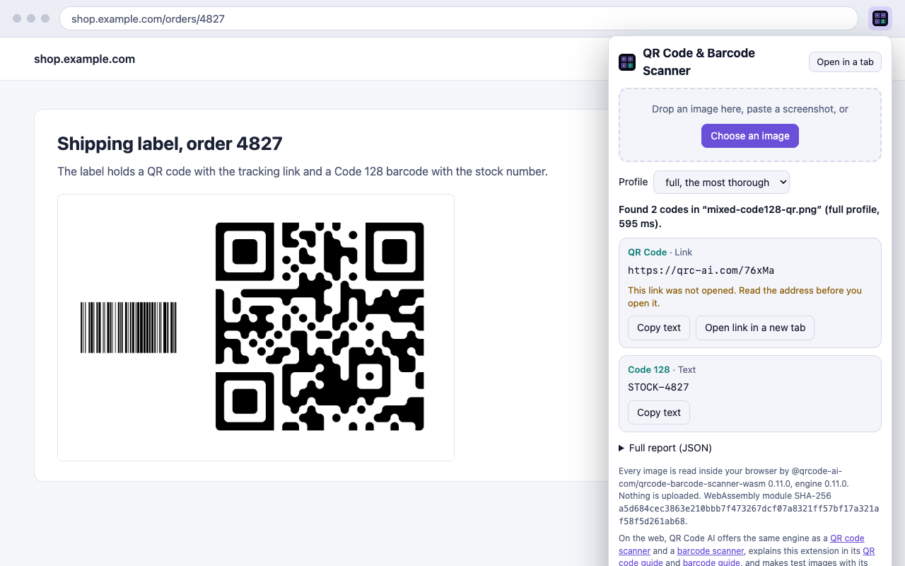

<p align="center">
  <a href="https://github.com/qrcode-ai-com/qrcode-barcode-scanner-rust">
    <picture>
      <source media="(prefers-color-scheme: dark)" srcset="https://raw.githubusercontent.com/qrcode-ai-com/.github/main/profile/assets/banner-browser-extension-dark.gif?v=496d8e3cbdbf">
      
    </picture>
  </a>
</p>

# QR Code & Barcode Scanner · browser extension 0.1.0

<!-- qrcode-ai-readme-actions:v2 -->

### Ask AI

[](https://chatgpt.com/?q=Help%20me%20understand%20QR%20Code%20%26%20Barcode%20Scanner%20%C2%B7%20browser%20extension%200.1.0%20%28integrations%2Fbrowser-extension%2FREADME.md%29%20for%20QR%20Code%20%26%20Barcode%20Scanner%2C%20the%20open-source%20scanner.%20Source%20documentation%3B%20publication%20is%20not%20implied.%20Provided%20README%20context%20%28verify%20against%20the%20sources%29%3A%20A%20Manifest%20V3%20extension%20for%20Chrome%2C%20Edge%2C%20Firefox%20and%20Safari%20that%20reads%20the%20QR%20codes%20and%20barcodes%20in%20an%20image.%20Right-click%20an%20image%20on%20a%20page%20and%20choose%20Scan%20this%20image%2C%20or%20drop%2C%20paste%20or%20choose%20an%20image%20file%20in%20the%20toolbar%20popup.%20Each%20code%20is%20shown%20with%20its%20format%20and%20its%20exact%20text%2C%20with%20a%20copy%20button.%20Decoding%20runs%20in%20the%20browser%20with%20the%20published%20WebAssembly%20engine%200.11.0%3A%20no%20image%20is%20uploaded%2C%20and%20a%20decoded%20link%20is%20never%20opened%20for%20you.%20Read%20the%20public%20documentation%20below.%20Explain%20what%20this%20destination%20does%2C%20its%20documented%20installation%20or%20access%20steps%2C%20a%20minimal%20example%20if%20supported%2C%20prerequisites%2C%20limitations%20and%20license.%20Distinguish%20published%20packages%20from%20working%20source%20and%20preparation.%20Cite%20your%20sources%3B%20if%20a%20page%20is%20unavailable%20or%20a%20fact%20cannot%20be%20checked%2C%20say%20so.%20Do%20not%20invent%20installation%20commands%2C%20benchmark%20results%20or%20comparisons.%20Answer%20in%20my%20language.%20Public%20sources%3A%20https%3A%2F%2Fgithub.com%2Fqrcode-ai-com%2Fqrcode-barcode-scanner-rust%2Fblob%2Fmain%2Fintegrations%2Fbrowser-extension%2FREADME.md%20https%3A%2F%2Fqrcode-ai.com%2Fen-US%2Fqr-code-scanner%20https%3A%2F%2Fqrcode-ai.com%2Fen-US%2Fbarcode-scanner%20https%3A%2F%2Fqrcode-ai.com%2Fen-US%2Fqr-code-scanner%2Fintegrations%2Fbrowser-extension%20https%3A%2F%2Fqrcode-ai.com%2Fen-US%2Fbarcode-scanner%2Fintegrations%2Fbrowser-extension%20https%3A%2F%2Fqrcode-ai.com%2Fen-US%2Fqr-code-generator%20https%3A%2F%2Fqrcode-ai.com%2Fen-US%2Fbarcode-generator)
[](https://claude.ai/new?q=Help%20me%20understand%20QR%20Code%20%26%20Barcode%20Scanner%20%C2%B7%20browser%20extension%200.1.0%20%28integrations%2Fbrowser-extension%2FREADME.md%29%20for%20QR%20Code%20%26%20Barcode%20Scanner%2C%20the%20open-source%20scanner.%20Source%20documentation%3B%20publication%20is%20not%20implied.%20Provided%20README%20context%20%28verify%20against%20the%20sources%29%3A%20A%20Manifest%20V3%20extension%20for%20Chrome%2C%20Edge%2C%20Firefox%20and%20Safari%20that%20reads%20the%20QR%20codes%20and%20barcodes%20in%20an%20image.%20Right-click%20an%20image%20on%20a%20page%20and%20choose%20Scan%20this%20image%2C%20or%20drop%2C%20paste%20or%20choose%20an%20image%20file%20in%20the%20toolbar%20popup.%20Each%20code%20is%20shown%20with%20its%20format%20and%20its%20exact%20text%2C%20with%20a%20copy%20button.%20Decoding%20runs%20in%20the%20browser%20with%20the%20published%20WebAssembly%20engine%200.11.0%3A%20no%20image%20is%20uploaded%2C%20and%20a%20decoded%20link%20is%20never%20opened%20for%20you.%20Read%20the%20public%20documentation%20below.%20Explain%20what%20this%20destination%20does%2C%20its%20documented%20installation%20or%20access%20steps%2C%20a%20minimal%20example%20if%20supported%2C%20prerequisites%2C%20limitations%20and%20license.%20Distinguish%20published%20packages%20from%20working%20source%20and%20preparation.%20Cite%20your%20sources%3B%20if%20a%20page%20is%20unavailable%20or%20a%20fact%20cannot%20be%20checked%2C%20say%20so.%20Do%20not%20invent%20installation%20commands%2C%20benchmark%20results%20or%20comparisons.%20Answer%20in%20my%20language.%20Public%20sources%3A%20https%3A%2F%2Fgithub.com%2Fqrcode-ai-com%2Fqrcode-barcode-scanner-rust%2Fblob%2Fmain%2Fintegrations%2Fbrowser-extension%2FREADME.md%20https%3A%2F%2Fqrcode-ai.com%2Fen-US%2Fqr-code-scanner%20https%3A%2F%2Fqrcode-ai.com%2Fen-US%2Fbarcode-scanner%20https%3A%2F%2Fqrcode-ai.com%2Fen-US%2Fqr-code-scanner%2Fintegrations%2Fbrowser-extension%20https%3A%2F%2Fqrcode-ai.com%2Fen-US%2Fbarcode-scanner%2Fintegrations%2Fbrowser-extension%20https%3A%2F%2Fqrcode-ai.com%2Fen-US%2Fqr-code-generator%20https%3A%2F%2Fqrcode-ai.com%2Fen-US%2Fbarcode-generator)
[](https://gemini.google.com/)
[](https://grok.com/?q=Help%20me%20understand%20QR%20Code%20%26%20Barcode%20Scanner%20%C2%B7%20browser%20extension%200.1.0%20%28integrations%2Fbrowser-extension%2FREADME.md%29%20for%20QR%20Code%20%26%20Barcode%20Scanner%2C%20the%20open-source%20scanner.%20Source%20documentation%3B%20publication%20is%20not%20implied.%20Provided%20README%20context%20%28verify%20against%20the%20sources%29%3A%20A%20Manifest%20V3%20extension%20for%20Chrome%2C%20Edge%2C%20Firefox%20and%20Safari%20that%20reads%20the%20QR%20codes%20and%20barcodes%20in%20an%20image.%20Right-click%20an%20image%20on%20a%20page%20and%20choose%20Scan%20this%20image%2C%20or%20drop%2C%20paste%20or%20choose%20an%20image%20file%20in%20the%20toolbar%20popup.%20Each%20code%20is%20shown%20with%20its%20format%20and%20its%20exact%20text%2C%20with%20a%20copy%20button.%20Decoding%20runs%20in%20the%20browser%20with%20the%20published%20WebAssembly%20engine%200.11.0%3A%20no%20image%20is%20uploaded%2C%20and%20a%20decoded%20link%20is%20never%20opened%20for%20you.%20Read%20the%20public%20documentation%20below.%20Explain%20what%20this%20destination%20does%2C%20its%20documented%20installation%20or%20access%20steps%2C%20a%20minimal%20example%20if%20supported%2C%20prerequisites%2C%20limitations%20and%20license.%20Distinguish%20published%20packages%20from%20working%20source%20and%20preparation.%20Cite%20your%20sources%3B%20if%20a%20page%20is%20unavailable%20or%20a%20fact%20cannot%20be%20checked%2C%20say%20so.%20Do%20not%20invent%20installation%20commands%2C%20benchmark%20results%20or%20comparisons.%20Answer%20in%20my%20language.%20Public%20sources%3A%20https%3A%2F%2Fgithub.com%2Fqrcode-ai-com%2Fqrcode-barcode-scanner-rust%2Fblob%2Fmain%2Fintegrations%2Fbrowser-extension%2FREADME.md%20https%3A%2F%2Fqrcode-ai.com%2Fen-US%2Fqr-code-scanner%20https%3A%2F%2Fqrcode-ai.com%2Fen-US%2Fbarcode-scanner%20https%3A%2F%2Fqrcode-ai.com%2Fen-US%2Fqr-code-scanner%2Fintegrations%2Fbrowser-extension%20https%3A%2F%2Fqrcode-ai.com%2Fen-US%2Fbarcode-scanner%2Fintegrations%2Fbrowser-extension%20https%3A%2F%2Fqrcode-ai.com%2Fen-US%2Fqr-code-generator%20https%3A%2F%2Fqrcode-ai.com%2Fen-US%2Fbarcode-generator)
[](https://www.perplexity.ai/?q=Help%20me%20understand%20QR%20Code%20%26%20Barcode%20Scanner%20%C2%B7%20browser%20extension%200.1.0%20%28integrations%2Fbrowser-extension%2FREADME.md%29%20for%20QR%20Code%20%26%20Barcode%20Scanner%2C%20the%20open-source%20scanner.%20Source%20documentation%3B%20publication%20is%20not%20implied.%20Provided%20README%20context%20%28verify%20against%20the%20sources%29%3A%20A%20Manifest%20V3%20extension%20for%20Chrome%2C%20Edge%2C%20Firefox%20and%20Safari%20that%20reads%20the%20QR%20codes%20and%20barcodes%20in%20an%20image.%20Right-click%20an%20image%20on%20a%20page%20and%20choose%20Scan%20this%20image%2C%20or%20drop%2C%20paste%20or%20choose%20an%20image%20file%20in%20the%20toolbar%20popup.%20Each%20code%20is%20shown%20with%20its%20format%20and%20its%20exact%20text%2C%20with%20a%20copy%20button.%20Decoding%20runs%20in%20the%20browser%20with%20the%20published%20WebAssembly%20engine%200.11.0%3A%20no%20image%20is%20uploaded%2C%20and%20a%20decoded%20link%20is%20never%20opened%20for%20you.%20Read%20the%20public%20documentation%20below.%20Explain%20what%20this%20destination%20does%2C%20its%20documented%20installation%20or%20access%20steps%2C%20a%20minimal%20example%20if%20supported%2C%20prerequisites%2C%20limitations%20and%20license.%20Distinguish%20published%20packages%20from%20working%20source%20and%20preparation.%20Cite%20your%20sources%3B%20if%20a%20page%20is%20unavailable%20or%20a%20fact%20cannot%20be%20checked%2C%20say%20so.%20Do%20not%20invent%20installation%20commands%2C%20benchmark%20results%20or%20comparisons.%20Answer%20in%20my%20language.%20Public%20sources%3A%20https%3A%2F%2Fgithub.com%2Fqrcode-ai-com%2Fqrcode-barcode-scanner-rust%2Fblob%2Fmain%2Fintegrations%2Fbrowser-extension%2FREADME.md%20https%3A%2F%2Fqrcode-ai.com%2Fen-US%2Fqr-code-scanner%20https%3A%2F%2Fqrcode-ai.com%2Fen-US%2Fbarcode-scanner%20https%3A%2F%2Fqrcode-ai.com%2Fen-US%2Fqr-code-scanner%2Fintegrations%2Fbrowser-extension%20https%3A%2F%2Fqrcode-ai.com%2Fen-US%2Fbarcode-scanner%2Fintegrations%2Fbrowser-extension%20https%3A%2F%2Fqrcode-ai.com%2Fen-US%2Fqr-code-generator%20https%3A%2F%2Fqrcode-ai.com%2Fen-US%2Fbarcode-generator)
[](https://copilot.com/)
[](https://chat.deepseek.com/)
[](https://www.meta.ai/)
[](https://qwen.ai/)

Choose an AI assistant to explain this destination using its public sources. Gemini opens gemini.google.com. Gemini, Copilot, DeepSeek, Meta AI and Qwen require pasting the prompt below; the other links include it in their URL. Sign-in or a manual paste may still be required. Check the answer against the documentation.

<details>
<summary>Copy the plain-text prompt</summary>

Use the code block's copy control, or select its complete text, then paste it into your assistant.

```text
Help me understand QR Code & Barcode Scanner · browser extension 0.1.0 (integrations/browser-extension/README.md) for QR Code & Barcode Scanner, the open-source scanner. Source documentation; publication is not implied. Provided README context (verify against the sources): A Manifest V3 extension for Chrome, Edge, Firefox and Safari that reads the QR codes and barcodes in an image. Right-click an image on a page and choose Scan this image, or drop, paste or choose an image file in the toolbar popup. Each code is shown with its format and its exact text, with a copy button. Decoding runs in the browser with the published WebAssembly engine 0.11.0: no image is uploaded, and a decoded link is never opened for you. Read the public documentation below. Explain what this destination does, its documented installation or access steps, a minimal example if supported, prerequisites, limitations and license. Distinguish published packages from working source and preparation. Cite your sources; if a page is unavailable or a fact cannot be checked, say so. Do not invent installation commands, benchmark results or comparisons. Answer in my language. Public sources: https://github.com/qrcode-ai-com/qrcode-barcode-scanner-rust/blob/main/integrations/browser-extension/README.md https://qrcode-ai.com/en-US/qr-code-scanner https://qrcode-ai.com/en-US/barcode-scanner https://qrcode-ai.com/en-US/qr-code-scanner/integrations/browser-extension https://qrcode-ai.com/en-US/barcode-scanner/integrations/browser-extension https://qrcode-ai.com/en-US/qr-code-generator https://qrcode-ai.com/en-US/barcode-generator
```

</details>

<!-- /qrcode-ai-readme-actions:v2 -->

A Manifest V3 extension for Chrome, Edge, Firefox and Safari that reads the QR codes and barcodes in an image. Right-click an image on a page and choose Scan this image, or drop, paste or choose an image file in the toolbar popup. Each code is shown with its format and its exact text, with a copy button. Decoding runs in the browser with the published WebAssembly engine 0.11.0: no image is uploaded, and a decoded link is never opened for you.



Version 0.1.0 is built and tested in this folder, but it is not in any store yet. Until the Chrome Web Store, Microsoft Edge Add-ons, Firefox Add-ons and the App Store list it, install it unpacked from a build of this folder, as shown below.

The same engine runs on the web as the [QR code scanner](https://qrcode-ai.com/en-US/qr-code-scanner) and the [barcode scanner](https://qrcode-ai.com/en-US/barcode-scanner) of QR Code AI. The [QR code scanner browser extension guide](https://qrcode-ai.com/en-US/qr-code-scanner/integrations/browser-extension) and the [barcode scanner browser extension guide](https://qrcode-ai.com/en-US/barcode-scanner/integrations/browser-extension) explain this extension for each use. If a page is unavailable, this README and the store texts in [listing/texts.md](listing/texts.md) remain the reference.

To make a test image with a known value, use the [QR code generator](https://qrcode-ai.com/en-US/qr-code-generator) or the [barcode generator](https://qrcode-ai.com/en-US/barcode-generator). Keep the text you encoded, then compare it with what the extension shows, character for character, leading zeroes included.

## Install

You need Node.js 22.19 or later on the 22 line, or Node.js 24 or later. From a checkout of this repository:

```sh
cd integrations/browser-extension
npm ci --ignore-scripts
npm run build
```

The build checks that the installed scanner package is version 0.11.0 and that its WebAssembly module has the pinned SHA-256, then writes `build/chrome`, `build/edge`, `build/firefox` and `build/safari`.

- **Chrome or Edge.** Open `chrome://extensions` or `edge://extensions`, turn on Developer mode, choose Load unpacked, then select `build/chrome` or `build/edge`. Chrome 103 or later and Edge 103 or later are required.
- **Firefox.** Open `about:debugging#/runtime/this-firefox`, choose Load Temporary Add-on, then select `build/firefox/manifest.json`. Firefox removes a temporary add-on when it closes; a lasting install needs the signed add-on from Firefox Add-ons. Firefox 142 or later is required, on the desktop.
- **Safari.** On a Mac with Safari 26 or later, tick Show features for web developers in Settings, Advanced, then Allow unsigned extensions in Settings, Developer. Choose Add Temporary Extension…, select `build/safari`, and turn the extension on in Settings, Extensions. Safari removes a temporary extension after 24 hours or when it quits, and turns Allow unsigned extensions off again; a lasting install needs the macOS app from the Mac App Store.

To remove it, use Remove on the browser's extensions page. Nothing stays behind except the browser's own records.

## Use

- **On a page.** Right-click an image and choose Scan this image. A scanner tab opens next to the page and reads that image. The tab names the site the image came from.
- **From the toolbar.** Open the popup, then drop an image, paste a screenshot, or choose a file. PNG, JPEG, WebP and GIF are read. In Firefox, Choose an image opens the scanner in a tab, because Firefox closes a popup when its file chooser opens.
- **Profiles.** Full reads the most, fast suits clear images, frame is the quickest. Changing the profile reads the same image again. The choice is remembered.

Each code shows its format (QR Code, Code 128 and so on), its kind (link, text, Wi-Fi network and others) and its exact text. Copy text copies that text. Invisible or direction-changing characters are shown by their code point, so a spoofed address stands out; Copy text still copies the exact text. When some bytes are not text in a known character set, a second button copies the raw bytes in base64. A link gets an explicit Open link in a new tab button and is never opened by itself. Full report (JSON) shows the engine's complete report.

A new image clears the previous result first. An image without a code says so. A file that is not an image is an error and shows nothing.

## Permissions, and why

The extension asks for two permissions at install, `contextMenus` and `activeTab`, and for no site.

- `contextMenus` adds Scan this image to the right-click menu of images.
- `activeTab` lets the extension fetch the image you clicked again from the page's own site. It holds for that tab, at the moment of the click.
- An image often comes from another site, such as a CDN. When that site allows other sites to read its images, the extension reads it with no extra permission. When it does not, the scanner tab shows an Allow button for that one site. On that click only, the extension asks the browser for that site's address pattern, declared as an optional host permission (`https://*/*` and `http://*/*`). The browser asks you to confirm, and you can remove that access later in the extension's settings.

The extension does not ask for access to all sites at install. That would let it read every site at all times, which this scanner does not need. It has no content script, no `tabs`, no `scripting`, no `downloads` and no `storage` permission: the chosen profile is kept in the extension page's own storage.

## Privacy

Nothing leaves the browser. The only network request the extension makes is to fetch the image you right-clicked, from the address the page already loaded it from. It is sent without cookies first, and with the site's own cookies if the site refuses. The extension has no server, no account and no analytics. The full statement is [listing/PRIVACY.md](listing/PRIVACY.md).

## Build, test and inspect

```sh
npm ci --ignore-scripts
npm run build               # the four store zips, the source zip and build/build-receipt.json
npm run check:pins          # the same build, which fails unless every archive is the pinned one
npm test                    # Node unit tests, no browser
npm run inspect             # opens each zip as a store reviewer would
npm run lint:firefox        # Mozilla's add-on linter on build/firefox, through web-ext
node node_modules/playwright/cli.js install chromium firefox webkit
npm run test:chromium -- --package build/qrcode-barcode-scanner-chrome-0.1.0.zip
npm run test:firefox-addon  # the Firefox zip installed in your Firefox (FIREFOX=/path/to/firefox)
npm run test:firefox-page   # the Firefox build's page in Playwright's Firefox
npm run test:webkit-page    # the Safari build's page in Playwright's WebKit
npm run test:reproduce      # rebuild from the source zip and compare every archive
npm run store-images        # the store screenshots and tiles, captured from build/chrome
npm run safari              # macOS with Xcode 26 or later: the unsigned Safari app, built
```

- `npm test` covers the result helpers, the manifests, the zip and PNG writers, the background's menu handler against a fake browser API, the store texts, and the files of each store package.
- `npm run inspect` checks that each zip holds exactly the expected files, equal to the unpacked build, with the described manifest and the pinned WebAssembly module, and that no script builds code from text or loads code from the network.
- `npm run lint:firefox` runs Mozilla's add-on linter, the one Firefox Add-ons runs on upload, and fails on any error, warning or notice.
- `npm run test:chromium` loads the extension in Playwright's Chromium, in a new profile. With `--package`, it first extracts that store zip into an empty folder, so it runs the bytes a store receives; CI runs it on the Chrome zip and on the Edge zip. With `--channel chrome` it runs in the installed Google Chrome instead, which ignores `--load-extension` and loads the folder through the DevTools protocol (`Extensions.loadUnpacked`, allowed by `--enable-unsafe-extension-debugging`); CI runs the Chrome zip that way in the runner's Chrome, and with `--channel msedge` the Edge zip in the runner's Microsoft Edge. It reads the mixed fixture in the popup in fast, frame and full, and checks the copy buttons, the link button, the empty and error states, drop and paste. It calls the menu handler for an image its site lets others read, a `data:` image, a closed image of another site (which must ask for that site), a `blob:` image and an expired request. It checks that no request leaves the local test server, then removes the extension.
- `npm run test:firefox-addon` starts Firefox with a new profile and installs the Firefox zip itself through WebDriver BiDi, as a temporary add-on: release Firefox installs an unsigned add-on only that way. It checks the add-on ID, the permissions, the declaration that no data is collected and the menu item, reads the mixed fixture in the popup page in fast, frame and full through the file input (release Firefox refuses the protocol's file command on an add-on page, so the test hands the same file to the input through a DataTransfer there), checks the empty and error states, checks that no request of the add-on's tab leaves the browser (after a control request proves the listener works), then uninstalls the add-on. CI runs it in the runner's release Firefox. The menu click itself is driven in Chromium only.
- `npm run test:firefox-page` opens the Firefox build's page in Playwright's Firefox, and `npm run test:webkit-page` the Safari build's page in Playwright's WebKit, under the manifest's policy, and each reads the mixed fixture in the three profiles. A control run without `'wasm-unsafe-eval'` must fail to load, which shows the policy is enforced.
- `npm run safari` has Apple's `safari-web-extension-packager` write a macOS-only Xcode project from `build/safari` into `build/safari-xcode`, raises its deployment target to macOS 14 (the first with Safari 26), then builds the macOS app with `xcodebuild`, unsigned. It checks that the app's extension sits at Safari's web extension point and holds the files of `build/safari` byte for byte, with the pinned WebAssembly module. The workflow's `safari` job runs it on a macOS runner, then `npm run test:webkit-page`, and keeps the unsigned macOS app as an artifact. [listing/safari.md](listing/safari.md) explains why the project is generated rather than committed.
- `npm run test:reproduce` extracts the source zip into an empty folder, installs and builds there, and requires the same bytes for every archive.
- The workflow's `wasm-rebuild` job builds the WebAssembly module again from the Rust source at tag `v0.11.0`, with the release's own pinned Rust, wasm-pack and Binaryen, and requires the SHA-256 the build pins. [SOURCE.md](SOURCE.md) gives the same steps to a Firefox Add-ons reviewer.
- `npm run store-images` loads `build/chrome` in Playwright's Chromium, scans the mixed fixture from a file, from the popup over a page and from the right-click menu, and captures the four 1280 × 800 screenshots and the two promotional tiles into [listing/images](listing/images). Every address shown is on example.com. CI captures them again into `build/store-images` on each run.
- The workflow's reproduce job builds again on Linux, macOS and Windows, with Node.js 22 and 24, in UTC and in UTC+14, and requires the hashes of [SHA256SUMS](SHA256SUMS) each time.

The browser tests write the reports under `build/acceptance/` in the shape of `distribution/acceptance/drivers/web-page.mjs`, so `scripts/check-demo-page.py` and `scripts/destination-acceptance.py` can judge them.

## Store packages

`npm run build` writes these files under `build/`:

- `qrcode-barcode-scanner-chrome-0.1.0.zip` for the Chrome Web Store;
- `qrcode-barcode-scanner-edge-0.1.0.zip` for Microsoft Edge Add-ons;
- `qrcode-barcode-scanner-firefox-0.1.0.zip` for Firefox Add-ons, with the add-on ID `qrcode-barcode-scanner@qrcode-ai.com`;
- `qrcode-barcode-scanner-safari-0.1.0.zip` for Safari on macOS, the extension that App Store Connect or Xcode wraps in a macOS app;
- `qrcode-barcode-scanner-source-0.1.0.zip`, the source package that Firefox Add-ons reviewers rebuild from, with [SOURCE.md](SOURCE.md);
- `amo-metadata.json`, the Firefox Add-ons listing for `web-ext sign`, and `store-assets/`, the icon and logo the store forms ask for;
- `SHA256SUMS` and `build-receipt.json`, the size and SHA-256 of each archive.

Every archive entry carries the same fixed date and the files are sorted, so the same source gives the same bytes in any time zone and on any system. [SHA256SUMS](SHA256SUMS) in this folder pins the archives of this revision: check a build with `(cd build && sha256sum --check ../SHA256SUMS)`, or with `npm run check:pins`. After an intended change, `npm run pin` rewrites it.

The four store zips differ only in the manifest. Chrome, Edge and Safari run a service worker; Firefox runs an event page. Each zip holds the WebAssembly module and its JavaScript glue, copied unchanged from the npm package. The manifest's policy is `script-src 'self' 'wasm-unsafe-eval'; object-src 'self'`, so the module can compile and no other code can run. The store texts shared by every store are in [listing/texts.md](listing/texts.md). The Chrome Web Store form, tab by tab, with the owner's steps and the sources read, is in [listing/chrome-web-store.md](listing/chrome-web-store.md); the Microsoft Edge Add-ons form is in [listing/edge-add-ons.md](listing/edge-add-ons.md), the Firefox Add-ons submission, with `web-ext sign` and the source package, is in [listing/firefox-add-ons.md](listing/firefox-add-ons.md), and the Safari app, from the unsigned build to the App Store, is in [listing/safari.md](listing/safari.md).

## Limits

- It reads images, not the camera.
- An image that exists only inside the page, such as a `blob:` address or a canvas, cannot be fetched again. Save it, then drop it in the popup.
- A `file:` image needs the browser's Allow access to file URLs setting for the extension.
- Images larger than 32 MB are refused.
- Firefox for Android is not targeted.
- The Chrome and Edge zips are tested in Playwright's Chromium, and each also in its own browser, Google Chrome or Microsoft Edge; the Firefox zip in release Firefox as a temporary add-on. The Safari zip is built into an unsigned macOS app and its page runs in Playwright's WebKit, but it has not run inside Safari in CI: Safari loads an unsigned extension only after a person allows it. None has been installed from a store yet, since none is published.

## How it works

<!-- qrcode-ai-readme-media:v1 -->
<p align="center">
  <picture>
    <source media="(prefers-color-scheme: dark)" srcset="https://raw.githubusercontent.com/qrcode-ai-com/.github/main/profile/assets/how-browser-dark.gif?v=32206e525b2c">
    
  </picture>
</p>
<!-- /qrcode-ai-readme-media:v1 -->

The picture shows the three steps of the browser package, and the extension follows them. When the scanner page opens, a worker loads the packaged WebAssembly module. The page then sends the image bytes to the worker, which reads them with the chosen profile. The report comes back to the page, which shows each code as text. For an image on a page, the background fetches the image first and hands its bytes to the scanner tab.

## What it returns

<!-- qrcode-ai-readme-media:v1 -->
<p align="center">
  <a href="https://github.com/qrcode-ai-com/qrcode-barcode-scanner-rust#examples">
    <picture>
      <source media="(prefers-color-scheme: dark)" srcset="https://raw.githubusercontent.com/qrcode-ai-com/qrcode-barcode-scanner-rust/main/docs/assets/brand/examples-mixed-dark.png?v=385593c1c18d">
      
    </picture>
  </a>
</p>
<!-- /qrcode-ai-readme-media:v1 -->

The picture is a recorded scan of one image that holds a QR code and a Code 128 barcode. The extension reads the same fixture in its tests: the QR code gives `https://qrc-ai.com/76xMa` and the barcode gives `STOCK-4827`, in one report. The extension lists each code with its format and exact text; the full report also holds where the engine measured it.

## What it reads

<!-- qrcode-ai-readme-media:v1 -->
<p align="center">
  <a href="https://github.com/qrcode-ai-com/qrcode-barcode-scanner-rust#supported-formats">
    <picture>
      <source media="(prefers-color-scheme: dark)" srcset="https://raw.githubusercontent.com/qrcode-ai-com/qrcode-barcode-scanner-rust/main/docs/assets/brand/formats-dark.gif?v=92fa0e8084df">
      
    </picture>
  </a>
</p>
<!-- /qrcode-ai-readme-media:v1 -->

The WebAssembly module of engine 0.11.0 reads these 19 formats, and codes of different formats in one image come back in one report.

- QR: QR Code, Micro QR Code, rectangular Micro QR Code (rMQR)
- Matrix and stacked: Data Matrix, Aztec, PDF417, MaxiCode
- Retail: EAN-13, EAN-8, UPC-A, UPC-E
- Other linear: Code 128, Code 39, Code 93, Codabar, ITF, GS1 DataBar, GS1 DataBar Expanded, Telepen

The engine's [supported formats](https://github.com/qrcode-ai-com/qrcode-barcode-scanner-rust#supported-formats) section states the known limits.

## The same engine in other runtimes

<!-- qrcode-ai-readme-media:v1 -->
<p align="center">
  <a href="https://github.com/qrcode-ai-com/qrcode-barcode-scanner-rust#get-started">
    <picture>
      <source media="(prefers-color-scheme: dark)" srcset="https://raw.githubusercontent.com/qrcode-ai-com/qrcode-barcode-scanner-rust/main/docs/assets/brand/runtimes-dark.png?v=57c63428574b">
      
    </picture>
  </a>
</p>
<!-- /qrcode-ai-readme-media:v1 -->

The extension uses the browser package. The Rust, Node.js, browser and Python packages hold the same engine. The Go and PHP packages hold no decoder: each one starts `qrscan` and hands you its report. Every route is listed in the [scanner repository](https://github.com/qrcode-ai-com/qrcode-barcode-scanner-rust).

## License of the packages

The extension's own source in this folder is under the MIT License, in [LICENSE](LICENSE). Each store package also holds the files of the npm package `@qrcode-ai-com/qrcode-barcode-scanner-wasm` 0.11.0, copied unchanged into `vendor/qrcode-barcode-scanner-wasm/`. That published archive stays under AGPL-3.0-or-later, with Apache-2.0 notices for the code derived from rxing, and the MIT License of the extension does not relicense it. `NOTICE.md` in each package states this boundary and names the engine's source revision.

Maintained by **Thibaut Mélen & Nicolas Cella** for **QR Code AI**, a product of **SuperNovae Studio**.

<!-- qrscan-source-license:v1 -->

## Source license

Project-authored scanner code and documentation in this checkout are available under the [MIT License](https://github.com/qrcode-ai-com/qrcode-barcode-scanner-rust/blob/main/LICENSE). You may use, modify and redistribute this source in open-source or proprietary applications, including commercial products, while preserving the copyright and permission notice. Thibaut Mélen & Nicolas Cella develop QR Code AI at SuperNovae Studio.

Retained third-party code, dependencies, artwork and test data keep their own licenses and notices. The [licensing guide](https://github.com/qrcode-ai-com/qrcode-barcode-scanner-rust/blob/main/LICENSING.md) explains these component boundaries; the project license does not assign a license to an unrelated platform or service.

Published archives retain the license shipped with their version. A pinned engine, adapter or bundle may therefore have different terms from this working source. Read its packaged license and the [license history](https://github.com/qrcode-ai-com/qrcode-barcode-scanner-rust/blob/main/docs/guides/license-history.mdx) before reuse. The source change does not replace an archive or publish a new version.

<!-- /qrscan-source-license:v1 -->
