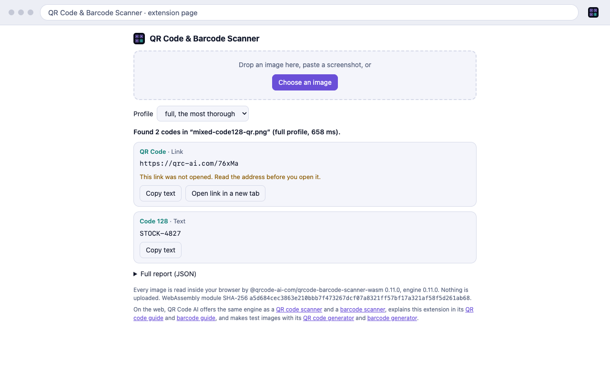

# Chrome Web Store · QR Code & Barcode Scanner 0.1.0

Everything the Chrome Web Store form asks for, ready to paste. Nothing here has been submitted:
the account, the fee, the agreement, the upload and the submit button belong to the owner.

The store rules below were read on the linked pages on 21 November 2026 (see
[Sources](#sources)). Open each page again before submitting; the store changes its forms
without notice.

## The package

| What | Value |
|---|---|
| File | `build/qrcode-barcode-scanner-chrome-0.1.0.zip` |
| SHA-256 | `8d85941169527f57f85c4bcaa3c7170c7b01c9c0d5983285a190bfdeaf47d347` |
| Made by | `npm ci && npm run build` in this folder, or the `browser-extension` artifact of the `integration-browser-extension` workflow |
| Checked by | `npm run check:pins` (same bytes as [SHA256SUMS](../SHA256SUMS)), `npm run inspect`, and `node test/chromium.mjs --package` on that zip, in Playwright's Chromium and with `--channel chrome` in Google Chrome |
| Manifest | Manifest V3, version 0.1.0, permissions `contextMenus` and `activeTab`, optional host permissions `https://*/*` and `http://*/*`, no `update_url` |

Rebuilding on any system with Node.js 22 or 24 gives the same bytes. If the hash differs, do
not upload: rebuild from a clean checkout of `main`.

## Before the first upload (the owner)

1. **Google account with 2-Step Verification.** Required for every developer account before
   publishing.
2. **Register** at the [Developer Dashboard](https://chrome.google.com/webstore/devconsole),
   accept the developer agreement and pay the one-time registration fee (US$5; the register
   page gives no amount, a store blog post of 28 April 2026 does).
3. **Trader or non-trader.** Every account declares one. A trader's name, address, email and
   phone number are shown at the bottom of the listing; for a non-trader, users are told that
   consumer protection rights do not apply. The extension is published for QR Code AI, a
   business, which points to trader. The owner decides.
4. **Publisher limit.** A new publisher may publish at most two extensions; the dashboard shows
   the current limit and an increase can be requested.

No token, environment or tag is needed: no workflow in this repository uploads to the Chrome
Web Store.

## Upload

Dashboard, **Add new item**, **Choose file**, then `qrcode-barcode-scanner-chrome-0.1.0.zip`,
**Upload**. The item opens with five tabs: Package, Store listing, Privacy, Distribution and
Test instructions.

## Store listing tab

| Field | Value |
|---|---|
| Description | The long description in [texts.md](texts.md#long-description) |
| Category | **Tools**. The store's list has no "Productivity" any more; Tools is the category "for extensions that don't fit any other category". Art & Design covers "viewing, editing, organizing, and sharing images", which this extension does not do. |
| Language | English |
| Store icon | `build/store-assets/icon-128.png`: 128 × 128, artwork 96 × 96 with 16 px of transparent margin, as the store asks |
| Screenshots | The four files below, in this order |
| Small promo tile | `listing/images/promo-small-440x280.png` |
| Marquee promo tile | `listing/images/promo-marquee-1400x560.png` |
| YouTube video | Empty |
| Official URL | Only if `qrcode-ai.com` is verified in Google Search Console for this account; otherwise empty |
| Homepage URL | `https://qrcode-ai.com/en-US/qr-code-scanner/integrations/browser-extension` |
| Support URL | `https://qrcode-ai-com.github.io/support/` (live after the owner's review); until then `https://github.com/qrcode-ai-com/qrcode-barcode-scanner-rust/issues` |
| Mature content | Off |

The summary under the name is the manifest's description (the short description in
[texts.md](texts.md#short-description), 128 characters; the limit is 132).

### Screenshots

Full-bleed 1280 × 800 PNGs with square corners, captured from the real build by
`npm run store-images`. The page addresses are on example.com.

| File | Shows |
|---|---|
| `listing/images/screenshot-1-scan-1280x800.png` | The scanner tab after reading an image: both codes with their format and text |
| `listing/images/screenshot-2-popup-1280x800.png` | The toolbar popup over a page that shows the image |
| `listing/images/screenshot-3-menu-1280x800.png` | The tab that "Scan this image" opens, naming the image's site |
| `listing/images/screenshot-4-report-1280x800.png` | The full JSON report of a scan |



## Privacy tab

**Single purpose**

```text
Read the QR codes and barcodes in an image the user chooses, and show their decoded text.
```

**Permission justifications.** Paste each text from
[texts.md](texts.md#permission-justifications) into the field of the same permission:
`contextMenus`, `activeTab`, and the host permission field for `https://*/*` and `http://*/*`.

**Remote code.** "No, I am not using remote code", with the text from texts.md if a field asks
for one.

**Data usage.** The store's User Data FAQ says local handling is disclosed too: "Extensions are
required to disclose how they handle user data, even when data is processed or stored locally
on a user's device and is not transmitted to external servers or third parties."

- Tick **Website content** (the data type that covers images of a web page): the image the user
  clicks is read inside the browser. Leave every other data type unticked: the extension reads
  no personal details, history, location, messages, authentication or activity data.
- Tick the three certifications: no sale or transfer of user data outside the approved uses, no
  use unrelated to the single purpose, no use for creditworthiness or lending. The extension
  keeps the image only while it reads it and sends nothing anywhere.

If the dashboard words a data type differently, choose the one that covers images on web pages
and keep the explanation above.

**Privacy policy URL.** `https://qrcode-ai-com.github.io/privacy/` (live after the owner's
review). Until it is live, the public copy of [PRIVACY.md](PRIVACY.md):
`https://github.com/qrcode-ai-com/qrcode-barcode-scanner-rust/blob/main/integrations/browser-extension/listing/PRIVACY.md`.

## Distribution tab

Free, public, all regions.

## Test instructions tab

The tab is for instructions and credentials "only if needed". No account is needed; paste the
notes for reviewers from [texts.md](texts.md#notes-for-reviewers) so the reviewer knows where
to click.

## Submit

**Submit for review**. In the confirmation dialog, unticking the box defers publication: the
item waits after review until the owner publishes it. The store says reviews take "a few days"
and can take "up to a few weeks", longer for items that request broad host permissions; the
optional host permissions here may count.

Once published, the listing address is `https://chromewebstore.google.com/detail/<item id>`.
Add it to the extension README's Install section then, not before.

## Sources

All read on 21 November 2026.

- Register and fee: <https://developer.chrome.com/docs/webstore/register>,
  <https://developer.chrome.com/blog/cws-role-expansion-developer-dashboard> (the US$5 amount)
- 2-Step Verification:
  <https://developer.chrome.com/docs/webstore/program-policies/two-step-verification>
- Trader declaration:
  <https://developer.chrome.com/docs/webstore/program-policies/trader-disclosure>,
  <https://developer.chrome.com/docs/webstore/program-policies/trader-verification-faq>
- Upload, tabs, publisher limit, deferred publishing:
  <https://developer.chrome.com/docs/webstore/publish>,
  <https://developer.chrome.com/blog/cws-review-updates-2026>
- Store listing fields: <https://developer.chrome.com/docs/webstore/cws-dashboard-listing>
- Image sizes: <https://developer.chrome.com/docs/webstore/images>
- Summary length: <https://developer.chrome.com/docs/webstore/best-listing>
- Categories: <https://developer.chrome.com/docs/webstore/best-practices>
- Privacy tab: <https://developer.chrome.com/docs/webstore/cws-dashboard-privacy>
- Local data disclosure:
  <https://developer.chrome.com/docs/webstore/program-policies/user-data-faq>
- Privacy policy: <https://developer.chrome.com/docs/webstore/program-policies/privacy>
- Review times: <https://developer.chrome.com/docs/webstore/review-process>
