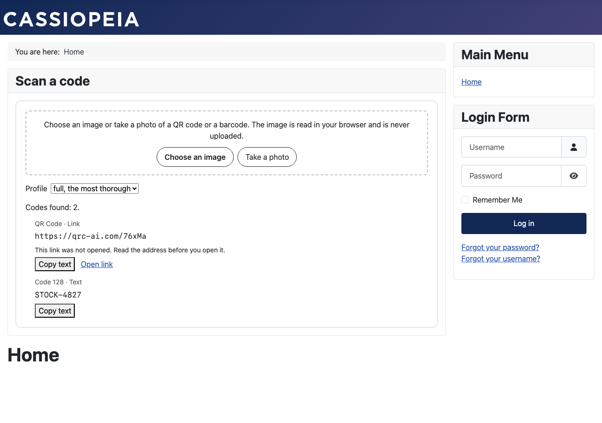

<p align="center">
  <a href="https://github.com/qrcode-ai-com/qrcode-barcode-scanner-rust">
    <picture>
      <source media="(prefers-color-scheme: dark)" srcset="https://raw.githubusercontent.com/qrcode-ai-com/.github/main/profile/assets/banner-joomla-dark.gif?v=bdf589ac9b99">
      
    </picture>
  </a>
</p>

# QR Code & Barcode Scanner · Joomla module 0.1.0

<!-- qrcode-ai-readme-actions:v2 -->

### Ask AI

[](https://chatgpt.com/?q=Help%20me%20understand%20QR%20Code%20%26%20Barcode%20Scanner%20%C2%B7%20Joomla%20module%200.1.0%20%28integrations%2Fjoomla%2FREADME.md%29%20for%20QR%20Code%20%26%20Barcode%20Scanner%2C%20the%20open-source%20scanner.%20Source%20documentation%3B%20publication%20is%20not%20implied.%20Provided%20README%20context%20%28verify%20against%20the%20sources%29%3A%20A%20Joomla%20package%20with%20a%20site%20module%20that%20reads%20the%20QR%20codes%20and%20barcodes%20in%20an%20image%20or%20a%20photo.%20A%20visitor%20chooses%20an%20image%2C%20or%20takes%20a%20photo%20with%20the%20phone%27s%20camera%2C%20and%20each%20code%20is%20listed%20with%20its%20format%20and%20its%20exact%20text%2C%20with%20a%20copy%20button.%20Decoding%20runs%20in%20the%20visitor%27s%20browser%20with%20the%20published%20WebAssembly%20engine%200.11.0%2C%20served%20by%20your%20own%20site%3A%20no%20image%20is%20uploaded%2C%20the%20module%20calls%20no%20other%20server%2C%20and%20a%20decoded%20link%20is%20never%20opened%20by%20itself.%20Read%20the%20public%20documentation%20below.%20Explain%20what%20this%20destination%20does%2C%20its%20documented%20installation%20or%20access%20steps%2C%20a%20minimal%20example%20if%20supported%2C%20prerequisites%2C%20limitations%20and%20license.%20Distinguish%20published%20packages%20from%20working%20source%20and%20preparation.%20Cite%20your%20sources%3B%20if%20a%20page%20is%20unavailable%20or%20a%20fact%20cannot%20be%20checked%2C%20say%20so.%20Do%20not%20invent%20installation%20commands%2C%20benchmark%20results%20or%20comparisons.%20Answer%20in%20my%20language.%20Public%20sources%3A%20https%3A%2F%2Fgithub.com%2Fqrcode-ai-com%2Fqrcode-barcode-scanner-rust%2Fblob%2Fmain%2Fintegrations%2Fjoomla%2FREADME.md%20https%3A%2F%2Fqrcode-ai.com%2Fen-US%2Fqr-code-scanner%20https%3A%2F%2Fqrcode-ai.com%2Fen-US%2Fbarcode-scanner%20https%3A%2F%2Fqrcode-ai.com%2Fen-US%2Fqr-code-scanner%2Fintegrations%2Fjoomla%20https%3A%2F%2Fqrcode-ai.com%2Fen-US%2Fbarcode-scanner%2Fintegrations%2Fjoomla%20https%3A%2F%2Fqrcode-ai.com%2Fen-US%2Fqr-code-generator%20https%3A%2F%2Fqrcode-ai.com%2Fen-US%2Fbarcode-generator)
[](https://claude.ai/new?q=Help%20me%20understand%20QR%20Code%20%26%20Barcode%20Scanner%20%C2%B7%20Joomla%20module%200.1.0%20%28integrations%2Fjoomla%2FREADME.md%29%20for%20QR%20Code%20%26%20Barcode%20Scanner%2C%20the%20open-source%20scanner.%20Source%20documentation%3B%20publication%20is%20not%20implied.%20Provided%20README%20context%20%28verify%20against%20the%20sources%29%3A%20A%20Joomla%20package%20with%20a%20site%20module%20that%20reads%20the%20QR%20codes%20and%20barcodes%20in%20an%20image%20or%20a%20photo.%20A%20visitor%20chooses%20an%20image%2C%20or%20takes%20a%20photo%20with%20the%20phone%27s%20camera%2C%20and%20each%20code%20is%20listed%20with%20its%20format%20and%20its%20exact%20text%2C%20with%20a%20copy%20button.%20Decoding%20runs%20in%20the%20visitor%27s%20browser%20with%20the%20published%20WebAssembly%20engine%200.11.0%2C%20served%20by%20your%20own%20site%3A%20no%20image%20is%20uploaded%2C%20the%20module%20calls%20no%20other%20server%2C%20and%20a%20decoded%20link%20is%20never%20opened%20by%20itself.%20Read%20the%20public%20documentation%20below.%20Explain%20what%20this%20destination%20does%2C%20its%20documented%20installation%20or%20access%20steps%2C%20a%20minimal%20example%20if%20supported%2C%20prerequisites%2C%20limitations%20and%20license.%20Distinguish%20published%20packages%20from%20working%20source%20and%20preparation.%20Cite%20your%20sources%3B%20if%20a%20page%20is%20unavailable%20or%20a%20fact%20cannot%20be%20checked%2C%20say%20so.%20Do%20not%20invent%20installation%20commands%2C%20benchmark%20results%20or%20comparisons.%20Answer%20in%20my%20language.%20Public%20sources%3A%20https%3A%2F%2Fgithub.com%2Fqrcode-ai-com%2Fqrcode-barcode-scanner-rust%2Fblob%2Fmain%2Fintegrations%2Fjoomla%2FREADME.md%20https%3A%2F%2Fqrcode-ai.com%2Fen-US%2Fqr-code-scanner%20https%3A%2F%2Fqrcode-ai.com%2Fen-US%2Fbarcode-scanner%20https%3A%2F%2Fqrcode-ai.com%2Fen-US%2Fqr-code-scanner%2Fintegrations%2Fjoomla%20https%3A%2F%2Fqrcode-ai.com%2Fen-US%2Fbarcode-scanner%2Fintegrations%2Fjoomla%20https%3A%2F%2Fqrcode-ai.com%2Fen-US%2Fqr-code-generator%20https%3A%2F%2Fqrcode-ai.com%2Fen-US%2Fbarcode-generator)
[](https://gemini.google.com/)
[](https://grok.com/?q=Help%20me%20understand%20QR%20Code%20%26%20Barcode%20Scanner%20%C2%B7%20Joomla%20module%200.1.0%20%28integrations%2Fjoomla%2FREADME.md%29%20for%20QR%20Code%20%26%20Barcode%20Scanner%2C%20the%20open-source%20scanner.%20Source%20documentation%3B%20publication%20is%20not%20implied.%20Provided%20README%20context%20%28verify%20against%20the%20sources%29%3A%20A%20Joomla%20package%20with%20a%20site%20module%20that%20reads%20the%20QR%20codes%20and%20barcodes%20in%20an%20image%20or%20a%20photo.%20A%20visitor%20chooses%20an%20image%2C%20or%20takes%20a%20photo%20with%20the%20phone%27s%20camera%2C%20and%20each%20code%20is%20listed%20with%20its%20format%20and%20its%20exact%20text%2C%20with%20a%20copy%20button.%20Decoding%20runs%20in%20the%20visitor%27s%20browser%20with%20the%20published%20WebAssembly%20engine%200.11.0%2C%20served%20by%20your%20own%20site%3A%20no%20image%20is%20uploaded%2C%20the%20module%20calls%20no%20other%20server%2C%20and%20a%20decoded%20link%20is%20never%20opened%20by%20itself.%20Read%20the%20public%20documentation%20below.%20Explain%20what%20this%20destination%20does%2C%20its%20documented%20installation%20or%20access%20steps%2C%20a%20minimal%20example%20if%20supported%2C%20prerequisites%2C%20limitations%20and%20license.%20Distinguish%20published%20packages%20from%20working%20source%20and%20preparation.%20Cite%20your%20sources%3B%20if%20a%20page%20is%20unavailable%20or%20a%20fact%20cannot%20be%20checked%2C%20say%20so.%20Do%20not%20invent%20installation%20commands%2C%20benchmark%20results%20or%20comparisons.%20Answer%20in%20my%20language.%20Public%20sources%3A%20https%3A%2F%2Fgithub.com%2Fqrcode-ai-com%2Fqrcode-barcode-scanner-rust%2Fblob%2Fmain%2Fintegrations%2Fjoomla%2FREADME.md%20https%3A%2F%2Fqrcode-ai.com%2Fen-US%2Fqr-code-scanner%20https%3A%2F%2Fqrcode-ai.com%2Fen-US%2Fbarcode-scanner%20https%3A%2F%2Fqrcode-ai.com%2Fen-US%2Fqr-code-scanner%2Fintegrations%2Fjoomla%20https%3A%2F%2Fqrcode-ai.com%2Fen-US%2Fbarcode-scanner%2Fintegrations%2Fjoomla%20https%3A%2F%2Fqrcode-ai.com%2Fen-US%2Fqr-code-generator%20https%3A%2F%2Fqrcode-ai.com%2Fen-US%2Fbarcode-generator)
[](https://www.perplexity.ai/?q=Help%20me%20understand%20QR%20Code%20%26%20Barcode%20Scanner%20%C2%B7%20Joomla%20module%200.1.0%20%28integrations%2Fjoomla%2FREADME.md%29%20for%20QR%20Code%20%26%20Barcode%20Scanner%2C%20the%20open-source%20scanner.%20Source%20documentation%3B%20publication%20is%20not%20implied.%20Provided%20README%20context%20%28verify%20against%20the%20sources%29%3A%20A%20Joomla%20package%20with%20a%20site%20module%20that%20reads%20the%20QR%20codes%20and%20barcodes%20in%20an%20image%20or%20a%20photo.%20A%20visitor%20chooses%20an%20image%2C%20or%20takes%20a%20photo%20with%20the%20phone%27s%20camera%2C%20and%20each%20code%20is%20listed%20with%20its%20format%20and%20its%20exact%20text%2C%20with%20a%20copy%20button.%20Decoding%20runs%20in%20the%20visitor%27s%20browser%20with%20the%20published%20WebAssembly%20engine%200.11.0%2C%20served%20by%20your%20own%20site%3A%20no%20image%20is%20uploaded%2C%20the%20module%20calls%20no%20other%20server%2C%20and%20a%20decoded%20link%20is%20never%20opened%20by%20itself.%20Read%20the%20public%20documentation%20below.%20Explain%20what%20this%20destination%20does%2C%20its%20documented%20installation%20or%20access%20steps%2C%20a%20minimal%20example%20if%20supported%2C%20prerequisites%2C%20limitations%20and%20license.%20Distinguish%20published%20packages%20from%20working%20source%20and%20preparation.%20Cite%20your%20sources%3B%20if%20a%20page%20is%20unavailable%20or%20a%20fact%20cannot%20be%20checked%2C%20say%20so.%20Do%20not%20invent%20installation%20commands%2C%20benchmark%20results%20or%20comparisons.%20Answer%20in%20my%20language.%20Public%20sources%3A%20https%3A%2F%2Fgithub.com%2Fqrcode-ai-com%2Fqrcode-barcode-scanner-rust%2Fblob%2Fmain%2Fintegrations%2Fjoomla%2FREADME.md%20https%3A%2F%2Fqrcode-ai.com%2Fen-US%2Fqr-code-scanner%20https%3A%2F%2Fqrcode-ai.com%2Fen-US%2Fbarcode-scanner%20https%3A%2F%2Fqrcode-ai.com%2Fen-US%2Fqr-code-scanner%2Fintegrations%2Fjoomla%20https%3A%2F%2Fqrcode-ai.com%2Fen-US%2Fbarcode-scanner%2Fintegrations%2Fjoomla%20https%3A%2F%2Fqrcode-ai.com%2Fen-US%2Fqr-code-generator%20https%3A%2F%2Fqrcode-ai.com%2Fen-US%2Fbarcode-generator)
[](https://copilot.com/)
[](https://chat.deepseek.com/)
[](https://www.meta.ai/)
[](https://qwen.ai/)

Choose an AI assistant to explain this destination using its public sources. Gemini opens gemini.google.com. Gemini, Copilot, DeepSeek, Meta AI and Qwen require pasting the prompt below; the other links include it in their URL. Sign-in or a manual paste may still be required. Check the answer against the documentation.

<details>
<summary>Copy the plain-text prompt</summary>

Use the code block's copy control, or select its complete text, then paste it into your assistant.

```text
Help me understand QR Code & Barcode Scanner · Joomla module 0.1.0 (integrations/joomla/README.md) for QR Code & Barcode Scanner, the open-source scanner. Source documentation; publication is not implied. Provided README context (verify against the sources): A Joomla package with a site module that reads the QR codes and barcodes in an image or a photo. A visitor chooses an image, or takes a photo with the phone's camera, and each code is listed with its format and its exact text, with a copy button. Decoding runs in the visitor's browser with the published WebAssembly engine 0.11.0, served by your own site: no image is uploaded, the module calls no other server, and a decoded link is never opened by itself. Read the public documentation below. Explain what this destination does, its documented installation or access steps, a minimal example if supported, prerequisites, limitations and license. Distinguish published packages from working source and preparation. Cite your sources; if a page is unavailable or a fact cannot be checked, say so. Do not invent installation commands, benchmark results or comparisons. Answer in my language. Public sources: https://github.com/qrcode-ai-com/qrcode-barcode-scanner-rust/blob/main/integrations/joomla/README.md https://qrcode-ai.com/en-US/qr-code-scanner https://qrcode-ai.com/en-US/barcode-scanner https://qrcode-ai.com/en-US/qr-code-scanner/integrations/joomla https://qrcode-ai.com/en-US/barcode-scanner/integrations/joomla https://qrcode-ai.com/en-US/qr-code-generator https://qrcode-ai.com/en-US/barcode-generator
```

</details>

<!-- /qrcode-ai-readme-actions:v2 -->

A Joomla package with a site module that reads the QR codes and barcodes in an image or a photo. A visitor chooses an image, or takes a photo with the phone's camera, and each code is listed with its format and its exact text, with a copy button. Decoding runs in the visitor's browser with the published WebAssembly engine 0.11.0, served by your own site: no image is uploaded, the module calls no other server, and a decoded link is never opened by itself.

Version 0.1.0 is built and tested in this folder for Joomla 5.4 and Joomla 6, but the Joomla Extensions Directory does not list it yet and no release holds its package. Until then, install it from the package that a build of this folder writes, as shown below. The texts, images and steps for the directory are in [LISTING.md](LISTING.md).

The same engine runs on the web as the [QR code scanner](https://qrcode-ai.com/en-US/qr-code-scanner) and the [barcode scanner](https://qrcode-ai.com/en-US/barcode-scanner) of QR Code AI. The [QR code scanner Joomla guide](https://qrcode-ai.com/en-US/qr-code-scanner/integrations/joomla) and the [barcode scanner Joomla guide](https://qrcode-ai.com/en-US/barcode-scanner/integrations/joomla) explain this module for each use. If a page is unavailable, this README and [LISTING.md](LISTING.md) remain the reference.

To make a test image with a known value, use the [QR code generator](https://qrcode-ai.com/en-US/qr-code-generator) or the [barcode generator](https://qrcode-ai.com/en-US/barcode-generator). Keep the text you encoded, then compare it with what the module shows, character for character, leading zeroes included.

<p align="center">
  
</p>

## Install

The package needs Joomla 5.4 with PHP 8.1 or later, or Joomla 6 with PHP 8.3 or later. To build it you need Node.js 22.22.2 or later on the 22 line, or Node.js 24.15.0 or later. From a checkout of this repository:

```sh
cd integrations/joomla
npm ci --ignore-scripts
npm run build
```

The build checks that the installed scanner package is version 0.11.0 and that its WebAssembly module has the pinned SHA-256, then writes `build/pkg_qrcodebarcodescanner-0.1.0.zip`, about 1 MB. Its SHA-256 is in the update file [updates.xml](updates.xml); the same inputs give the same bytes on Linux, macOS and Windows.

In the Joomla administrator, open **System › Install › Extensions**, choose **Upload Package File** and drop the zip. Joomla reports that the installation of the package was successful.

To remove it, open **System › Manage › Extensions**, search for **QR Code & Barcode Scanner**, tick the line whose type is **Package**, then **Actions › Uninstall** and confirm. The module, its files, its media and its module instances go with it. The package keeps no table, no option and no file of its own.

## Use

- **Place the module.** Open **Content › Site Modules**. Joomla has already added one unpublished instance of the module at install, in no position: open it, or choose **New** and pick **QR Code & Barcode Scanner**. Give it a title, choose a **Position** of your template (for Cassiopeia, `main-top` puts it above the article), choose the pages in **Menu Assignment**, set **Status** to **Published** and **Save & Close**.
- **Its settings.** **Profile chosen first** (full, fast or frame), **Show the full report** and **Show a credit line**. The credit line is off unless you turn it on; when it is on, it names the open-source engine and links six QR Code AI pages.
- **On the page.** The visitor chooses **Choose an image** or **Take a photo**. PNG, JPEG, WebP and GIF are read; another file type is refused with a message that names them. **Profile** switches between full (the most thorough), fast (clear images) and frame (the quickest), and reads the same image again.

Each code shows its format (QR Code, Code 128 and so on), its kind (link, text, Wi-Fi network and others) and its exact text. **Copy text** copies that text. Invisible or direction-changing characters are shown by their code point, so a spoofed address stands out; **Copy text** still copies the exact text. A link gets an explicit **Open link** button with a note that it was not opened, and is never opened by itself. **Full report (JSON)** shows the engine's complete report when it is turned on.

The texts are in British English, in the module's language files under `language/en-GB/`; another language can be added the usual Joomla way, with a language override or a translated `.ini` file.

## Privacy

Nothing leaves the visitor's browser. The image is read by code served from your site and is discarded when the page closes. The module makes no request to another server, sets no cookie, uses no local storage, stores nothing in your database and has no analytics. Its script and stylesheet are registered with Joomla's Web Asset Manager from `media/mod_qrcodebarcodescanner/`, and the engine is a file of the module; nothing is fetched from a CDN.

Joomla itself checks the package's update file, [updates.xml](updates.xml) in this repository, when an administrator looks for updates. That request comes from the administrator's side of the site, never from a visitor's page.

## Content Security Policy

If your site sends a Content Security Policy, for example through Joomla's HTTP Headers plugin, the engine needs `'wasm-unsafe-eval'` in `script-src` to compile. Without it, the module shows that WebAssembly is not allowed on this site, and nothing else breaks.

## Server-side scanning

This module reads images in the browser, so it works on any host. To read images on your server instead, in your own PHP code, the engine also has a PHP package on Packagist, `qrcode-ai-com/qrcode-barcode-scanner`. That package runs the separately installed `qrscan` command, which most shared hosts do not allow. This module does not use it and does not depend on it.

## Build, test and inspect

```sh
npm ci --ignore-scripts
npm run build              # the package zip, build/mod_qrcodebarcodescanner/, build-receipt.json and updates.xml
npm run inspect            # opens the package and the module zip as the directory's reviewers would
npm test                   # Node unit tests, no browser
node node_modules/playwright/cli.js install chromium
npm run test:joomla        # the package on a new site of the official Joomla Docker image
npm run test:reproduce     # rebuild in two time zones and compare with updates.xml
npm run assets             # redraw the listing icon into listing-assets/
```

- `node scripts/build.mjs --check` writes nothing in this folder and fails when the committed [updates.xml](updates.xml) is not the file this build gives, with the package's SHA-256.
- `npm run inspect` checks that the package and the module zip hold exactly the expected files, that the manifests name every file both ways, that the WebAssembly module is the pinned one, and that every language key the PHP and the script use is defined. It checks the `_JEXEC` guard and the GPL notice in every PHP file, the update server address and the fields of `updates.xml`, the 2 MB default upload limit of PHP, and that no file calls another server or builds code from text.
- `npm test` covers the result helpers, the translated texts, the credit line being off by default, the version pins, the update file, the inspection against altered packages, the zip writer and the listing images.
- `npm run test:joomla` needs Docker. It starts the official `joomla` image and MariaDB on `127.0.0.1` with nothing installed. As an administrator it uploads the zip in **System › Install › Extensions**, checks the package, the module and the update site in the database, and that the media files are served. It publishes the module on every page, checks that Joomla's own unpublished instance stays unpublished, then as a visitor reads the mixed fixture in fast, frame and full and requires exactly `https://qrc-ai.com/76xMa` and `STOCK-4827`. It checks the refusals of a BMP image and a text file, the credit line when it is turned on, and that no request leaves the site. It then uninstalls the package and checks that its files are no longer served, its folders are gone and no row is left. `--image joomla:5.4.10-php8.3-apache` runs it on Joomla 5.4.
- `npm run test:reproduce` rebuilds the package in UTC and in UTC+14 and requires the same bytes as `build/` and as [updates.xml](updates.xml).

The Joomla test writes its reports under `build/acceptance/` in the shape of `distribution/acceptance/drivers/web-page.mjs`, and judges them with `scripts/check-demo-page.py` and `scripts/destination-acceptance.py`. The workflow [integration-joomla.yml](../../.github/workflows/integration-joomla.yml) runs all of this on every change, on Joomla 6.2 with PHP 8.4 and on Joomla 5.4 with PHP 8.3, each image pinned by digest. It also rebuilds the package on Linux, macOS and Windows with Node.js 22 and 24.

## Package and updates

`npm run build` writes these files under `build/`:

- `pkg_qrcodebarcodescanner-0.1.0.zip`, the package to install and to attach to the directory listing: the package manifest, `LICENSE.txt` (GPL-3.0), `LICENSE-MIT.txt`, `LICENSE-ENGINE.txt` and `packages/mod_qrcodebarcodescanner.zip`, the site module;
- `mod_qrcodebarcodescanner/`, the module as Joomla installs it, for reading;
- `build-receipt.json`, with the sizes and SHA-256 of the package and the module, and the engine they hold;
- `updates.xml`, the update file, identical to the committed one.

The module holds its PHP, its layout, its language files, its script and stylesheet, and the files of the npm package `@qrcode-ai-com/qrcode-barcode-scanner-wasm` 0.11.0, copied unchanged into `media/vendor/qrcode-barcode-scanner-wasm/`. The package manifest names an update server, `https://raw.githubusercontent.com/qrcode-ai-com/qrcode-barcode-scanner-rust/main/integrations/joomla/updates.xml`, as the directory requires. That file announces version 0.1.0 with the download address of the GitHub release `joomla-v0.1.0` of this repository and the package's SHA-256. The release does not exist yet; [LISTING.md](LISTING.md) gives the owner's steps to create it with the package the workflow builds. The listing icon and screenshots are in [listing-assets/](listing-assets/).

## Limits

- It reads images and photos, not a live camera stream.
- Its texts ship in British English only.
- A site whose Content Security Policy forbids WebAssembly cannot run it until `'wasm-unsafe-eval'` is allowed.
- It has been tested on the official Docker images of Joomla 6.2.0 with PHP 8.4 and Joomla 5.4.10 with PHP 8.3, with the Cassiopeia template, in Playwright's Chromium. It has not been run yet on a hosted site, with another template or in Firefox and Safari.

## How it works

<!-- qrcode-ai-readme-media:v1 -->
<p align="center">
  <picture>
    <source media="(prefers-color-scheme: dark)" srcset="https://raw.githubusercontent.com/qrcode-ai-com/.github/main/profile/assets/how-browser-dark.gif?v=32206e525b2c">
    
  </picture>
</p>
<!-- /qrcode-ai-readme-media:v1 -->

The picture shows the three steps of the browser package, and the module follows them in the visitor's browser. The page loads a small script module registered with Joomla's Web Asset Manager. When the visitor chooses an image, a worker loads the WebAssembly module from your site. The page sends the image bytes to the worker, which reads them with the chosen profile. The report comes back to the page, which shows each code as text. A long scan never freezes the page, because it runs in the worker.

## What it returns

<!-- qrcode-ai-readme-media:v1 -->
<p align="center">
  <a href="https://github.com/qrcode-ai-com/qrcode-barcode-scanner-rust#examples">
    <picture>
      <source media="(prefers-color-scheme: dark)" srcset="https://raw.githubusercontent.com/qrcode-ai-com/qrcode-barcode-scanner-rust/main/docs/assets/brand/examples-mixed-dark.png?v=385593c1c18d">
      
    </picture>
  </a>
</p>
<!-- /qrcode-ai-readme-media:v1 -->

The picture is a recorded scan of one image that holds a QR code and a Code 128 barcode. The module reads the same fixture in its tests: the QR code gives `https://qrc-ai.com/76xMa` and the barcode gives `STOCK-4827`, in one report. The module lists each code with its format and exact text; the full report also holds where the engine measured it.

## What it reads

<!-- qrcode-ai-readme-media:v1 -->
<p align="center">
  <a href="https://github.com/qrcode-ai-com/qrcode-barcode-scanner-rust#supported-formats">
    <picture>
      <source media="(prefers-color-scheme: dark)" srcset="https://raw.githubusercontent.com/qrcode-ai-com/qrcode-barcode-scanner-rust/main/docs/assets/brand/formats-dark.gif?v=92fa0e8084df">
      
    </picture>
  </a>
</p>
<!-- /qrcode-ai-readme-media:v1 -->

The WebAssembly module of engine 0.11.0 reads these 19 formats, and codes of different formats in one image come back in one report.

- QR: QR Code, Micro QR Code, rectangular Micro QR Code (rMQR)
- Matrix and stacked: Data Matrix, Aztec, PDF417, MaxiCode
- Retail: EAN-13, EAN-8, UPC-A, UPC-E
- Other linear: Code 128, Code 39, Code 93, Codabar, ITF, GS1 DataBar, GS1 DataBar Expanded, Telepen

The engine's [supported formats](https://github.com/qrcode-ai-com/qrcode-barcode-scanner-rust#supported-formats) section states the known limits.

## The same engine in other runtimes

<!-- qrcode-ai-readme-media:v1 -->
<p align="center">
  <a href="https://github.com/qrcode-ai-com/qrcode-barcode-scanner-rust#get-started">
    <picture>
      <source media="(prefers-color-scheme: dark)" srcset="https://raw.githubusercontent.com/qrcode-ai-com/qrcode-barcode-scanner-rust/main/docs/assets/brand/runtimes-dark.png?v=57c63428574b">
      
    </picture>
  </a>
</p>
<!-- /qrcode-ai-readme-media:v1 -->

The module uses the browser package. The Rust, Node.js, browser and Python packages hold the same engine. The Go and PHP packages hold no decoder: each one starts `qrscan` and hands you its report. Every route is listed in the [scanner repository](https://github.com/qrcode-ai-com/qrcode-barcode-scanner-rust).

## License of the package

The module's own source in this folder is under the MIT License, in [LICENSE](LICENSE). In the package, the same files are distributed under the GNU General Public License version 3 or later, as the Joomla Extensions Directory asks of an extension, and stay available under the MIT License, in `LICENSE-MIT.txt`. The package also holds the files of the npm package `@qrcode-ai-com/qrcode-barcode-scanner-wasm` 0.11.0, copied unchanged, which stay under AGPL-3.0-or-later, with Apache-2.0 notices for the code derived from rxing. `LICENSE-ENGINE.txt` in the package lists each part, and the manifests' license tags name the engine's licence. Neither licence of the module's files relicenses the engine.

Joomla is a trademark of Open Source Matters, Inc. This module is not affiliated with or endorsed by the Joomla! Project or Open Source Matters.

Maintained by **Thibaut Mélen & Nicolas Cella** for **QR Code AI**, a product of **SuperNovae Studio**.

<!-- qrscan-source-license:v1 -->

## Source license

Project-authored scanner code and documentation in this checkout are available under the [MIT License](https://github.com/qrcode-ai-com/qrcode-barcode-scanner-rust/blob/main/LICENSE). You may use, modify and redistribute this source in open-source or proprietary applications, including commercial products, while preserving the copyright and permission notice. Thibaut Mélen & Nicolas Cella develop QR Code AI at SuperNovae Studio.

Retained third-party code, dependencies, artwork and test data keep their own licenses and notices. The [licensing guide](https://github.com/qrcode-ai-com/qrcode-barcode-scanner-rust/blob/main/LICENSING.md) explains these component boundaries; the project license does not assign a license to an unrelated platform or service.

Published archives retain the license shipped with their version. A pinned engine, adapter or bundle may therefore have different terms from this working source. Read its packaged license and the [license history](https://github.com/qrcode-ai-com/qrcode-barcode-scanner-rust/blob/main/docs/guides/license-history.mdx) before reuse. The source change does not replace an archive or publish a new version.

<!-- /qrscan-source-license:v1 -->
