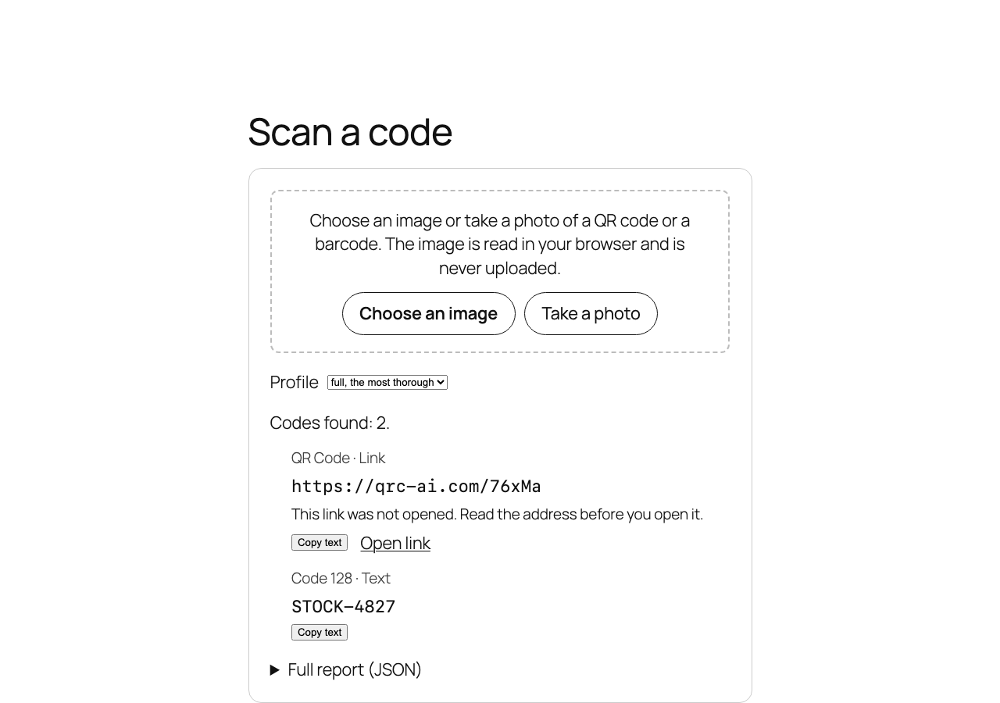
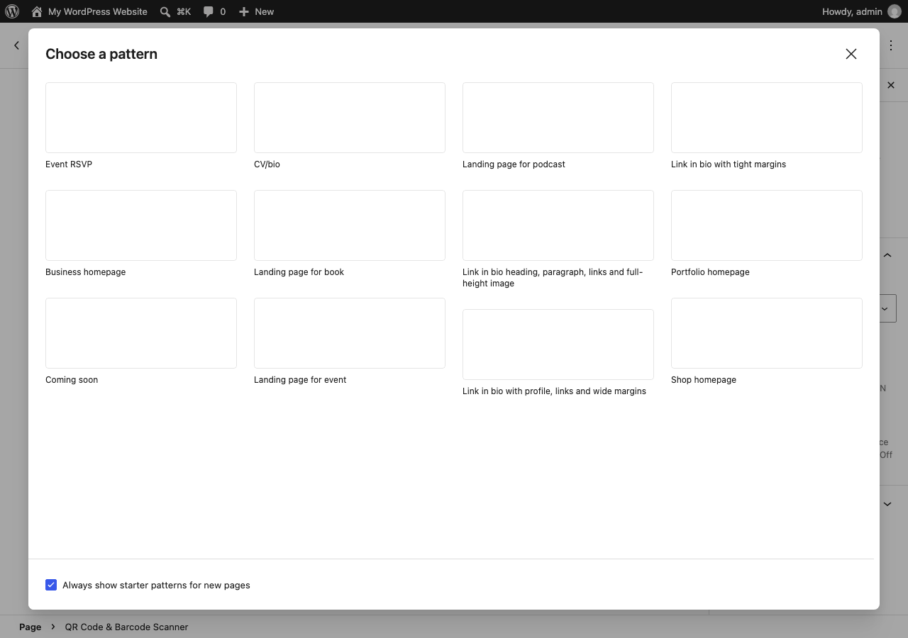

<p align="center">
  <a href="https://github.com/qrcode-ai-com/qrcode-barcode-scanner-rust">
    <picture>
      <source media="(prefers-color-scheme: dark)" srcset="https://raw.githubusercontent.com/qrcode-ai-com/.github/main/profile/assets/banner-wordpress-dark.gif?v=63ce322607b0">
      
    </picture>
  </a>
</p>

# QR Code & Barcode Scanner · WordPress plugin 0.1.0

<!-- qrcode-ai-readme-actions:v2 -->

### Ask AI

[](https://chatgpt.com/?q=Help%20me%20understand%20QR%20Code%20%26%20Barcode%20Scanner%20%C2%B7%20WordPress%20plugin%200.1.0%20%28integrations%2Fwordpress%2FREADME.md%29%20for%20QR%20Code%20%26%20Barcode%20Scanner%2C%20the%20open-source%20scanner.%20Source%20documentation%3B%20publication%20is%20not%20implied.%20Provided%20README%20context%20%28verify%20against%20the%20sources%29%3A%20A%20WordPress%20plugin%20with%20a%20block%20and%20a%20shortcode%20that%20read%20the%20QR%20codes%20and%20barcodes%20in%20an%20image%20or%20a%20photo.%20A%20visitor%20chooses%20an%20image%2C%20or%20takes%20a%20photo%20with%20the%20phone%27s%20camera%2C%20and%20each%20code%20is%20listed%20with%20its%20format%20and%20its%20exact%20text%2C%20with%20a%20copy%20button.%20Decoding%20runs%20in%20the%20visitor%27s%20browser%20with%20the%20published%20WebAssembly%20engine%200.11.0%2C%20served%20by%20your%20own%20site%3A%20no%20image%20is%20uploaded%2C%20the%20plugin%20calls%20no%20other%20server%2C%20and%20a%20decoded%20link%20is%20never%20opened%20by%20itself.%20Read%20the%20public%20documentation%20below.%20Explain%20what%20this%20destination%20does%2C%20its%20documented%20installation%20or%20access%20steps%2C%20a%20minimal%20example%20if%20supported%2C%20prerequisites%2C%20limitations%20and%20license.%20Distinguish%20published%20packages%20from%20working%20source%20and%20preparation.%20Cite%20your%20sources%3B%20if%20a%20page%20is%20unavailable%20or%20a%20fact%20cannot%20be%20checked%2C%20say%20so.%20Do%20not%20invent%20installation%20commands%2C%20benchmark%20results%20or%20comparisons.%20Answer%20in%20my%20language.%20Public%20sources%3A%20https%3A%2F%2Fgithub.com%2Fqrcode-ai-com%2Fqrcode-barcode-scanner-rust%2Fblob%2Fmain%2Fintegrations%2Fwordpress%2FREADME.md%20https%3A%2F%2Fqrcode-ai.com%2Fen-US%2Fqr-code-scanner%20https%3A%2F%2Fqrcode-ai.com%2Fen-US%2Fbarcode-scanner%20https%3A%2F%2Fqrcode-ai.com%2Fen-US%2Fqr-code-scanner%2Fintegrations%2Fwordpress%20https%3A%2F%2Fqrcode-ai.com%2Fen-US%2Fbarcode-scanner%2Fintegrations%2Fwordpress%20https%3A%2F%2Fqrcode-ai.com%2Fen-US%2Fqr-code-generator%20https%3A%2F%2Fqrcode-ai.com%2Fen-US%2Fbarcode-generator)
[](https://claude.ai/new?q=Help%20me%20understand%20QR%20Code%20%26%20Barcode%20Scanner%20%C2%B7%20WordPress%20plugin%200.1.0%20%28integrations%2Fwordpress%2FREADME.md%29%20for%20QR%20Code%20%26%20Barcode%20Scanner%2C%20the%20open-source%20scanner.%20Source%20documentation%3B%20publication%20is%20not%20implied.%20Provided%20README%20context%20%28verify%20against%20the%20sources%29%3A%20A%20WordPress%20plugin%20with%20a%20block%20and%20a%20shortcode%20that%20read%20the%20QR%20codes%20and%20barcodes%20in%20an%20image%20or%20a%20photo.%20A%20visitor%20chooses%20an%20image%2C%20or%20takes%20a%20photo%20with%20the%20phone%27s%20camera%2C%20and%20each%20code%20is%20listed%20with%20its%20format%20and%20its%20exact%20text%2C%20with%20a%20copy%20button.%20Decoding%20runs%20in%20the%20visitor%27s%20browser%20with%20the%20published%20WebAssembly%20engine%200.11.0%2C%20served%20by%20your%20own%20site%3A%20no%20image%20is%20uploaded%2C%20the%20plugin%20calls%20no%20other%20server%2C%20and%20a%20decoded%20link%20is%20never%20opened%20by%20itself.%20Read%20the%20public%20documentation%20below.%20Explain%20what%20this%20destination%20does%2C%20its%20documented%20installation%20or%20access%20steps%2C%20a%20minimal%20example%20if%20supported%2C%20prerequisites%2C%20limitations%20and%20license.%20Distinguish%20published%20packages%20from%20working%20source%20and%20preparation.%20Cite%20your%20sources%3B%20if%20a%20page%20is%20unavailable%20or%20a%20fact%20cannot%20be%20checked%2C%20say%20so.%20Do%20not%20invent%20installation%20commands%2C%20benchmark%20results%20or%20comparisons.%20Answer%20in%20my%20language.%20Public%20sources%3A%20https%3A%2F%2Fgithub.com%2Fqrcode-ai-com%2Fqrcode-barcode-scanner-rust%2Fblob%2Fmain%2Fintegrations%2Fwordpress%2FREADME.md%20https%3A%2F%2Fqrcode-ai.com%2Fen-US%2Fqr-code-scanner%20https%3A%2F%2Fqrcode-ai.com%2Fen-US%2Fbarcode-scanner%20https%3A%2F%2Fqrcode-ai.com%2Fen-US%2Fqr-code-scanner%2Fintegrations%2Fwordpress%20https%3A%2F%2Fqrcode-ai.com%2Fen-US%2Fbarcode-scanner%2Fintegrations%2Fwordpress%20https%3A%2F%2Fqrcode-ai.com%2Fen-US%2Fqr-code-generator%20https%3A%2F%2Fqrcode-ai.com%2Fen-US%2Fbarcode-generator)
[](https://gemini.google.com/)
[](https://grok.com/?q=Help%20me%20understand%20QR%20Code%20%26%20Barcode%20Scanner%20%C2%B7%20WordPress%20plugin%200.1.0%20%28integrations%2Fwordpress%2FREADME.md%29%20for%20QR%20Code%20%26%20Barcode%20Scanner%2C%20the%20open-source%20scanner.%20Source%20documentation%3B%20publication%20is%20not%20implied.%20Provided%20README%20context%20%28verify%20against%20the%20sources%29%3A%20A%20WordPress%20plugin%20with%20a%20block%20and%20a%20shortcode%20that%20read%20the%20QR%20codes%20and%20barcodes%20in%20an%20image%20or%20a%20photo.%20A%20visitor%20chooses%20an%20image%2C%20or%20takes%20a%20photo%20with%20the%20phone%27s%20camera%2C%20and%20each%20code%20is%20listed%20with%20its%20format%20and%20its%20exact%20text%2C%20with%20a%20copy%20button.%20Decoding%20runs%20in%20the%20visitor%27s%20browser%20with%20the%20published%20WebAssembly%20engine%200.11.0%2C%20served%20by%20your%20own%20site%3A%20no%20image%20is%20uploaded%2C%20the%20plugin%20calls%20no%20other%20server%2C%20and%20a%20decoded%20link%20is%20never%20opened%20by%20itself.%20Read%20the%20public%20documentation%20below.%20Explain%20what%20this%20destination%20does%2C%20its%20documented%20installation%20or%20access%20steps%2C%20a%20minimal%20example%20if%20supported%2C%20prerequisites%2C%20limitations%20and%20license.%20Distinguish%20published%20packages%20from%20working%20source%20and%20preparation.%20Cite%20your%20sources%3B%20if%20a%20page%20is%20unavailable%20or%20a%20fact%20cannot%20be%20checked%2C%20say%20so.%20Do%20not%20invent%20installation%20commands%2C%20benchmark%20results%20or%20comparisons.%20Answer%20in%20my%20language.%20Public%20sources%3A%20https%3A%2F%2Fgithub.com%2Fqrcode-ai-com%2Fqrcode-barcode-scanner-rust%2Fblob%2Fmain%2Fintegrations%2Fwordpress%2FREADME.md%20https%3A%2F%2Fqrcode-ai.com%2Fen-US%2Fqr-code-scanner%20https%3A%2F%2Fqrcode-ai.com%2Fen-US%2Fbarcode-scanner%20https%3A%2F%2Fqrcode-ai.com%2Fen-US%2Fqr-code-scanner%2Fintegrations%2Fwordpress%20https%3A%2F%2Fqrcode-ai.com%2Fen-US%2Fbarcode-scanner%2Fintegrations%2Fwordpress%20https%3A%2F%2Fqrcode-ai.com%2Fen-US%2Fqr-code-generator%20https%3A%2F%2Fqrcode-ai.com%2Fen-US%2Fbarcode-generator)
[](https://www.perplexity.ai/?q=Help%20me%20understand%20QR%20Code%20%26%20Barcode%20Scanner%20%C2%B7%20WordPress%20plugin%200.1.0%20%28integrations%2Fwordpress%2FREADME.md%29%20for%20QR%20Code%20%26%20Barcode%20Scanner%2C%20the%20open-source%20scanner.%20Source%20documentation%3B%20publication%20is%20not%20implied.%20Provided%20README%20context%20%28verify%20against%20the%20sources%29%3A%20A%20WordPress%20plugin%20with%20a%20block%20and%20a%20shortcode%20that%20read%20the%20QR%20codes%20and%20barcodes%20in%20an%20image%20or%20a%20photo.%20A%20visitor%20chooses%20an%20image%2C%20or%20takes%20a%20photo%20with%20the%20phone%27s%20camera%2C%20and%20each%20code%20is%20listed%20with%20its%20format%20and%20its%20exact%20text%2C%20with%20a%20copy%20button.%20Decoding%20runs%20in%20the%20visitor%27s%20browser%20with%20the%20published%20WebAssembly%20engine%200.11.0%2C%20served%20by%20your%20own%20site%3A%20no%20image%20is%20uploaded%2C%20the%20plugin%20calls%20no%20other%20server%2C%20and%20a%20decoded%20link%20is%20never%20opened%20by%20itself.%20Read%20the%20public%20documentation%20below.%20Explain%20what%20this%20destination%20does%2C%20its%20documented%20installation%20or%20access%20steps%2C%20a%20minimal%20example%20if%20supported%2C%20prerequisites%2C%20limitations%20and%20license.%20Distinguish%20published%20packages%20from%20working%20source%20and%20preparation.%20Cite%20your%20sources%3B%20if%20a%20page%20is%20unavailable%20or%20a%20fact%20cannot%20be%20checked%2C%20say%20so.%20Do%20not%20invent%20installation%20commands%2C%20benchmark%20results%20or%20comparisons.%20Answer%20in%20my%20language.%20Public%20sources%3A%20https%3A%2F%2Fgithub.com%2Fqrcode-ai-com%2Fqrcode-barcode-scanner-rust%2Fblob%2Fmain%2Fintegrations%2Fwordpress%2FREADME.md%20https%3A%2F%2Fqrcode-ai.com%2Fen-US%2Fqr-code-scanner%20https%3A%2F%2Fqrcode-ai.com%2Fen-US%2Fbarcode-scanner%20https%3A%2F%2Fqrcode-ai.com%2Fen-US%2Fqr-code-scanner%2Fintegrations%2Fwordpress%20https%3A%2F%2Fqrcode-ai.com%2Fen-US%2Fbarcode-scanner%2Fintegrations%2Fwordpress%20https%3A%2F%2Fqrcode-ai.com%2Fen-US%2Fqr-code-generator%20https%3A%2F%2Fqrcode-ai.com%2Fen-US%2Fbarcode-generator)
[](https://copilot.com/)
[](https://chat.deepseek.com/)
[](https://www.meta.ai/)
[](https://qwen.ai/)

Choose an AI assistant to explain this destination using its public sources. Gemini opens gemini.google.com. Gemini, Copilot, DeepSeek, Meta AI and Qwen require pasting the prompt below; the other links include it in their URL. Sign-in or a manual paste may still be required. Check the answer against the documentation.

<details>
<summary>Copy the plain-text prompt</summary>

Use the code block's copy control, or select its complete text, then paste it into your assistant.

```text
Help me understand QR Code & Barcode Scanner · WordPress plugin 0.1.0 (integrations/wordpress/README.md) for QR Code & Barcode Scanner, the open-source scanner. Source documentation; publication is not implied. Provided README context (verify against the sources): A WordPress plugin with a block and a shortcode that read the QR codes and barcodes in an image or a photo. A visitor chooses an image, or takes a photo with the phone's camera, and each code is listed with its format and its exact text, with a copy button. Decoding runs in the visitor's browser with the published WebAssembly engine 0.11.0, served by your own site: no image is uploaded, the plugin calls no other server, and a decoded link is never opened by itself. Read the public documentation below. Explain what this destination does, its documented installation or access steps, a minimal example if supported, prerequisites, limitations and license. Distinguish published packages from working source and preparation. Cite your sources; if a page is unavailable or a fact cannot be checked, say so. Do not invent installation commands, benchmark results or comparisons. Answer in my language. Public sources: https://github.com/qrcode-ai-com/qrcode-barcode-scanner-rust/blob/main/integrations/wordpress/README.md https://qrcode-ai.com/en-US/qr-code-scanner https://qrcode-ai.com/en-US/barcode-scanner https://qrcode-ai.com/en-US/qr-code-scanner/integrations/wordpress https://qrcode-ai.com/en-US/barcode-scanner/integrations/wordpress https://qrcode-ai.com/en-US/qr-code-generator https://qrcode-ai.com/en-US/barcode-generator
```

</details>

<!-- /qrcode-ai-readme-actions:v2 -->

A WordPress plugin with a block and a shortcode that read the QR codes and barcodes in an image or a photo. A visitor chooses an image, or takes a photo with the phone's camera, and each code is listed with its format and its exact text, with a copy button. Decoding runs in the visitor's browser with the published WebAssembly engine 0.11.0, served by your own site: no image is uploaded, the plugin calls no other server, and a decoded link is never opened by itself.

Version 0.1.0 is built and tested in this folder, but the WordPress Plugin Directory does not list it yet. Until it does, install it from the zip that a build of this folder writes, as shown below. The texts, images and steps for the directory are in [LISTING.md](LISTING.md).

The same engine runs on the web as the [QR code scanner](https://qrcode-ai.com/en-US/qr-code-scanner) and the [barcode scanner](https://qrcode-ai.com/en-US/barcode-scanner) of QR Code AI. The [QR code scanner WordPress guide](https://qrcode-ai.com/en-US/qr-code-scanner/integrations/wordpress) and the [barcode scanner WordPress guide](https://qrcode-ai.com/en-US/barcode-scanner/integrations/wordpress) explain this plugin for each use. If a page is unavailable, this README and [LISTING.md](LISTING.md) remain the reference.

To make a test image with a known value, use the [QR code generator](https://qrcode-ai.com/en-US/qr-code-generator) or the [barcode generator](https://qrcode-ai.com/en-US/barcode-generator). Keep the text you encoded, then compare it with what the block shows, character for character, leading zeroes included.

<p align="center">
  
</p>

## Install

The plugin needs WordPress 6.6 or later and PHP 7.4 or later. To build the zip you need Node.js 22.22.2 or later on the 22 line, or Node.js 24.15.0 or later. From a checkout of this repository:

```sh
cd integrations/wordpress
npm ci --ignore-scripts
npm run build
```

The build checks that the installed scanner package is version 0.11.0 and that its WebAssembly module has the pinned SHA-256, compiles the block's editor script with `@wordpress/scripts`, then writes `build/qrcode-barcode-scanner-0.1.0.zip`. Its SHA-256 is in [SHA256SUMS](SHA256SUMS); the same inputs give the same bytes on Linux and macOS.

In WordPress, open **Plugins › Add New Plugin**, choose **Upload Plugin**, select the zip, then **Install Now** and **Activate**.

To remove it, open **Plugins**, choose **Deactivate**, then **Delete**. The plugin creates no option, no table and no file, so nothing stays behind.

## Use

- **The block.** In the block editor, add the **QR Code & Barcode Scanner** block (Widgets). Its settings are **Profile chosen first**, **Show the full report** and **Show a credit line**. The editor shows a placeholder; preview or publish the page to try it.
- **The shortcode.** Anywhere a shortcode works, write `[qrcode_barcode_scanner]`. It takes `profile="full"`, `profile="fast"` or `profile="frame"`, `report="yes"` and `credit="yes"`, for example `[qrcode_barcode_scanner profile="fast" report="yes"]`.
- **On the page.** The visitor chooses **Choose an image** or **Take a photo**. PNG, JPEG, WebP and GIF are read; another file type is refused with a message that names them. **Profile** switches between full (the most thorough), fast (clear images) and frame (the quickest), and reads the same image again.

Each code shows its format (QR Code, Code 128 and so on), its kind (link, text, Wi-Fi network and others) and its exact text. **Copy text** copies that text. Invisible or direction-changing characters are shown by their code point, so a spoofed address stands out; **Copy text** still copies the exact text. A link gets an explicit **Open link** button with a note that it was not opened, and is never opened by itself. **Full report (JSON)** shows the engine's complete report when it is turned on.

The credit line is off unless you turn it on. When it is on, it names the open-source engine and links six QR Code AI pages.

<p align="center">
  
</p>

## Privacy

Nothing leaves the visitor's browser. The image is read by code served from your site and is discarded when the page closes. The plugin makes no request to another server, sets no cookie, uses no local storage, stores nothing in your database and has no analytics. Its scripts and the engine are files of the plugin, loaded with WordPress's own script functions; nothing is fetched from a CDN.

## Content Security Policy

WordPress sets no Content Security Policy. If your site adds one, the engine needs `'wasm-unsafe-eval'` in `script-src` to compile. Without it, the block shows that WebAssembly is not allowed on this site, and nothing else breaks.

## Server-side scanning

This plugin reads images in the browser, so it works on any host. To read images on your server instead, in your own PHP code, the engine also has a PHP package on Packagist, `qrcode-ai-com/qrcode-barcode-scanner`. That package runs the separately installed `qrscan` command, which most shared hosts do not allow. This plugin does not use it and does not depend on it.

## Build, test and inspect

```sh
npm ci --ignore-scripts
npm run build              # the plugin zip, build/qrcode-barcode-scanner/ and build/build-receipt.json
npm run inspect            # opens the zip as the directory's reviewers would
npm test                   # Node unit tests, no browser
node node_modules/playwright/cli.js install chromium
npm run test:playground    # the zip on a new WordPress Playground site, in Playwright's Chromium
npm run test:reproduce     # rebuild in two time zones and compare with SHA256SUMS
npm run assets             # redraw the directory icons into directory-assets/
```

- `npm run build -- --check` writes nothing in this folder and fails when the committed [SHA256SUMS](SHA256SUMS) is not the zip this build gives.
- `npm run inspect` checks that the zip holds exactly the expected 28 files, equal to the unpacked build, with the pinned WebAssembly module, agreeing versions in the plugin header, `readme.txt` and `block.json`, at most five tags, a short description of 150 characters or fewer, the `ABSPATH` guard in every PHP file, and no script that builds code from text, loads code from the network or calls another server.
- `npm test` covers the result helpers, the translated texts, the credit line being off by default, the version pins, the inspection against altered zips, the zip writer and the directory images.
- `npm run test:playground` starts WordPress Playground with nothing installed and requests to other servers blocked. As an administrator it uploads the zip in **Plugins › Add New Plugin**, activates it, inserts the block in the editor and publishes the page. As a visitor it reads the mixed fixture in fast, frame and full and requires exactly `https://qrc-ai.com/76xMa` and `STOCK-4827`. It checks the refusals of a BMP image and a text file, the same three scans through the shortcode, and the credit line when it is turned on. It checks that no request leaves the site. It then deactivates and deletes the plugin, and checks that its files are no longer served and that it left no option behind. `--wp 6.6 --php 7.4` runs the oldest WordPress and PHP the plugin supports.
- `npm run test:reproduce` rebuilds the zip in UTC and in UTC+14 and requires the same bytes as `build/` and as [SHA256SUMS](SHA256SUMS).

The Playground test writes its reports under `build/acceptance/` in the shape of `distribution/acceptance/drivers/web-page.mjs`, and judges them with `scripts/check-demo-page.py` and `scripts/destination-acceptance.py`. The workflow [integration-wordpress.yml](../../.github/workflows/integration-wordpress.yml) runs all of this on every change, on the current WordPress with PHP 8.3 and on WordPress 6.6 with PHP 7.4. It also runs the WordPress.org [Plugin Check](https://github.com/WordPress/plugin-check-action) on the unpacked plugin, every category, warnings included, and rebuilds the zip on Linux and macOS with Node.js 22 and 24.

## Directory package

`npm run build` writes these files under `build/`:

- `qrcode-barcode-scanner-0.1.0.zip`, the zip to submit and to upload; its folder is `qrcode-barcode-scanner/`;
- `qrcode-barcode-scanner/`, the same files unpacked, which become the `trunk/` of the directory's SVN repository;
- `build-receipt.json`, with the zip's size and SHA-256 and the engine it holds.

The zip holds the plugin's PHP, its scripts and stylesheet, the block's editor script with its source in `src/`, `readme.txt`, and the files of the npm package `@qrcode-ai-com/qrcode-barcode-scanner-wasm` 0.11.0, copied unchanged into `assets/vendor/qrcode-barcode-scanner-wasm/`. `readme.txt` links the engine's source and build script for the compiled WebAssembly module, as the directory's guideline on human-readable code asks. The icons and screenshots of the directory page are in [directory-assets/](directory-assets/), for the SVN `assets/` folder. The directory texts, the form values and the owner's steps are in [LISTING.md](LISTING.md).

## Limits

- It reads images and photos, not a live camera stream.
- A site whose Content Security Policy forbids WebAssembly cannot run it until `'wasm-unsafe-eval'` is allowed.
- It has been tested on WordPress Playground (WordPress 7.1 on PHP 8.3, and WordPress 6.6 on PHP 7.4) in Playwright's Chromium. It has not been run yet from a directory install, on a hosted site or in Firefox and Safari.

## How it works

<!-- qrcode-ai-readme-media:v1 -->
<p align="center">
  <picture>
    <source media="(prefers-color-scheme: dark)" srcset="https://raw.githubusercontent.com/qrcode-ai-com/.github/main/profile/assets/how-browser-dark.gif?v=32206e525b2c">
    
  </picture>
</p>
<!-- /qrcode-ai-readme-media:v1 -->

The picture shows the three steps of the browser package, and the plugin follows them in the visitor's browser. The page loads a small script module. When the visitor chooses an image, a worker loads the WebAssembly module from your site, once per visit. The page sends the image bytes to the worker, which reads them with the chosen profile. The report comes back to the page, which shows each code as text. A long scan never freezes the page, because it runs in the worker.

## What it returns

<!-- qrcode-ai-readme-media:v1 -->
<p align="center">
  <a href="https://github.com/qrcode-ai-com/qrcode-barcode-scanner-rust#examples">
    <picture>
      <source media="(prefers-color-scheme: dark)" srcset="https://raw.githubusercontent.com/qrcode-ai-com/qrcode-barcode-scanner-rust/main/docs/assets/brand/examples-mixed-dark.png?v=385593c1c18d">
      
    </picture>
  </a>
</p>
<!-- /qrcode-ai-readme-media:v1 -->

The picture is a recorded scan of one image that holds a QR code and a Code 128 barcode. The plugin reads the same fixture in its tests: the QR code gives `https://qrc-ai.com/76xMa` and the barcode gives `STOCK-4827`, in one report. The block lists each code with its format and exact text; the full report also holds where the engine measured it.

## What it reads

<!-- qrcode-ai-readme-media:v1 -->
<p align="center">
  <a href="https://github.com/qrcode-ai-com/qrcode-barcode-scanner-rust#supported-formats">
    <picture>
      <source media="(prefers-color-scheme: dark)" srcset="https://raw.githubusercontent.com/qrcode-ai-com/qrcode-barcode-scanner-rust/main/docs/assets/brand/formats-dark.gif?v=92fa0e8084df">
      
    </picture>
  </a>
</p>
<!-- /qrcode-ai-readme-media:v1 -->

The WebAssembly module of engine 0.11.0 reads these 19 formats, and codes of different formats in one image come back in one report.

- QR: QR Code, Micro QR Code, rectangular Micro QR Code (rMQR)
- Matrix and stacked: Data Matrix, Aztec, PDF417, MaxiCode
- Retail: EAN-13, EAN-8, UPC-A, UPC-E
- Other linear: Code 128, Code 39, Code 93, Codabar, ITF, GS1 DataBar, GS1 DataBar Expanded, Telepen

The engine's [supported formats](https://github.com/qrcode-ai-com/qrcode-barcode-scanner-rust#supported-formats) section states the known limits.

## The same engine in other runtimes

<!-- qrcode-ai-readme-media:v1 -->
<p align="center">
  <a href="https://github.com/qrcode-ai-com/qrcode-barcode-scanner-rust#get-started">
    <picture>
      <source media="(prefers-color-scheme: dark)" srcset="https://raw.githubusercontent.com/qrcode-ai-com/qrcode-barcode-scanner-rust/main/docs/assets/brand/runtimes-dark.png?v=57c63428574b">
      
    </picture>
  </a>
</p>
<!-- /qrcode-ai-readme-media:v1 -->

The plugin uses the browser package. The Rust, Node.js, browser and Python packages hold the same engine. The Go and PHP packages hold no decoder: each one starts `qrscan` and hands you its report. Every route is listed in the [scanner repository](https://github.com/qrcode-ai-com/qrcode-barcode-scanner-rust).

## License of the plugin

The plugin's own source in this folder is under the MIT License, in [LICENSE](LICENSE). The zip also holds the files of the npm package `@qrcode-ai-com/qrcode-barcode-scanner-wasm` 0.11.0, copied unchanged, which stay under AGPL-3.0-or-later, with Apache-2.0 notices for the code derived from rxing. The zip as a whole is therefore distributed under AGPL-3.0-or-later, which the directory accepts as a GPL-compatible license, and its `LICENSE-NOTES.txt` lists each part. The MIT License of the plugin's files does not relicense the engine.

Maintained by **Thibaut Mélen & Nicolas Cella** for **QR Code AI**, a product of **SuperNovae Studio**.

<!-- qrscan-source-license:v1 -->

## Source license

Project-authored scanner code and documentation in this checkout are available under the [MIT License](https://github.com/qrcode-ai-com/qrcode-barcode-scanner-rust/blob/main/LICENSE). You may use, modify and redistribute this source in open-source or proprietary applications, including commercial products, while preserving the copyright and permission notice. Thibaut Mélen & Nicolas Cella develop QR Code AI at SuperNovae Studio.

Retained third-party code, dependencies, artwork and test data keep their own licenses and notices. The [licensing guide](https://github.com/qrcode-ai-com/qrcode-barcode-scanner-rust/blob/main/LICENSING.md) explains these component boundaries; the project license does not assign a license to an unrelated platform or service.

Published archives retain the license shipped with their version. A pinned engine, adapter or bundle may therefore have different terms from this working source. Read its packaged license and the [license history](https://github.com/qrcode-ai-com/qrcode-barcode-scanner-rust/blob/main/docs/guides/license-history.mdx) before reuse. The source change does not replace an archive or publish a new version.

<!-- /qrscan-source-license:v1 -->
